# Lesson 03: Exploratory data analysis (EDA)

**Stage goal in one sentence:** Look at the training data through plots and numbers, learn what patterns exist, and write down what they mean for the models we will build.

**Files created or changed:**
- `src/eda.py`: loads the training data and makes every figure (run `python src/eda.py`)
- `reports/figures/01_...png` to `11_...png`: the 11 figures shown below
- `reports/eda_findings.md`: one entry per figure (pattern + implication), reusable in the report
- `docs/learning/03_eda.md`: this lesson

---

## 1. The big picture
Before a doctor prescribes anything, they examine the patient. EDA is the examination: we look at the data to learn what is normal, what is odd, and what a model could realistically learn. It comes after cleaning (Stage 2) and before building features (Stage 4), because what we see here tells us which features are worth building and what accuracy to expect. No model is trained in this stage.

**Why only the training data?** We used `train.csv` (2015-16 to 2024-25, 3,800 matches) and nothing from 2025-26. If we looked at test outcomes while choosing features or models, our choices would be quietly shaped by the test answers. It is like a student who sees the exam questions "just to understand the topic" and then studies exactly those. The final score would no longer be honest. (One detail: `odds.csv` also contains 2025-26 rows. We read only the three Bet365 columns and kept only the training match IDs straight away; no test row was printed, plotted or used.)

## 2. What we built
Each analysis below has one figure and the key numbers.

### a. Outcome distribution (Figure 1)
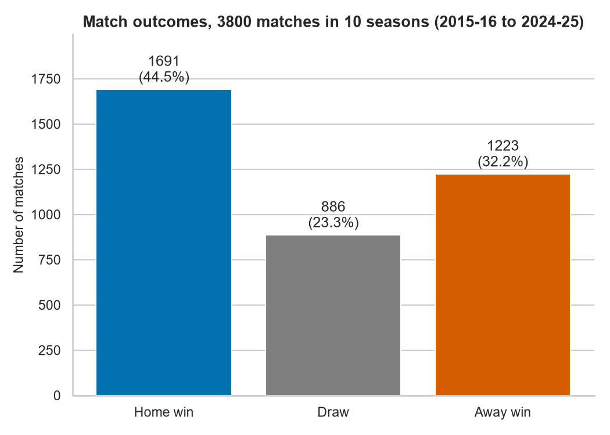

Home wins 1,691 (44.5%), draws 886 (23.3%), away wins 1,223 (32.2%). Our plan said "home teams win about 45%": confirmed. Why it matters: a "model" that always says "home win" is right 44.5% of the time. Any real model must beat that.

### b. Home advantage over time (Figure 2)
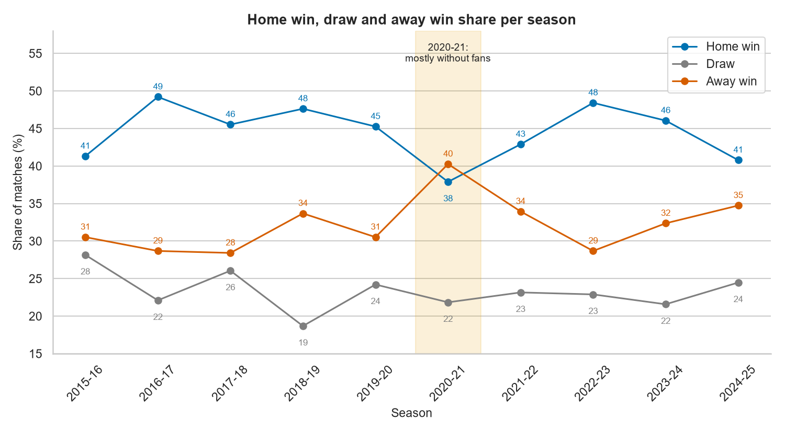

The home-win share per season ranges from 37.9% to 49.2%. A single 380-match season wobbles by about 2.5 points by luck alone, so only big gaps mean something. **2020-21 stands out:** 37.9% home wins and 40.3% away wins (away wins were more common than home wins). That season was played mostly without fans. This is evidence (not proof) that crowds help the home team. The next lowest, 2024-25 (40.8%), is within the normal wobble.

### c. Goals per match and the Poisson curve (Figure 3)
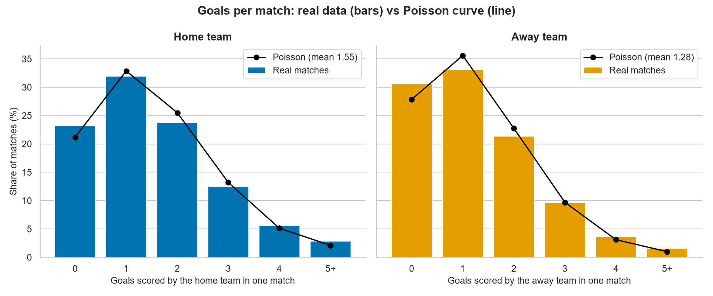

The home team scores 1.55 goals on average and the away team 1.28 (2.83 per match). The black line is a Poisson distribution with the same mean. It follows the bars closely: every bar is within 3 percentage points. It is not perfect, though: real matches have more 0-goal and more 4+ goal outcomes than Poisson predicts, and a statistical test (chi-square) detects the small misfit because we have 3,800 matches.

### d. Goals per season (Figure 4)
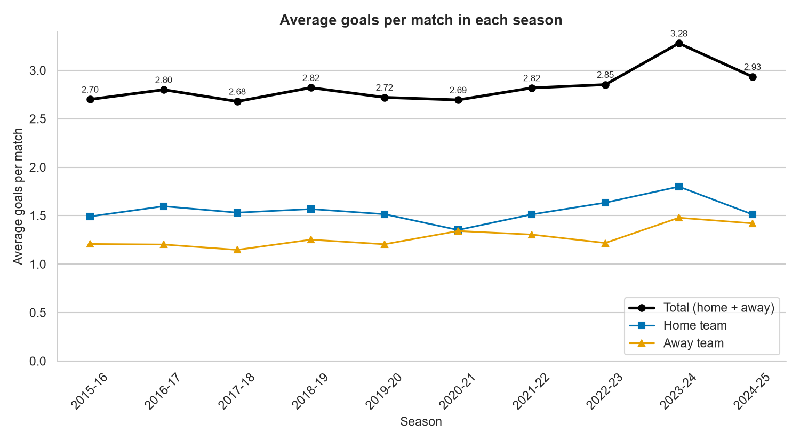

Total goals per match were 2.68 to 2.85 in eight of ten seasons, but **3.28 in 2023-24** (the highest), then 2.93 in 2024-25. The league's scoring level moves from season to season.

### e. Team strength over seasons (Figures 5, 6, 7)
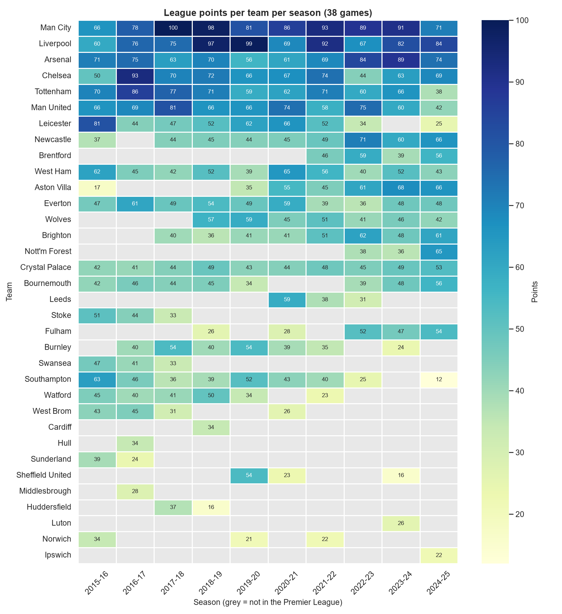

Each row is a team, each column a season, each cell the league points (win = 3, draw = 1). Grey means the team was not in the league. Man City reached 100 points in 2017-18. Notice how much single teams change: Leicester 81 points in 2015-16 (champions), then 44. Chelsea 50, then 93. Tottenham 66, then 38 in 2024-25.

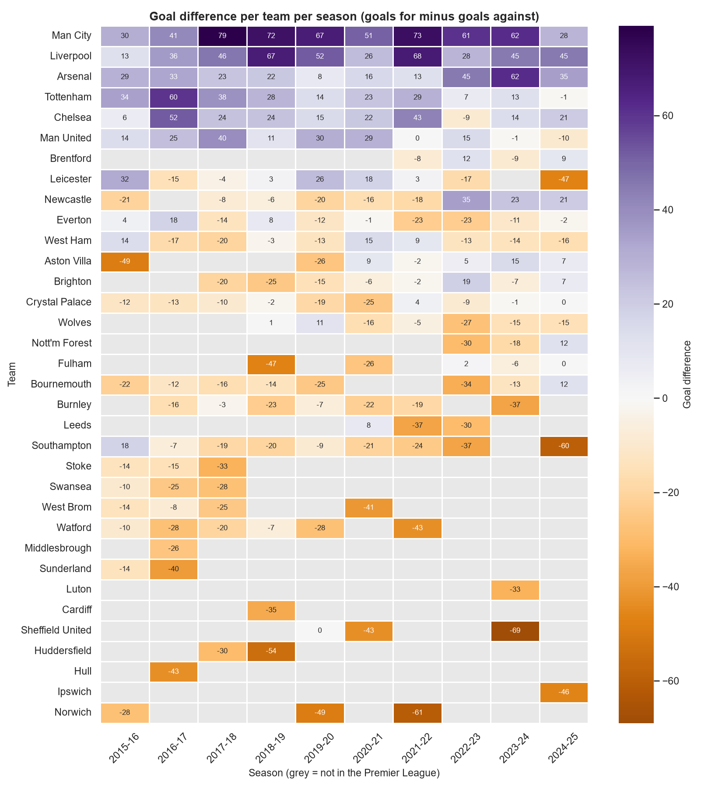

Same layout, but showing goal difference (goals scored minus goals conceded). Purple = positive (strong), orange = negative (weak).

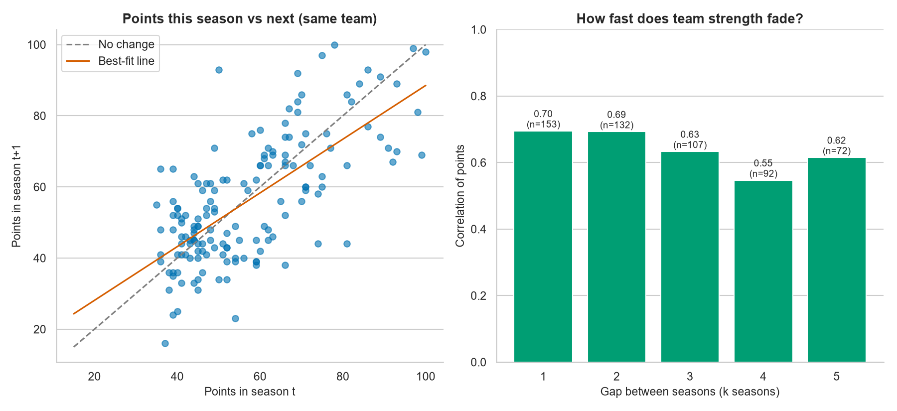

*Left:* each dot is a team; x = its points one season, y = its points the next season. Dots on the dashed line would mean "no change". The orange best-fit line is flatter than the dashed one: strong teams tend to drop back a bit and weak ones rise (regression toward the middle). *Right:* the correlation of a team's points with its points k seasons later: 0.70 (1 season), 0.69, 0.63, 0.55, 0.62 (5 seasons; fewer teams remain, so this bar is noisy). A typical team changes by about 10.5 points from one season to the next. So old seasons help, but less and less.

### f. Home vs away per team (Figure 8)
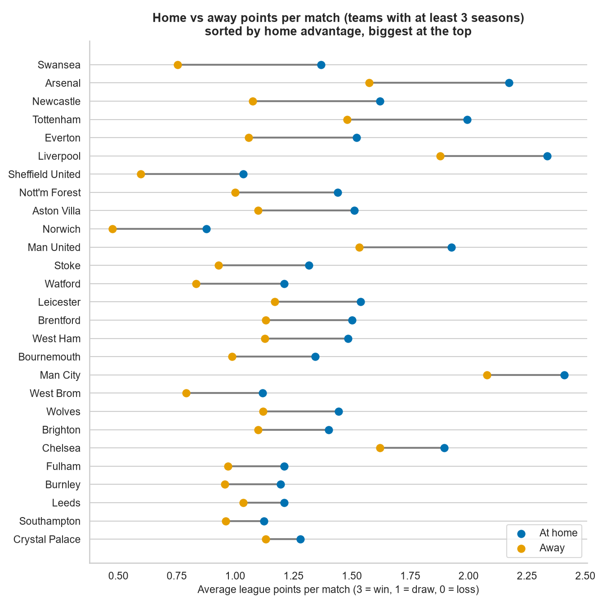

Blue = average points per match at home, orange = away. The longer the grey line, the bigger the home advantage. All teams together: 1.57 points per home match vs 1.20 away. Biggest gaps: Swansea (+0.61), Arsenal (+0.60), Newcastle (+0.54). Smallest: Crystal Palace (+0.15). But each team has only 57 to 190 home matches, which leaves about +/- 0.33 points per game of pure noise. Only 15 of 27 teams have a gap clearly above zero, so most ranking differences are probably luck.

### g. Same-match stats and goals (Figure 9)
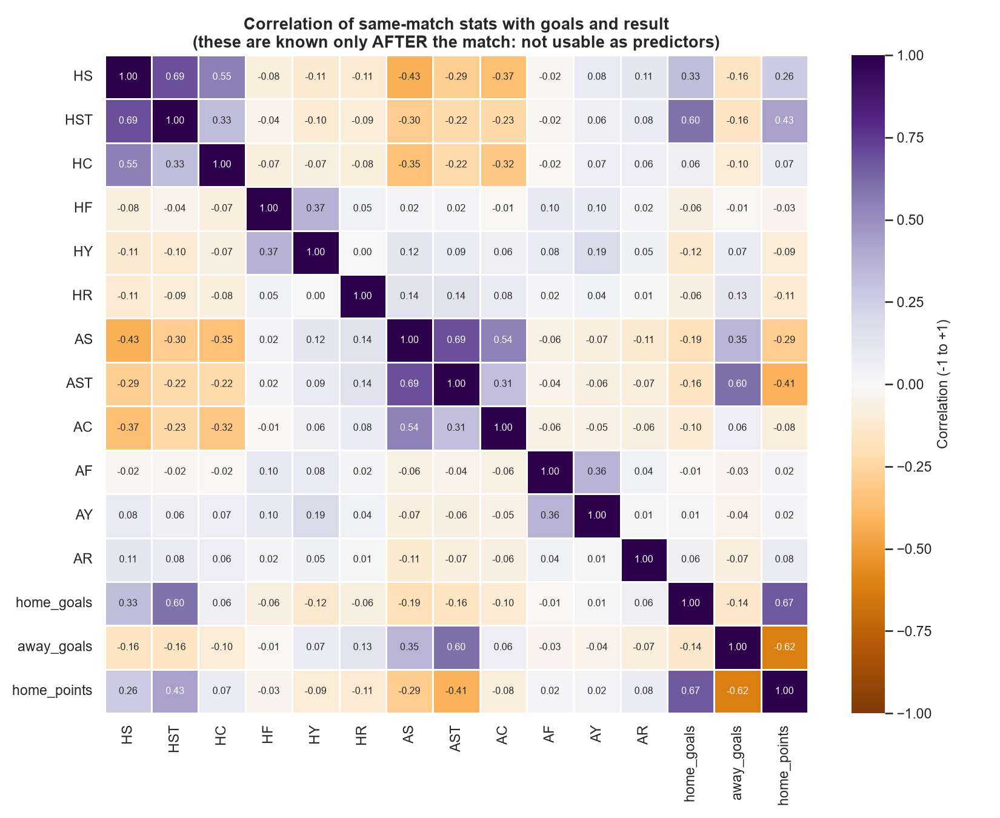

Shots on target and goals go together: home shots on target (HST) vs home goals +0.60. HST vs home points +0.43. Fouls and cards hardly matter: fouls vs home points -0.03, home yellow cards -0.09. Shots (HS), shots on target (HST) and corners (HC) also move together (HS with HST +0.69).

### h. Bookmaker odds (Figure 10)
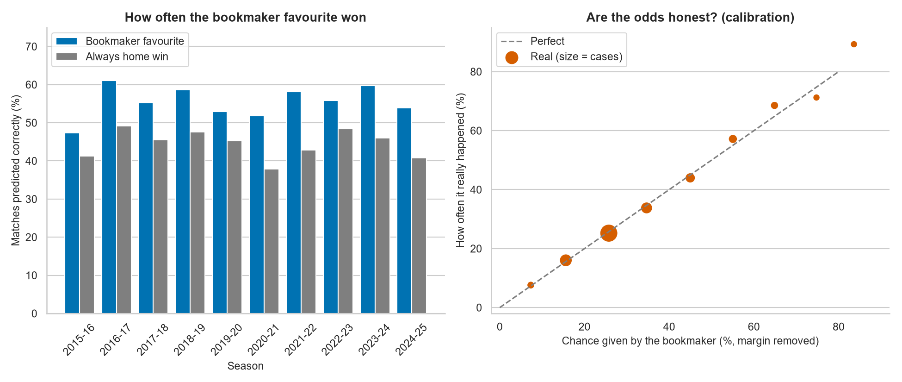

Bet365 odds exist for all 3,800 training matches (nothing missing). Turning odds into probabilities (see section 3), the bookmaker's favourite won **55.5%** of matches, against 44.5% for "always home win". The right plot shows the odds are honest: when the bookmaker says 25%, it happens about 25% of the time.

### i. Draws (Figure 11)
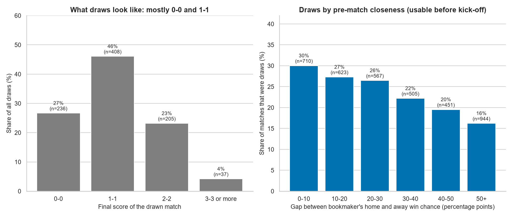

73% of all draws are 0-0 (27%) or 1-1 (46%). Draws are more common when the teams look evenly matched (30% when the bookmaker sees them as equals, 16% when one team is a clear favourite). Even so, the bookmaker never made a draw its favourite outcome in 3,800 matches; its highest draw probability was 34%.

## 3. New concepts (explained simply)
- **EDA:** exploring data to find patterns before modelling. It tells us what is learnable.
- **Histogram / bar chart:** bars show how many (or what share of) matches fall in each category, like the goals chart. *How to read:* tall bar = common.
- **Line chart:** points joined in time order, good for trends (goals per season). *How to read:* look at the direction, and ask whether the wiggles are bigger than normal noise.
- **Heatmap:** a table where the colour shows the number. Figures 5 and 6 are "team x season" tables. *How to read:* find the dark rows (strong teams) and big colour jumps from one column to the next (big changes).
- **Correlation:** a number from -1 to +1 that says how much two columns move together. +1 = rise together perfectly, 0 = no straight-line link, -1 = one rises as the other falls. Example: HST vs home goals = +0.60, fairly strong. Fouls vs result = -0.03, nothing.
  - **Correlation is not causation:** two things moving together does not prove one causes the other. A classic example: ice-cream sales and drownings both rise in summer, but ice cream does not drown anyone (hot weather causes both).
  - **A high correlation can be useless for prediction:** shots on target correlate 0.60 with goals, but we only know the shots after the match. A forecast has to be made before kick-off, when this number does not exist yet. That is **data leakage** again, the same idea as in Stage 2.
  - **Link to KNN:** features that are strongly correlated (HS and HST, +0.69) carry nearly the same information. In KNN's distance calculation they would count twice, giving that one idea extra weight.
- **Poisson distribution:** a distribution for "how many times does a rare event happen in a fixed period?", for example goals in 90 minutes. It has one number, the mean (average). The chance of exactly k events is e^(-mean) x mean^k / k!. With the home mean 1.55: P(0 goals) = e^(-1.55) = 0.212 (21.2%), P(1) = 0.212 x 1.55 = 0.329 (32.9%). These match the black line in Figure 3. Why goals fit: they are fairly rare, they happen at a roughly steady rate, and one goal does not make the next one impossible. Why it is not perfect: teams differ in strength (so the "true mean" differs from match to match) and a goal changes how teams play. Mixing many different means makes the real data more spread out than a single Poisson (the variance is 1.13 times the mean instead of 1.0).
- **Implied probability and overround:** decimal odds of 2.00 mean "pay 2 for every 1 staked", so the bookmaker thinks the chance is about 1 / 2.00 = 50%. If you do this for home, draw and away, the three chances add up to MORE than 100%. The extra is the **overround**, the bookmaker's built-in profit margin (4.4% on average in our data). We divide by the sum to remove it. Example from Stage 1: odds 1.30, 6.00, 8.50 give 77%, 17%, 12%, which add up to 105.4%.
- **Calibration:** do the stated chances match reality? If events given "25%" really happen 25% of the time, the forecast is well calibrated (Figure 10, right).
- **Home advantage:** home teams win more because of crowd, familiarity, and no travel. In our data: 1.57 points per home match vs 1.20 away.
- **Standard error / noise:** how much a number would wobble by pure luck. It tells us when a difference is real (for example 2020-21) and when it is not (most teams' home advantage differences).

## 4. How the code works
Everything is in `src/eda.py`, with one small function per analysis (`outcome_distribution`, `home_advantage_by_season`, `goals_per_match`, ...). `main()` calls them in order.
- `load_train()`: reads `train.csv` only, and asserts that it contains exactly the 10 training seasons, so the test season cannot sneak in. It adds helper columns: total goals, and league points (3 for a win, 1 for a draw, 0 for a loss) for each side.
- `load_training_odds()`: reads just the Bet365 columns and merges them onto the training matches by `match_id`.
- `build_team_tables()`: stacks home and away appearances into one table with one row per team per match. *Why:* to compute a team's season points we must count its home and away matches together.
- `add_implied_probabilities()`: `1 / odds`, divided by the row sum to remove the overround, and the favourite is the largest probability.
- `setup_style()` and `save()`: one style for all figures (titles, labelled axes, a colour-blind-safe palette, no on-screen windows). Each figure is saved as PNG in `reports/figures/`.
- The Poisson overlay uses `scipy.stats.poisson.pmf(k, mean)` with the same mean as the data.

## 5. Results and how to read them
All outputs are shown above. The key reading rules:
- **Bars with labels (Figures 1, 3, 11):** compare heights; the labels give the exact share.
- **Lines over seasons (Figures 2, 4):** a wiggle smaller than about 5 percentage points (home wins) is noise; 2020-21 is bigger than that.
- **Heatmaps (5, 6, 9):** colour = size of number; in Figure 9 purple is positive and orange is negative.
- **Scatter (Figure 7, left):** points near the dashed line mean "same as last season"; the spread around the line shows how unpredictable teams are.
- **Calibration (Figure 10, right):** dots on the dashed line mean honest odds. Ours are close, so odds are a good benchmark.

What would be "bad"? For the Poisson fit, large gaps between bars and line; for odds, dots far from the line; for correlation, features that look strongly related to the result but would not be known before the match (leakage).

## 6. Common mistakes and gotchas
- **Peeking at the test set.** Avoided: only training data was used.
- **Reading noise as a pattern.** One season of 380 matches is small. We compared differences with the expected wobble (about 2.5 points) before calling anything real.
- **Treating correlation as cause, or as usable.** Same-match stats correlate with the result but are only known afterwards, so they cannot be model inputs.
- **Misleading charts.** We first drew "draw rate by total goals" and dropped it: an odd total of goals can never be a draw, so that chart shows arithmetic, not a pattern.
- **Teams with few matches.** We showed home/away only for teams with at least 3 seasons and printed the noise level.
- **Survivor bias in persistence.** Figure 7 only includes teams that stayed in the league in both seasons; relegated teams disappear, which probably makes strength look more stable than it is.

## 7. Check yourself
1. Why did we use only the training seasons for EDA, and what could go wrong if we had also looked at 2025-26?
2. A model that always predicts "home win" is correct about 44.5% of the time here. Why is that number useful?
3. Shots on target correlate +0.60 with goals scored. Why can't we use the shots in a match to predict that same match?
4. In Figure 3, the Poisson line predicts 21.2% of home teams score 0 goals, but 23.2% really did. What does the small gap tell us, and what does the Poisson curve still tell us?
5. In Figure 10, what does it mean that a "25%" chance from the bookmaker really happens about 25% of the time?
6. Why will "draw" be the hardest result for a model to predict?

## 8. Try it yourself
Do a Poisson check by hand. Run this in a terminal (environment active):
```
python -c "import math; print(math.exp(-1.278))"
```
That is the Poisson chance that the away team scores 0 goals, using its mean of 1.28 goals. Before running it, predict: will the real share of away teams scoring 0 (from Figure 3 or the printed table, 30.7%) be higher or lower than this number? Then run it, compare with 30.7%, and explain the gap in your own words (hint: do all teams score at the same rate?).

## 9. How this connects to the report
This stage feeds the **Exploratory Data Analysis** section of the report (analysis, appropriate graphs, important patterns), and supports the model choice in the **Models** section (why Poisson for goals, why draws are hard).

*Draft paragraph:* "We explored the ten training seasons (3,800 matches) before modelling. Home teams win 44.5% of matches, draws occur in 23.3% and away teams win 32.2%. Home advantage was weakest in 2020-21, which was played mostly without fans (37.9% home wins). Goals per team per match follow a Poisson distribution closely (mean 1.55 at home and 1.28 away), which supports using Poisson regression to predict scores. Team strength is persistent but not fixed: the correlation between a team's points in consecutive seasons is 0.70, so recent form must be weighted more heavily than old seasons. Bookmaker favourites win 55.5% of matches, which gives us a realistic accuracy target. Match statistics such as shots correlate strongly with the result but are only known after the match, so only their averages over previous matches are used as features."

## What this changes for the next stages
Stated honestly, nothing in the plan has to change, but several things need care:
- **Draws:** expect a model to almost never choose "draw", and report the draw class separately (we will use log loss as well as accuracy).
- **2020-21 (no fans):** a real outlier in home advantage. We do not drop it yet. We can test later whether dropping or flagging it helps on the validation seasons, and ask you first.
- **Team changes year to year:** keep all 10 seasons but build features from recent matches (rolling windows, Elo that updates after each match).
- **Home/away strength per team:** based on few matches, so noisy. Stage 4 should blend it with overall strength or use enough matches.
- **Goal level shifts:** 2023-24 had 3.28 goals per match vs about 2.8 usually. A model trained on average seasons can be off if the next season's level differs.

---

## Answers to "Check yourself"
1. Looking at test results would let those results influence our choices (which features, which models), a quiet form of leakage. The final test score would then be too optimistic because the test was no longer unseen.
2. It is the baseline: the simplest possible "model". A real model is only useful if it beats it. Matching 44.5% would mean the model learned nothing.
3. The shots happen during the match, so they are only known after it ends. A prediction has to be made before kick-off. In Stage 4 we use each team's average shots in earlier matches instead.
4. Real matches have a few more scoreless games than Poisson predicts, because teams differ in strength and a single average hides that. The Poisson curve is still close (every bar within about 3 points), so it is a good simple model for goals, and our Poisson regression can improve it by giving each team its own expected goals.
5. It means the bookmaker's probabilities are honest (well calibrated): among all the cases where it said about 25%, about one in four really happened. That makes odds a trustworthy benchmark.
6. Draws are the smallest class (23.3%), they happen even in unevenly matched games, and a draw is rarely the most likely single outcome: the bookmaker never favoured a draw in 3,800 matches, and its highest draw chance was only 34%. So a model that picks the most likely result will almost never pick "draw".
