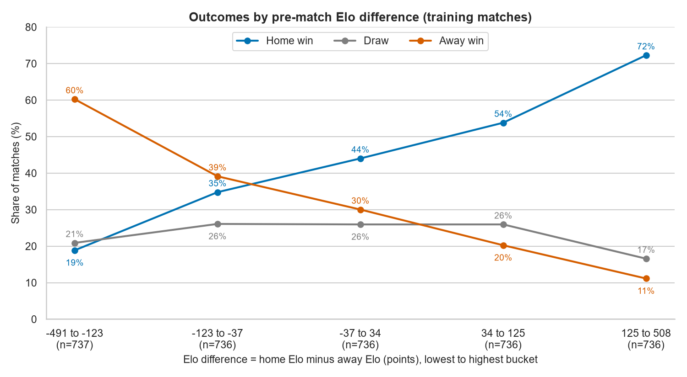
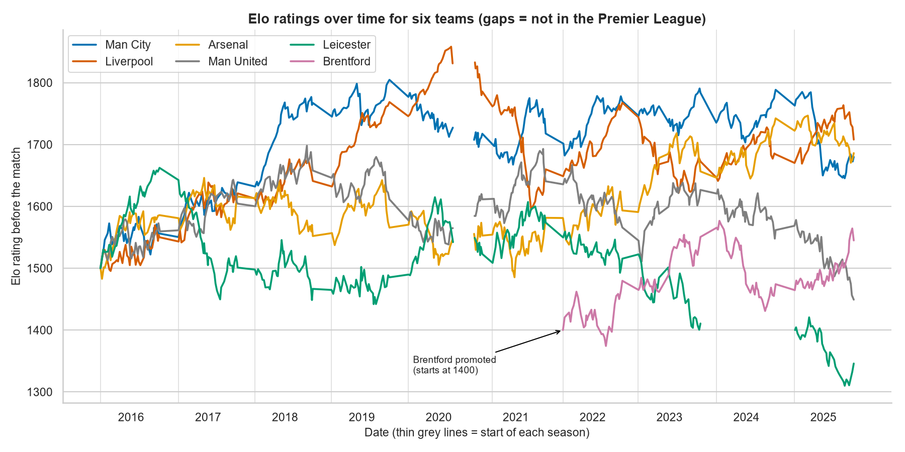
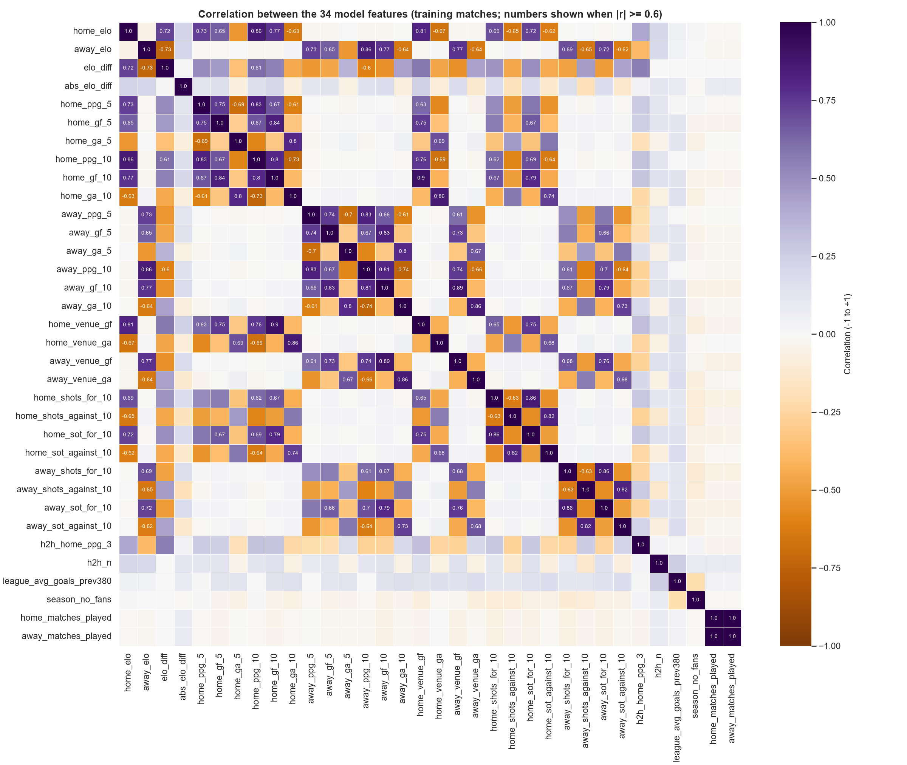

# Lesson 04: Feature engineering

**Stage goal in one sentence:** Turn each match into one row of 34 numbers that describe the two teams using only what was known BEFORE kick-off, and prove with tests that nothing leaks.

**Files created or changed:**
- `src/features.py`: builds all features in one pass over time, tunes Elo, scales features (run `python src/features.py`)
- `src/check_features.py`: the leakage tests and sanity checks
- `src/feature_plots.py`: the three sanity plots (figures 12 to 14)
- `data/processed/features.csv`: one row per match (4,180 rows): metadata, targets, `warmup`, `defaults_used` and the 34 features, unscaled
- `data/processed/feature_params.json`: the chosen Elo constants and the neutral defaults
- `data/processed/elo_start_of_2025-26.csv`: each team's Elo at the start of 2025-26 (needed in Stage 7)
- `models/feature_scaler.joblib`: a StandardScaler fitted on training rows only
- `reports/elo_tuning_grid.csv`: the full 144-row tuning table
- `reports/figures/12_elo_diff_vs_outcome.png`, `13_elo_over_time.png`, `14_feature_correlation.png`
- `docs/learning/04_feature_engineering.md`: this lesson

---

## 1. The big picture
Stage 2 gave us a clean table, but each row is a match that has already happened. A model needs, for each match, a description of the situation BEFORE it: how strong is each team, how are they playing, how do they usually do against each other. That description is the **features**. Think of a bookmaker's pre-match preview: "City have won 4 of their last 5 and score 3 goals a game; Liverpool are a bit weaker away". Stage 4 writes that preview as numbers. Stage 5 trains models on those numbers. The most important job in this stage is to make sure the preview only contains things known before kick-off.

## 2. What we built
Each of the 34 features is computed for a match using only matches played on EARLIER dates.

| Group | Features | Meaning |
|---|---|---|
| Elo (4) | `home_elo`, `away_elo`, `elo_diff`, `abs_elo_diff` | Strength rating of each team before the match, the gap between them, and the size of the gap |
| Form (12) | `home_ppg_5`, `home_gf_5`, `home_ga_5`, `home_ppg_10`, `home_gf_10`, `home_ga_10` and the same six with `away_` | Points, goals scored and goals conceded per match over each team's last 5 and last 10 matches (any venue) |
| Venue strength (4) | `home_venue_gf`, `home_venue_ga`, `away_venue_gf`, `away_venue_ga` | Goals scored/conceded by the home team in its last 10 HOME matches, and by the away team in its last 10 AWAY matches, shrunk toward its overall average |
| Shots (8) | `home_shots_for_10`, `home_shots_against_10`, `home_sot_for_10`, `home_sot_against_10` and the same four with `away_` | Average shots and shots on target taken and allowed over the last 10 matches |
| Head-to-head (2) | `h2h_home_ppg_3`, `h2h_n` | The home team's points per game in its last (up to) 3 meetings with this opponent, and how many meetings were found |
| Context (4) | `league_avg_goals_prev380`, `season_no_fans`, `home_matches_played`, `away_matches_played` | Average total goals in the previous 380 league matches; 1 for 2020-21; matches each team has already played this season |

**One real row.** Man City v Liverpool, 25 November 2023 (a training match, 1-1):
- Elo: Man City 1739.9, Liverpool 1676.0, so `elo_diff` = +63.96.
- Man City's last 5 matches: lost 0-1 at Arsenal, beat Brighton 2-1, won 3-0 at Man United, beat Bournemouth 6-1, drew 4-4 at Chelsea. Points = 0 + 3 + 3 + 3 + 1 = 10, so `home_ppg_5` = 10 / 5 = **2.0**. Goals scored = 0 + 2 + 3 + 6 + 4 = 15, so `home_gf_5` = **3.0**. Goals conceded = 1 + 1 + 0 + 1 + 4 = 7, so `home_ga_5` = **1.4**. These are exactly the values in `features.csv`.
- Head-to-head: the last 3 meetings gave Man City 1.33 points per game (`h2h_n` = 3).

**What was NOT used:** fouls, cards and corners (EDA 09: fouls and cards are almost unrelated to the result, and corners overlap with shots), the bookmaker odds (our plan), and of course anything from the match itself. We can revisit fouls/cards/corners later.

## 3. New concepts (explained simply)
- **Feature:** one number that describes a match before it is played. The whole feature table is the "coordinates" of each match.
  - **Link to KNN:** in KNN each point has coordinates and we measure distances between points. Here every match is a point in a 34-dimensional space, and `elo_diff` is one coordinate. Two matches that are close in this space are "similar situations" (two strong teams at home vs two weak ones...). Because KNN uses distances, the features would need scaling (Stage 2), and strongly related features (such as shots and shots on target) would count the same information twice. K-means would behave the same way.
- **Elo rating:** a number for team strength, starting at 1500 for everyone. It was invented for chess. It goes up after good results and down after bad ones, by an amount that depends on how surprising the result was.
  - **Expected score:** before the match the rating gap gives the home team's expected score between 0 and 1 (1 = win, 0.5 = draw, 0 = loss): `E = 1 / (1 + 10^(-(Rhome + H - Raway) / 400))`. `H` is a home-advantage bonus added to the home rating.
  - **Update:** after the match the home rating changes by `K x (actual - E)` and the away rating by the same amount in the opposite direction. `actual` is 1, 0.5 or 0. `K` controls how fast ratings move.
  - **Worked example from our data.** Man City v Liverpool, 25 Nov 2023, with our chosen K = 30 and H = 50:
    - Ratings before: Man City 1739.94, Liverpool 1675.98.
    - Gap including the home bonus: 1739.94 + 50 - 1675.98 = 113.96.
    - `E = 1 / (1 + 10^(-113.96/400)) = 1 / (1 + 0.5189) = 0.658`. Elo expected Man City to score about 66% of the available points.
    - The match was a 1-1 draw, so actual = 0.5. Change = 30 x (0.5 - 0.658) = **-4.75**.
    - New ratings: Man City 1735.19, Liverpool 1680.73. (These are exactly the ratings in `features.csv` for their next matches.) City "underperformed" slightly, so they lose a little and Liverpool gain the same.
    - A big favourite winning changes little: Man City (1772.8) v Ipswich (1393.4) in Aug 2024 gave E = 0.922; City won, so they gained only 30 x (1 - 0.922) = +2.34.
  - **Why Elo is useful:** it summarises ALL past results in one number, weights recent ones more, and adjusts for opponent strength (beating a strong team counts more).
- **Season pull-back (`keep`):** between seasons we keep a fraction of each rating's distance from 1500: `1500 + keep x (rating - 1500)`. Squads change over the summer, so strength partly resets. EDA 07 showed next-season points are about 13 + 0.76 x this-season points.
- **Promoted-team offset:** a team that did not play in the previous Premier League season starts at 1500 + offset. Promoted teams are usually weaker. We chose -100 (start at 1400).
- **Rolling average (window):** the average over a team's last N matches. Tiny example: points in the last 5 matches 3, 1, 0, 3, 3 give 10 / 5 = 2.0 points per game. After the next match (a loss, 0 points) the window slides: the oldest match drops out, giving 7 / 5 = 1.4. The window continues across seasons: a team's first match of a new season looks back at the end of the previous season. A team that was not in the league the season before starts with an empty history (it was in the Championship, which is not in our data).
- **Shrinkage:** pulling a noisy number toward a safer average when it is based on few matches. Formula: `(n x venue_average + k x overall_average) / (n + k)` with k = 5. Example: a team scored 3.0 goals per game in only 2 home matches, but 1.4 per game overall. Shrunk value = (2 x 3.0 + 5 x 1.4) / (2 + 5) = 13 / 7 = **1.86**. With 10 home matches at 3.0 it would be (10 x 3.0 + 5 x 1.4) / 15 = 2.47: more matches, more trust in the venue average. EDA 08 showed per-team home advantage is mostly noise, so we do not trust small samples.
- **Neutral default:** a stand-in value when a window has no earlier matches (for example 1.38 points per game, the training average). Computed from training rows only.
- **Warm-up row (`warmup = 1`):** a match where either team has fewer than 5 earlier matches in the data. Its features are based on very little. We keep these rows and flag them; Stage 5 decides what to do.
- **Data leakage (again) and the perturbation test:** a feature leaks if it contains information from the match itself or from the future. How do we PROVE we have none? We run a test: pick a match, change its final score (and shots), recompute every feature from scratch, and check that nothing about that match or any earlier match changed. If a feature secretly used the match's own result, it would change and the test would fail. It is a strong proof because it does not rely on us reading the code carefully: it checks the actual numbers.
- **Redundancy (correlated features):** two features that carry nearly the same information (for example shots and shots on target, or 5-match and 10-match form).

## 4. How the code works
All in `src/features.py`.
- `build_features(matches, params, defaults)`: the heart. It groups matches by date. For each date it (1) computes features for all matches on that date from the history so far, and only then (2) adds that date's results to the history. So a match can never see its own result or a same-day result. It keeps small per-team memories (`deque`s holding only the last N matches): overall form and shots, home matches, away matches, matches this season, head-to-head meetings and the league's last 380 goals totals.
- `compute_elo(matches, params)`: one pass computing each match's ratings BEFORE the match, then updating. At the start of each season `apply_season_start` pulls ratings back, or gives teams without a previous-season match the lower start.
- `tune_elo(train)`: tries all 144 combinations of K, H, keep and offset and keeps the one with the lowest error (mean squared error between Elo's expected score and the real score). Only training matches go in: the test season is not even loaded into this function.
- `compute_defaults(train)`: the neutral values, from training rows only.
- `warmup_flags(matches)`: marks rows where either team has fewer than 5 earlier matches in the data.
- `fit_feature_scaler(...)`: StandardScaler fitted on training rows only; `features.csv` stays unscaled because trees do not need scaling and Logistic Regression will apply the saved scaler in Stage 5a.
- `season_membership(matches)`: which teams played each season and which were new (no match the season before).

Important design choices:
- **Same-day matches are treated as simultaneous.** This is stricter than needed and makes the leakage tests stronger.
- **A team absent last season starts fresh** (empty history, Elo 1500 + offset). Otherwise a promoted team like Sunderland would "remember" form from 2016-17.
- **Constants are fixed before the main pass.** They come from training data, and in the leakage test they are held fixed.

## 5. Results and how to read them

### The tuned Elo constants
We tried K in {10, 20, 30, 40}, H in {0, 50, 100}, keep in {0.6, 0.75, 0.9} and offset in {0, -50, -100, -150} on the training seasons 2015-16 to 2022-23 (2,931 matches after skipping warm-up rows). Error = mean squared error between the expected score and the actual score (lower is better).

| K | H | keep | offset | Error on fit seasons | Error on validation seasons (2023-24, 2024-25) |
|---|---|---|---|---|---|
| **30** | **50** | **0.90** | **-100** | **0.1566** | **0.1533** |
| 20 | 50 | 0.90 | -100 | 0.1566 | 0.1533 |
| 30 | 50 | 0.90 | -150 | 0.1567 | 0.1526 |
| 30 | 50 | 0.90 | -50 | 0.1567 | 0.1541 |
| 30 | 50 | 0.75 | -100 | 0.1569 | 0.1535 |
| Baseline: always predict the average score (0.567) | | | | 0.1877 | 0.1910 |

*What it tells us:* Elo clearly beats the baseline, on the fit seasons (0.1566 vs 0.1877) and also on the two validation seasons it never saw during tuning (0.1533 vs 0.1910). So it is not just fitted to the past. Home advantage matters: H = 0 is clearly worse (0.1614) than H = 50 (0.1566). But the differences among the top combinations are tiny (about 0.0001 to 0.0003), so the data cannot really tell K = 20 from K = 30 or an offset of -100 from -50. Two caveats, honestly stated: (1) `keep = 0.9` is the edge of our grid, so a larger value might be even better. The EDA-based starting guess of 0.75 is only 0.0003 worse, so we cannot say it is wrong. (2) In 2015-16 every team starts at 1500, which favours fast learning. If we ignore that season when tuning, the best K would be 20 instead of 30 and the other constants stay the same.

### Elo difference vs outcome (Figure 12)


Matches are split into 5 equal-sized groups by `elo_diff` (home Elo minus away Elo). *How to read it:* each x position is one group, lowest gap (away team much stronger) on the left. The home win share rises steadily from 19% to 72%, the away win share falls from 60% to 11%. *What it tells us:* Elo carries real information about who wins. *Draws:* about 26% in the three middle groups, but only 21% on the far left and 17% on the far right: draws are less common when one team is much stronger. A "bad" result would be flat lines.

### Elo over time (Figure 13)


Six teams across all seasons. Everyone starts at 1500 in 2015-16 and the ratings spread out. Man City and Liverpool rise toward 1800 and above. Leicester (green) peaks near 1660 after the 2015-16 title, drifts down, disappears in 2023-24 (gap) and returns at 1400 in 2024-25. Brentford (pink) enters at 1400 when promoted in 2021-22 and climbs toward 1580. The yearly small jumps at the grey season lines are the pull-back toward 1500.

### Feature correlation (Figure 14)


Correlation heatmap of the 34 features (training matches, warm-up rows excluded); numbers are shown for |r| of 0.6 or more. This fulfils the EDA item in our plan. **18 pairs have |correlation| above 0.8**, for example:
- `home_matches_played` and `away_matches_played`: 1.00 (all teams have played nearly the same number of games at any date)
- `home_gf_10` and `home_venue_gf`: 0.90 (and the away version 0.89); `home_ga_10` and `home_venue_ga`: 0.86 (away 0.86). Reason: venue strength is shrunk toward the overall average.
- `home_shots_for_10` and `home_sot_for_10`: 0.86 (away 0.86); the "against" versions 0.82
- `home_elo` and `home_ppg_10`: 0.86 (away 0.86). Elo is basically a smoothed version of form.
- `home_gf_5` and `home_gf_10`: 0.84; `home_ppg_5` and `home_ppg_10`: 0.83 (away versions 0.83)

*What redundancy means for each model:*
- **Logistic Regression:** it can still predict well, but the individual coefficients become unstable and hard to interpret (credit is split arbitrarily between twins). Regularisation (a penalty on big coefficients) helps.
- **Random Forest and XGBoost:** robust to redundancy, since each tree chooses what it needs. But feature importance gets split between twins, so a twin may look less important than it is.
- **Poisson regression:** strongly correlated inputs make the estimates and their uncertainty unreliable (multicollinearity), so we may want to drop twins there.
- **KNN and K-means (what you know):** a doubled feature counts twice in the distance, giving that idea extra weight.
In Stage 5 we can test dropping some features (for example one of the two `matches_played` columns) on the validation data.

### Rows with no or short history
| Rows | All | Training | Test |
|---|---|---|---|
| `warmup = 1` (a team had fewer than 5 earlier matches in the data) | 119 | 119 | 0 |
| `defaults_used = 1` (a team had no history at all, neutral defaults used) | 40 | 37 | 3 |
| `h2h_n = 0` (the two teams had never met in the data) | 475 | 469 | 6 |

`warmup` by season: 50 in 2015-16 (everyone is new in the data), 14 in 2016-17, 10 in 2017-18, 15 in 2018-19, 5 in each of 2019-20 to 2024-25 (the first 5 matches of a club new to the data, such as Sheffield United, Leeds, Luton, Ipswich), and 0 in 2025-26. The 3 test rows using defaults are the first matches of the three promoted teams (Burnley, Leeds, Sunderland), which start with empty history. Nothing was dropped.

### Elo at the start of 2025-26 (for Stage 7)
Liverpool 1680, Man City 1672 and Arsenal 1671 lead, and Burnley, Leeds and Sunderland start at 1400 (promoted or returning). **Why we saved this:** a real season forecast in Stage 7 cannot use real 2025-26 results, so it must start from ratings known at the end of the previous season and then simulate. This file is computed from matches before 2025-26 only.

### Scaling
The fitted scaler (training rows only) standardises all 34 features: before scaling, for example, `home_elo` has mean 1512 and standard deviation 102.6; after it every feature has mean 0 and standard deviation 1 on the training rows. `features.csv` itself is unscaled.

### The leakage tests (`check_features.py`)
Real output (all ran):
```
PASS  features.csv has 4180 rows, in date order, same matches as matches_clean.csv
PASS  columns are exactly the metadata plus the 34-feature whitelist
PASS  no same-match goals, shots, fouls, corners, cards, results or odds among the features
PASS  no missing or infinite values in any feature column
...
Perturbation tests (change the final score and shots of one match, recompute everything):
  match 1667 (Wolves v West Ham, 2019-12-04, train): 1668 rows on or before this date unchanged; 381 later rows changed
  match  338 (Arsenal v West Brom, 2016-04-21, train): 339 rows on or before this date unchanged; 380 later rows changed
  match 2486 (Everton v Aston Villa, 2022-01-22, train): 2490 rows on or before this date unchanged; 1690 later rows changed
  ...
PASS  detector self-test: a deliberately leaky column (same-match goals) IS caught by this test
All checks passed.
```
*How to read it:* changing a match's result alters the features of LATER matches (that is expected: the result becomes history) but never its own row or any earlier row. We also confirmed the test can fail: a deliberately leaky column (same-match goals) was caught. Another check: the training rows' features are identical with and without the test season in the data.

## 6. Common mistakes and gotchas
- **Using the match's own numbers.** The easy mistake is a feature like "this match's shots". Whitelist plus perturbation test guard against it.
- **Updating history too early.** If a match is added to the history before its features are computed, it leaks into itself. We compute first, update after.
- **Choosing constants with the test set.** Elo constants and defaults come from training seasons only; the test season is excluded from tuning.
- **Stale history.** A promoted team's "last 5 matches" could come from years ago. We reset history for teams absent last season.
- **Small samples.** Venue-specific and head-to-head numbers are based on few matches, so they are noisy: we use shrinkage for venue strength. **Head-to-head is probably a weak feature:** in our data the average number of previous meetings found is only 2.3 of 3, and 475 matches have none. We keep it for now; Stage 5 will test it on validation data.
- **Features that look the same.** 18 pairs correlate above 0.8, as listed above.
- **Decisions you may want to review:** (1) `keep = 0.9` is the best on the grid but at its edge, and the EDA-based 0.75 is almost as good; (2) the first 5 matches of promoted teams use partly default values for form, so they look "average" in form (Elo does capture their weakness); (3) `season_no_fans` is 0 for all test matches, so it only helps training separate 2020-21: Stage 5 decides whether to include it; (4) `home_matches_played` and `away_matches_played` are almost the same column.

## 7. Check yourself
1. What is a feature, and how does the feature table relate to the points KNN measures distances between?
2. A team has Elo 1600, its opponent 1500 and the home bonus is 50. Without calculating exactly, does Elo expect the home team to score more or less than 50% of the points? And what happens to the home team's rating if it only draws?
3. Why do we compute a match's features BEFORE adding its result to the history?
4. Explain the perturbation test in your own words. Why does it prove more than just reading the code?
5. A team has played only 2 home matches, scoring 3.0 goals per game, but its overall average is 1.4. Why do we shrink the 3.0 toward 1.4 instead of trusting it?
6. Why did we leave fouls and cards out, and which EDA figure supports that?

## 8. Try it yourself
Save the following as `try_k.py` in the project folder (do not put it in `src/`) and run `python try_k.py` with the environment active:
```python
import sys
sys.path.insert(0, "src")          # lets us import our own features.py
import numpy as np
import pandas as pd
from features import compute_elo, ELO_SCORE_HOME

matches = pd.read_csv("data/processed/matches_clean.csv", parse_dates=["Date"])
train = matches[matches["split"] == "train"].reset_index(drop=True)   # training rows only
actual = train["result"].map(ELO_SCORE_HOME).to_numpy()
for K in (10, 30, 40):
    params = {"K": K, "H": 50, "keep": 0.9, "offset": -100}
    expected = compute_elo(train, params)[2]
    print(f"K = {K}: mean squared error {np.mean((expected - actual) ** 2):.4f}")
```
Before running, predict: will K = 10 (slow-moving ratings) or K = 40 (fast-moving ratings) have the lower error than our chosen K = 30? Will the differences be big or small? Then run it and explain in your own words what a very small K and a very large K would do to a team's rating after one surprising result.

## 9. How this connects to the report
This stage feeds the **Feature Engineering / Input Features** part of the dataset section of the report (input features and target) and shows the no-leakage design.

*Draft paragraph:* "For each match we built 34 input features using only information available before kick-off: an Elo rating for each team (constants chosen on the training seasons and checked on two validation seasons), average points, goals and shots over each team's last 5 and 10 matches, venue-specific scoring rates shrunk toward the team's overall average, head-to-head results, and league context. Features were computed in a single pass through time, and automated tests, which change a match's score and recompute every feature, confirmed that no feature uses information from the match itself or from later matches. Betting odds, and same-match statistics such as shots, fouls and cards, are not used as inputs."

## What changed because of the EDA
| EDA finding | What we did |
|---|---|
| Next-season points ≈ 13 + 0.76 x this season (Figure 7) | Elo is pulled back toward 1500 between seasons; the tuned keep-fraction is 0.9 (0.75 is nearly as good) |
| Per-team home advantage is mostly noise (Figure 8) | Venue strength is shrunk toward the overall average (k = 5); Elo uses one league-wide home bonus |
| Scoring level shifts (3.28 goals in 2023-24, Figure 4) | `league_avg_goals_prev380` |
| Fouls and cards unrelated to results; corners overlap shots (Figure 9) | Not used as features |
| Draws are more common in close matches (Figure 11) | `abs_elo_diff` |
| 2020-21 had much weaker home advantage (Figure 2) | `season_no_fans` (Stage 5 decides) |
| Odds are a reference only | Not used |

**Why `abs_elo_diff`?** Logistic Regression models each outcome with a straight-line score in the features. With only `elo_diff` the model can describe "the bigger the gap, the more likely a home win", but draws depend on how CLOSE the teams are, which is the same for a gap of +100 and -100. A feature that is large when the teams are far apart and small when they are close gives the model a direct way to see this (Figure 12: draws fall from about 26% to 17% as the gap grows). To be precise, a softmax model could still make a rough hump for draws from `elo_diff` alone, but only in a limited, awkward way, and `abs_elo_diff` makes it simple. Trees can find this by themselves, but it costs them nothing to have it.

---

## Answers to "Check yourself"
1. A feature is a number describing a match before it is played (for example `elo_diff`). The feature table puts every match at a point in a space with one axis per feature, which is exactly the kind of space where KNN measures distances between points.
2. Elo gap including the home bonus is 1600 + 50 - 1500 = 150, so the home team is expected to score more than 50% (about 70%). If it only draws, its actual score (0.5) is below the expected one, so its rating goes down a little and the opponent's goes up by the same amount.
3. Otherwise the match would see its own result (a leak). Computing features first and updating the history afterwards means a match only sees earlier matches.
4. We change a match's final score and shots, recompute every feature, and check that the features of that match and all earlier matches stay exactly the same. A feature that secretly used the match's own information would change and fail the test. It checks the actual numbers instead of trusting that we wrote the code correctly, and we showed that the test does catch a deliberately leaky column.
5. Two matches are very little evidence: a hot streak can be luck (EDA 08 showed per-team home effects are mostly noise). Shrinking pulls the number toward the safer overall average: (2 x 3.0 + 5 x 1.4) / 7 = 1.86. With more matches, we trust the venue average more.
6. Fouls and cards had almost no relationship with the result (EDA Figure 9: fouls -0.03, home yellow cards -0.09), and corners overlap with shots, so they add little. We can revisit them later.
