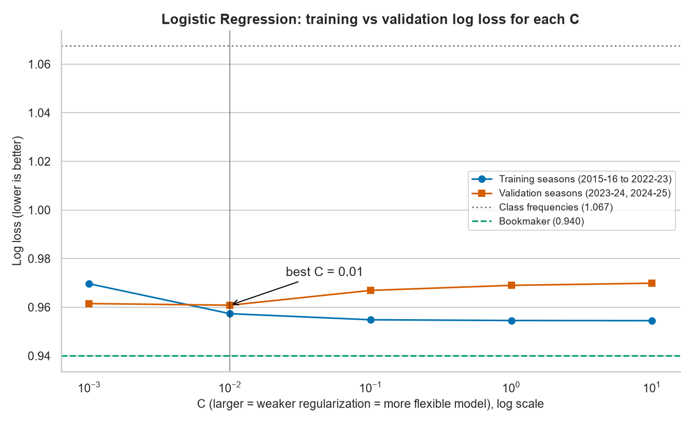
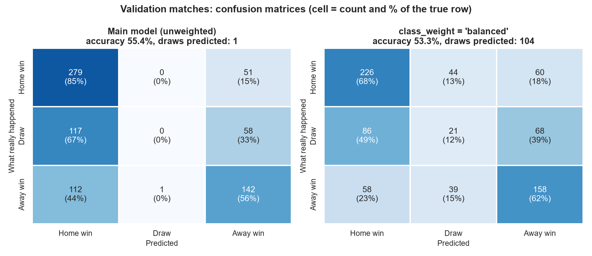
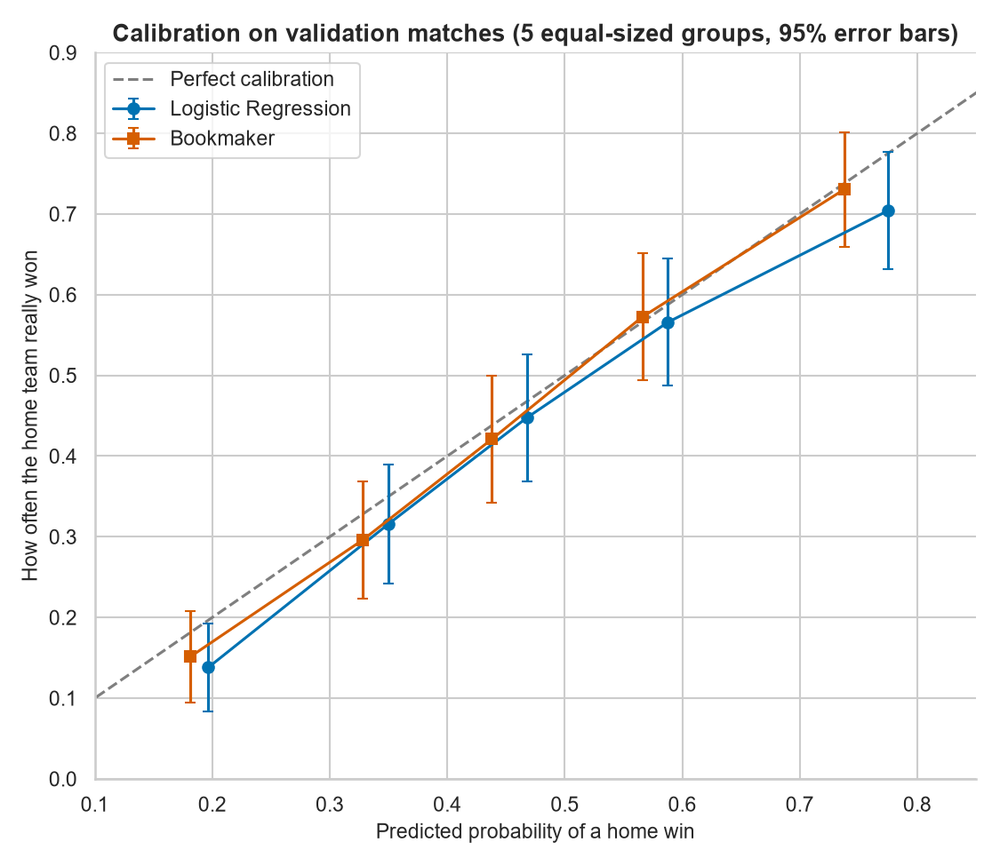
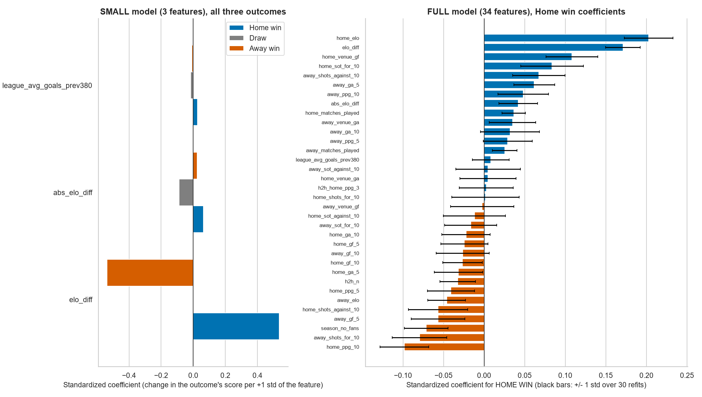

# Lesson 05a: Baselines and Logistic Regression

**Stage goal in one sentence:** Build the evaluation tools, score three "reference" predictors, then train, tune and honestly test a Logistic Regression, using only the validation seasons.

**Files created or changed:**
- `src/modeling_utils.py`: shared tools (data slices with test-set guards, metrics, paired bootstrap, feature sets, bookmaker probabilities)
- `src/logreg.py`: the ORIGINAL analysis (v1 feature sets): baselines, Logistic Regression, tuning, the experiments, figures
- `src/amendment_5a.py`: the amendment after review: drift table, primary (ELO2) and reference (FULL) models, per-season home-win check, saving the final models
- `src/check_models.py`: the checks (guards, time order, frozen v1 hash, v2 amendment, probabilities, hand computations, saved models, drift table)
- `data/processed/feature_sets_v1.json`: the original three feature sets FULL, REDUCED and SMALL (frozen before any model result, never changed)
- `data/processed/feature_sets_v2.json`: the amendment (post-hoc): FULL (33, reference), REDUCED (24), ELO2 (2, primary), with date and reason
- `reports/ablations_logreg.csv`: every v1 experiment with its numbers and decision (the record of what was found)
- `reports/drift_validation.csv`: the drift table for all 34 features
- `reports/amendment_5a_results.csv`: C tuning for ELO2 and FULL
- `reports/val_predictions_5a.csv` (v1) and `reports/val_predictions_5a_v2.csv` (amendment): validation probabilities of the models and baselines (for Stage 6)
- `models/logreg.joblib`, `models/logreg_config.json`: the PRIMARY model (ELO2); `models/logreg_full_reference.joblib` and its config: the FULL reference model
- `reports/figures/15_logreg_validation_curve.png`, `16_confusion_matrix.png`, `17_calibration.png`, `18_coefficients.png` (made under the v1 analysis)
- `docs/decisions.md`: decisions log (created in this stage, updated by the amendment)
- `docs/learning/05a_baseline_logistic_regression.md`: this lesson

> **Amendment after review (post-hoc).** After reading this lesson's first version, the team approved three changes that were driven by a diagnostic run *after* seeing validation results: the primary Logistic Regression now uses only `elo_diff` + `abs_elo_diff` (ELO2); `league_avg_goals_prev380` is removed from every classifier feature set; head-to-head features are kept only in the FULL reference set. Sections 2, 5 and 6 mark where the original (v1) text is superseded, and section 5b explains the amendment, including why these choices must be treated as post-hoc.

---

## 1. The big picture
So far we prepared data. Now we start predicting. Before any fancy model, we need two things: (1) a ruler to measure predictions fairly, and (2) reference predictors, so that "55% accuracy" means something. This lesson builds both and then trains our first real model, Logistic Regression.

**The test-set rule for all of Stage 5:** the 2025-26 season is NOT touched. Every choice is made on two *validation* seasons (2023-24 and 2024-25, 760 matches), using models trained on 2015-16 to 2022-23. Analogy: study with past exam papers (training), check your progress with a practice exam (validation), and keep the real exam (test) sealed until the very end (Stage 6). The code enforces this: asking for test rows raises an error.

## 2. What we built
1. **Shared tools.** Load features, cut them into time-based slices, compute metrics, compare two options with a bootstrap. They are reused in Stages 5b to 5d.
2. **Three frozen feature sets** (written to a file before any model result was seen, so we could not be tempted to adjust them to look good):
   - **FULL:** all 34 features.
   - **REDUCED (27):** FULL without "redundant twins", found by a mechanical rule on the fit seasons only. Rule: always drop `away_matches_played` (identical to `home_matches_played`); then for each pair with |correlation| above 0.85, strongest first, drop the one that is on average more correlated with everything else. It dropped: `away_matches_played`, `home_gf_10`, `away_gf_10`, `away_ga_10`, `home_venue_ga`, `away_sot_for_10`, `home_sot_for_10`.
   - **SMALL (3):** `elo_diff`, `abs_elo_diff`, `league_avg_goals_prev380`. (Retired in the amendment, replaced by ELO2: `elo_diff`, `abs_elo_diff`.)
3. **Three baselines** on the 760 validation matches (table below).
4. **A Logistic Regression**, tuned and examined (draws, calibration, coefficients).
5. **Five experiments**, one change at a time, each judged by a noise rule.
6. **Final models**, refit on all ten training seasons and saved, not scored on the test season. After the amendment: the primary model (ELO2) and a FULL reference model (33 features, keeps head-to-head) for Stage 6.

**Baselines and the model on the validation seasons** (lower log loss is better; higher accuracy and F1 are better):

| Predictor | Accuracy | Log loss | Macro-F1 | Brier score | Draws predicted |
|---|---|---|---|---|---|
| Always predict "Home win" | 43.4% | not defined | 0.202 | 1.132 | 0 |
| Class frequencies (knows nothing) | 43.4% | 1.0675 | 0.202 | 0.646 | 0 |
| Bookmaker (Bet365, margin removed) | 56.8% | 0.9400 | 0.422 | 0.556 | 0 |
| Logistic Regression, v1 default: FULL (34 features), C = 0.01 | 55.4% | 0.9608 | 0.409 | 0.569 | 1 |
| Logistic Regression, v1 rule result: SMALL (3 features), C = 10 (superseded) | 55.3% | 0.9663 | 0.407 | not shown | not shown |
| **Amendment: PRIMARY, ELO2 (2 features), C = 10** | 55.4% | 0.9582 | not shown | not shown | not shown |
| **Amendment: FULL reference (33 features, no league average), C = 0.01** | 55.5% | 0.9577 | not shown | not shown | not shown |

## 3. New concepts (explained simply)
- **Baseline:** a deliberately simple predictor that sets the bar. "Always Home win" is right 330 times out of 760 (43.4%). "Class frequencies" says "44.8% home, 23.4% draw, 31.8% away" for every match, using fit-season proportions: it knows nothing about the teams. Its log loss, **1.0675**, is the "knows nothing" level that a real model must beat.
- **Implied probability and the bookmaker.** Odds of 2.00 imply a chance of 1 / 2.00 = 50%. For home, draw and away the three chances add up to more than 100% (5.5% extra on average in our validation matches): that is the bookmaker's margin. We divide each by the sum so they add up to 100%. The bookmaker is our benchmark: the aim is to get close, not to beat it.
- **Logistic Regression (multinomial).** For each possible outcome it computes a *score*: a starting number (intercept) plus a weight times each standardized feature, added up. Higher score = more likely. A function called **softmax** turns the three scores into three probabilities that add up to 1: probability = e^score / (sum of e^scores). Training searches for the weights that make the probabilities fit the real results as well as possible.
  - **Worked example, one real validation match:** Man City v Liverpool, 25 Nov 2023, which ended 1-1 (a draw). We use the 3-feature model so every step can be seen.
    - Standardized features: `elo_diff` = 63.96 (training mean -0.14, std 146.16) gives **+0.439**; `abs_elo_diff` = 63.96 (mean 114.17, std 91.25) gives **-0.550**; `league_avg_goals_prev380` = 2.934 (mean 2.746, std 0.080) gives **+2.356**.
    - Weights learned (Home win / Draw / Away win): `elo_diff` +0.536 / +0.001 / -0.537; `abs_elo_diff` +0.064 / -0.088 / +0.024; `league_avg_goals_prev380` +0.026 / -0.017 / -0.009. Intercepts: +0.333 / -0.250 / -0.083.
    - Home score = 0.333 + 0.536 x 0.439 + 0.064 x (-0.550) + 0.026 x 2.356 = **0.594**. Draw score = **-0.241**. Away score = **-0.353**.
    - Softmax: e^0.594 = 1.811, e^-0.241 = 0.786, e^-0.353 = 0.703; sum 3.300. Probabilities: **Home win 54.9%, Draw 23.8%, Away win 21.3%**. (The bookmaker said 54.8%, 22.6%, 22.6%.)
    - **Log loss** of this match = -ln(probability given to what happened) = -ln(0.238) = **1.435**. The model gave the draw a modest chance, so the "penalty" is large.
  - **Contrast with KNN:** KNN keeps all training matches and, for a new match, finds the K nearest ones and lets them vote. Logistic Regression keeps only a small table of weights (here 3 features x 3 outcomes + 3 intercepts) and then discards the data. KNN's answer depends on who the neighbours are; Logistic Regression's depends on one straight-line formula, which is fast, smooth and easy to read, but cannot capture curves or interactions on its own.
  - **How training works:** start with some weights, compute the average log loss on the training matches, nudge each weight slightly in the direction that lowers it, repeat until it stops improving (this is what the solver does). The weights end up making the training probabilities as "honest" as possible.
- **Log loss:** the average of -ln(probability given to what really happened). It rewards honest, confident-when-right probabilities and punishes confident mistakes. Tiny examples: giving 50% to what happened costs 0.693; 90% costs only 0.105; 25% costs 1.386; never knowing anything (1/3 each) costs 1.099. It is our **main metric** because accuracy ignores how sure the model was, and because the app will show probabilities.
- **Accuracy:** the share of matches where the most likely outcome was right. Simple, but blind to probabilities, and 43% can be achieved by always saying "Home win".
- **Precision, recall, F1, confusion matrix.** The confusion matrix counts, for each real outcome (rows), what the model predicted (columns). From our Logistic Regression: of 330 real home wins, 279 were predicted as home wins. **Recall** = 279 / 330 = 84.5% (of all real home wins, how many did we find?). **Precision** = 279 / (279 + 117 + 112) = 54.9% (of all home wins we predicted, how many were right?). **F1** is a single number combining the two: 2 x 0.549 x 0.845 / (0.549 + 0.845) = 0.666. **Macro-F1** averages F1 over the three outcomes, so a model that ignores draws is punished (draw F1 = 0 drags it down).
- **Brier score:** the average squared distance between the predicted probabilities and what happened (lower is better). A second view of probability quality.
- **Regularization and C.** Regularization is a penalty on large weights that keeps the model from over-reacting to noise. In scikit-learn the setting is **C: a smaller C means a stronger penalty (simpler model); a larger C means a weaker penalty (more flexible model).** Think of it as how strictly a teacher marks "too complicated" answers.
- **Underfitting vs overfitting.** Underfitting: the model is too simple or too restrained, so it is poor on both training and new data. Overfitting: too flexible, so very good on training data but worse on new data. In Figure 15 (below), a tiny C underfits (high loss on both); a larger C lowers the training loss but the validation loss goes up a little.
- **Calibration ("honest probabilities").** A model is calibrated if, among all the matches where it says "60% home win", the home team really wins about 60% of the time.
- **Standardized coefficient.** The weight attached to a feature that was standardized (mean 0, std 1). It says how much the outcome's score changes when the feature goes up by one standard deviation, so coefficients of different features can be compared. Our model's coefficients across the three outcomes add up to zero for each feature: the coefficient of "Home win" is relative to the average outcome.
- **Paired bootstrap.** To judge whether option B really beats option A, we take the per-match log losses of both on the same 760 matches and compute the average difference. Then we resample the 760 matches *with replacement* 2,000 times, recompute the difference each time, and read the middle 95% of those results: that is the **95% interval**. If it excludes zero, the difference is unlikely to be luck. "Paired" means both options are scored on the same matches, which cancels out how hard each match is.
- **Noise rule used in this stage:** adopt a change only if the 95% interval of the log-loss improvement excludes zero. Otherwise keep the **simpler** option and say the data cannot tell them apart. With 760 validation matches, one standard error of accuracy is about **1.8 points** (about 3.6 points for a 95% range), so accuracy alone never decides.
- **Sample weights (recency weights):** per-match importance factors. We tried weights that halve every 2 seasons back, so recent matches count more.

## 4. How the code works
- `modeling_utils.py`
  - `get_slice("fit" | "validation" | "train_all")`: returns those seasons. Any other name, including `"test"`, raises `TestSetAccessError`. `load_features()` drops test rows chunk by chunk while reading, and `make_xy()` refuses any table containing a test row, so every fit and every prediction is guarded.
  - `evaluate(y_true, proba)`: accuracy, log loss, macro-F1, per-class precision/recall/F1, confusion matrix, Brier score. `per_match_log_loss` gives the loss of each match.
  - `paired_bootstrap(loss_a, loss_b)`: the interval described above (fixed seed 42, 2,000 resamples). A positive mean means option B is better.
  - `build_feature_sets`: the mechanical REDUCED rule.
  - `make_logreg(C)`: a `Pipeline` of `StandardScaler` + `LogisticRegression`. *Why a pipeline:* when you fit it, the scaler learns its means and standard deviations from the training rows only, then applies them to whatever it predicts. Nothing from the validation rows can leak into the scaling.
- `logreg.py`: `score_config` fits a configuration on the fit seasons and scores it on the validation seasons; `tune_C` loops over C; `run_experiments` changes one thing at a time; `decide` applies the noise rule; the final model is refit on 2015-16 to 2024-25 with its own scaler.
- `check_models.py`: 13 checks (see the output in the Stage 5a summary).

## 5. Results and how to read them

### The logistic regression versus the baselines
- **Beats "knows nothing" clearly:** log loss 0.9608 vs 1.0675, an improvement of 0.107 with a 95% interval of [+0.075, +0.138].
- **Does not reach the bookmaker:** the bookmaker's 0.9400 is better than our 0.9608 by 0.021, interval [0.008, 0.034] (the bookmaker is clearly better). In accuracy the gap is 56.8% vs 55.4% (1.4 points, inside the 1.8-point noise). Honest summary: we capture most of the available signal (the gap between "knows nothing" 1.0675 and the bookmaker 0.9400 is 0.127, and we cover about 84% of it), but not all. This is what we expected: the bookmaker knows about injuries, line-ups and money flows we do not.

### Figure 15: validation curve


*What am I looking at?* Log loss of the model on the training seasons (blue) and on the unseen validation seasons (orange) for five values of C. Dotted grey = "knows nothing" level, dashed green = bookmaker. *What does it tell us?* C = 0.001 (strongest penalty): training loss 0.9697 and validation 0.9615, a bit too restrained. At C = 0.01 validation is best (0.9608). As C grows, training loss keeps falling to 0.9545 while validation loss rises to 0.9699: the first signs of overfitting. *Honest reading:* the whole curve is flat (the difference between the best and worst C is about 0.009), so C matters little here. A "bad" result would be a training loss far below the validation loss.

### Figure 16: confusion matrices, and why draws are never predicted


*Left, main model:* it predicted a draw only once in 760 matches. Of the 175 real draws, 117 were called home wins and 58 away wins. Home-win recall is 85%, draw recall 0%. *Why:* the model predicts the most likely outcome, and a draw is almost never the *most* likely one: the highest draw probability the bookmaker ever gave was 34% (EDA Figure 11), and draws are just 23% of matches. Close matches have draws about 30% of the time, but the home or away win is still a bit more likely. This is not a bug; it is how football is. *Right, `class_weight="balanced"`:* this setting makes errors on rare classes count more, so the model predicts 104 draws. But only 21 of them were correct (draw precision 20%, recall 12%), accuracy falls from 55.4% to 53.3%, and log loss gets worse (0.9673 vs 0.9608; the difference is within noise: [-0.024, +0.012]). Macro-F1 does rise (0.409 to 0.460) because draw F1 changes from 0 to 0.15. We keep the **unweighted model as the main one**, because its probabilities are honest.

### Figure 17: calibration


*What am I looking at?* Matches are sorted by predicted home-win probability into 5 equal groups (152 matches each). For each group: the average prediction (x) and how often the home team really won (y). Points on the dashed diagonal = honest. Bars show the 95% noise range. *What does it tell us?* The bookmaker (orange) hugs the line. Our model (blue) is a bit too optimistic about home wins: when it says 78% the home team won 70%; when it says 20% it won 14%. But the bars are wide (about +/-0.06 to 0.08), so none of the gaps is clearly beyond luck: the safe reading is "slightly over-optimistic about home wins, not proven". A validation set with fewer home wins than the training seasons (43.4% vs 44.8%) also contributes.

### Figure 18: coefficients


*Left, SMALL model:* the biggest weight is `elo_diff`: +0.54 for Home win and -0.54 for Away win per standard deviation (146 Elo points). `abs_elo_diff` pushes the Draw score down (-0.088) as teams get further apart, which matches EDA Figure 11. `league_avg_goals_prev380` has tiny weights. *Right, FULL model:* Home-win coefficients with black bars showing how much each coefficient moves when we refit on resampled data 30 times. **Correlated twins make individual coefficients unreliable:** `home_elo` +0.20 and `elo_diff` +0.17 share the same information; `home_ppg_10` (points per game, which should *help* the home team) gets a negative weight of -0.10 because `home_elo` already captures it, so the model "corrects" for it. Such signs should not be read as "form hurts". Coefficients can only be interpreted safely for features that are not strongly correlated, which is another argument for the SMALL set.

### The experiments (one change at a time from the default; validation log loss)
Default: FULL, C = 0.01, all 8 fit seasons, warm-up rows included: log loss 0.9608, accuracy 55.4%. "Improvement" = default minus alternative (positive = alternative better).

| Experiment | Option | Log loss | Accuracy | Improvement [95% interval] | Verdict |
|---|---|---|---|---|---|
| a. Feature set | REDUCED (27) | 0.9592 | 55.7% | +0.0016 [-0.0007, +0.0040] | cannot tell |
| | SMALL (3) | 0.9663 | 55.3% | -0.0055 [-0.0163, +0.0045] | cannot tell: the simpler SMALL is kept |
| b. Head-to-head | without h2h | 0.9583 | 55.7% | +0.0025 [+0.0004, +0.0048] | clearly better, but only just |
| c. `season_no_fans` | exclude the feature | 0.9642 | 56.2% | -0.0033 [-0.0069, -0.0002] | clearly worse: keep the feature |
| | keep it, drop 2020-21 rows | 0.9591 | 56.1% | +0.0017 [-0.0013, +0.0047] | cannot tell: keep the default |
| d. Training window | last 3 seasons | 0.9862 | 54.5% | -0.0254 [-0.0375, -0.0140] | clearly worse |
| | last 5 seasons | 0.9626 | 55.0% | -0.0018 [-0.0096, +0.0054] | cannot tell: keep all 8 |
| | all 8 with recency weights | 0.9762 | 54.9% | -0.0153 [-0.0241, -0.0071] | clearly worse |
| e. Warm-up rows | exclude from training | 0.9748 | 55.4% | -0.0140 [-0.0211, -0.0075] | clearly worse: keep them (but see below) |

**What each concluded:**
- *a:* the three feature sets cannot be separated: the data cannot tell 3 features from 34. This is worth knowing: **Elo alone carries almost all the signal our features have.** By the noise rule the simplest, SMALL, was chosen in the v1 analysis. (REDUCED had the lowest loss but not clearly.) After review this was replaced by ELO2 (see section 5b).
- *b:* dropping head-to-head helps, but the lower end of the interval is only +0.0004. With about 9 comparisons in this stage, one borderline "hit" is expected by luck alone, so this is weak evidence. It is moot for SMALL.
- *c:* `season_no_fans` is useful: removing it is clearly worse. It lets the model treat 2020-21's different home advantage separately. Test matches all have the value 0, so for them it just means "a normal season".
- *d:* more history is not automatically better, but too little hurts: 3 seasons are clearly worse; 5 seasons cannot be told from 8; recency weights are clearly worse here (so older seasons are still useful, which matches the persistence we saw in EDA Figure 7).
- *e:* excluding warm-up rows looks clearly worse, but see the next paragraph.

**A surprise, and what it showed.** Excluding just 109 of 3,040 rows should not cost 0.014 in log loss, and the loss rose on almost every validation match, not just the warm-up ones. A diagnostic (clearly marked as *not used for any decision*) found the cause: `league_avg_goals_prev380`. In the fit seasons it has mean 2.75 and standard deviation only 0.08, but in the validation seasons the goal average over the previous 380 matches was much higher (3.05 in 2023-24 and 3.17 in 2024-25), so a typical validation value is **5.3 training standard deviations** from the training mean (maximum 6.7). The model has a tiny weight for it, but multiplied by such large standardized numbers it shifts the probabilities, and removing a few rows changes the scaler and weight slightly, which changes everything. Without that feature, excluding warm-up rows makes no difference (-0.0003 [-0.0021, +0.0015]). Also, FULL without that feature scores 0.9577 vs 0.9608, and SMALL without it (only `elo_diff` and `abs_elo_diff`) scores 0.9582 vs 0.9663. None of these passes the noise rule alone, but all lean the same way. *Lesson:* a feature whose values drift far outside what the model saw in training is dangerous for a linear model (trees are not hurt this way, since they simply stop at their last split). EDA 04 warned that scoring levels shift (3.28 goals per match in 2023-24); this is that shift showing up.

**The v1 result of the rule** (superseded by the amendment in section 5b): SMALL features, C = 10, all seasons, no weights, warm-up rows included. Validation log loss 0.9663 and accuracy 55.3%, which is -0.0055 [-0.0163, +0.0045] versus the default: no clear difference. All numbers are in `reports/ablations_logreg.csv`; this file is kept unchanged as the record of what was found, and the conclusions are in `docs/decisions.md`.

## 5b. Amendment after review (post-hoc, diagnostic-driven)

**Read this first: these changes are post-hoc.** They were made after the team saw the validation results and the `league_avg_goals_prev380` diagnostic. That means the validation scores can no longer serve as clean, unbiased evidence for these particular choices: we looked, then decided. We record them honestly as post-hoc and diagnostic-driven. The primary feature set was fixed *before* looking at any new numbers, so that we would not pick by comparing more results.

**The three approved changes**
1. **Primary Logistic Regression = ELO2** (`elo_diff` + `abs_elo_diff`). FULL stays as a reference row for Stage 6. Justification, recorded on purpose: (a) the noise rule (the feature sets were indistinguishable, so keep the simpler one), and (b) the extrapolation risk of the league-average feature. *Not* "it had the best validation score".
2. **`league_avg_goals_prev380` is removed from every classifier feature set** (Logistic Regression, Random Forest, XGBoost). It stays in `features.csv`, because Stage 5d will test a level-neutral form (team goals relative to the league average).
3. **Head-to-head is kept only in FULL** (weak evidence: a borderline result among about 9 comparisons).

The frozen `feature_sets_v1.json` was **not changed** (a check compares its hash with the original). The change is written as `feature_sets_v2.json` with the date (2026-11-14), the reason and a pointer to v1. In v2: FULL has 33 features, REDUCED has 24 (v1 REDUCED without the league average and head-to-head), and ELO2 has 2.

**The drift table (a diagnostic).** For each of the 34 features: where do the validation values lie, measured in *training* standard deviations? ("z" below = (value - training mean) / training standard deviation. A value with |z| above 3 is far outside what the model saw.) Only validation rows were used; the check will be repeated for the test features in Stage 6, labelled a diagnostic, not a tuning step. Highlights (the whole table is in `reports/drift_validation.csv`):

| Feature | Mean z | Max abs z | Validation rows above 3 | In the v2 classifier sets |
|---|---|---|---|---|
| `league_avg_goals_prev380` | **+4.51** | 6.67 | **73%** | none (removed) |
| `away_sot_against_10` | +0.43 | 7.04 | 2% | FULL, REDUCED |
| `away_ga_10` | +0.39 | 5.34 | 2% | FULL |
| `home_venue_ga` | +0.43 | 4.96 | 4% | FULL |
| `abs_elo_diff` | +0.17 | 3.82 | 0.8% (about 6 rows) | ELO2 (and the others) |
| `elo_diff` | 0.00 | 3.17 | 0.3% (about 2 rows) | ELO2 (and the others) |
| `home_elo` | +0.13 | 2.78 | 0% | FULL, REDUCED |
| `h2h_home_ppg_3` | +0.01 | 1.87 | 0% | FULL |

*How to read it, honestly:* by the rule "flag any feature with max |z| above 3", **22 of 34 features are flagged**, including both ELO2 features. But the flag only means "at least one unusual match". The *mean z* and the *share of rows above 3* show whether a feature drifts systematically: only `league_avg_goals_prev380` does (mean +4.5 training standard deviations, 73% of validation rows above 3). Every other feature has a mean z between -0.38 and +0.45 and at most 4% of rows above 3. A mild upward shift (+0.3 to +0.4) in goals-against and shots features is consistent with the higher-scoring seasons seen in EDA 04, but it is far from the league-average problem. The two ELO2 features have only about 2 and 6 unusual rows out of 760.

**Results of the amendment (validation seasons, reported, not used to choose):**

| Model | Features | C | Validation log loss | Accuracy |
|---|---|---|---|---|
| Class frequencies | none | | 1.0675 | 43.4% |
| Bookmaker | | | 0.9400 | 56.8% |
| FULL reference (v2) | 33 | 0.01 | 0.9577 | 55.5% |
| **ELO2 primary** | 2 | 10 | **0.9582** | 55.4% |

ELO2 versus FULL: improvement -0.0006 [-0.0116, +0.0102], so **the options cannot be told apart**, which is exactly what the noise rule says (keep the simpler one). ELO2 versus class frequencies: +0.1093 [+0.0784, +0.1402], clearly better. ELO2 versus the bookmaker: the bookmaker is clearly better by 0.0182 [0.0066, 0.0292]. For ELO2, C values from 0.1 to 10 give practically the same validation loss (0.9583, 0.9582, 0.9582): a two-feature model needs almost no regularization. Both models were then refit on 2015-16 to 2024-25 and saved; neither was scored on the test season.

**Average predicted home-win probability vs the real home-win rate, per validation season:**

| Season | Home teams really won | ELO2 predicted | FULL reference | Bookmaker | Class frequencies |
|---|---|---|---|---|---|
| 2023-24 (380 matches) | 46.1% | 45.2% (-0.9) | 47.0% (+0.9) | 44.6% (-1.4) | 44.8% (-1.3) |
| 2024-25 (380 matches) | **40.8%** | 45.2% (+4.4) | 46.9% (+6.2) | 44.6% (+3.8) | 44.8% (+4.0) |

(In brackets: predicted minus real, in percentage points.) In 2023-24 all predictors were close. **2024-25 had only 40.8% home wins** (as noted in EDA Figure 2) and *every* predictor, including the bookmaker and the "knows nothing" baseline, over-predicted home wins by 4 to 6 points. One standard error for a 380-match season is about 2.5 points, so a gap of 4.4 points is under two standard errors. So the home-win over-optimism we saw in the calibration plot (Figure 17) is largely a feature of that unusual season, and not clear evidence of a flaw in the model. Figures 15 to 18 were made under the v1 analysis (FULL with 34 features, and SMALL), and are kept as the record.

## 6. Common mistakes and gotchas
- **Peeking at the test set.** Prevented by guards in the code, and checked by `check_models.py`.
- **Scaling on all the data.** The scaler is inside the pipeline, fitted only on the training rows each time.
- **Tuning to noise.** 760 validation matches are few. Trying many combinations would eventually "win" by chance, so we changed one thing at a time and used the bootstrap rule. Even so, about 9 comparisons means about one false "clearly better" result is expected.
- **Judging by accuracy.** 55.4% vs 55.3% means nothing; one standard error is 1.8 points.
- **Over-reading coefficients.** Correlated features share credit (Figure 18).
- **Features that leave their training range.** The `league_avg_goals_prev380` finding above, and the drift table in section 5b. Watch the *mean* and the *share of rows* above 3, not only the maximum.
- **Post-hoc decisions.** Choices made after looking at validation results are no longer clean tests. We recorded the amendment as post-hoc, fixed the primary set before looking at any new numbers, and gave reasons that do not depend only on the scores.
- **Draws.** A model that never predicts draws can still be useful; judge it with log loss and calibration, not only with accuracy.
- **Known pitfalls from `CLAUDE.md` addressed in this stage:** *Metrics* (log loss, macro-F1 and confusion matrix reported, not only accuracy); *small test set / noise* (a bootstrap rule and a stated accuracy noise level, applied to the validation set); *bookmaker benchmark* (odds converted to probabilities and scored on the validation seasons, never used as a feature; Stage 6 scores them on the test season); *training window* (last 3, last 5 and all seasons, plus recency weights, all compared on the validation seasons, not on 2025-26); *Elo warm-up* (features were computed over all seasons; the warm-up rows were tested); *newly promoted teams and cold start* (handled in Stage 4 with defaults and Elo 1400; the warm-up experiment checked what happens when those rows are removed).
- **Decisions that were open, now settled (post-hoc):** (1) primary feature set = ELO2; (2) `league_avg_goals_prev380` removed from every classifier set; (3) head-to-head only in FULL. Still open: the Elo `keep` constant (0.9 vs 0.75, see `docs/decisions.md`).

## 7. Check yourself
1. Why can't we judge the model on the 2025-26 season yet, and which seasons did we use instead?
2. A model gives 25% to the outcome that happens. What is that match's log loss, and what would a model that gave it 90% get? Which is "more honest" if the 90% model says 90% for everything?
3. Our Logistic Regression predicted a draw once in 760 matches. Why is this not a bug, and what did `class_weight="balanced"` change?
4. What does it mean that the bootstrap interval for an improvement is [-0.0007, +0.0040]? What do we do in that case?
5. In the validation curve, what happens to training and validation loss as C grows from 0.001 to 10, and what does it tell us about the model?
6. How is Logistic Regression different from KNN in what it stores and how it predicts?
7. In the drift table, 22 of 34 features are "flagged" (max |z| above 3), yet we removed only one feature. What do the mean z and the share of rows above 3 tell us that the maximum does not, and why is a feature drifting like `league_avg_goals_prev380` especially risky for a linear model?
8. Why must the choice of ELO2 as the primary feature set be called "post-hoc", and what did we do to limit the damage?

## 8. Try it yourself
First compute the "knows nothing" log loss by hand. The validation set has 330 home wins, 175 draws and 255 away wins, and the fit-season shares are 0.448, 0.234, 0.318. Work out -(330 ln 0.448 + 175 ln 0.234 + 255 ln 0.318) / 760 on a calculator and check that you get about 1.0675.

Then save this as `try_c.py` in the project folder and run `python try_c.py`:
```python
import sys
sys.path.insert(0, "src")                      # lets us import our own modules
from modeling_utils import load_features, get_slice, load_feature_sets
from logreg import score_config, make_config

rows = load_features()                         # training rows only: the test set cannot be loaded
fit, val = get_slice("fit", rows), get_slice("validation", rows)
features = load_feature_sets()["FULL"]
for C in (0.0001, 0.01, 100):
    result = score_config(make_config(features, C), fit, val)
    print(f"C = {C:>7}: training log loss {result['train_loss']:.4f}, "
          f"validation log loss {result['metrics']['log_loss']:.4f}")
```
Before running, predict: for C = 0.0001 and C = 100, will the training loss be above or below that of C = 0.01? And the validation loss? Which setting underfits and which overfits? Then run it and compare with your predictions.

## 9. How this connects to the report
This stage feeds the **Models**, **Evaluation metrics** and the start of the **Comparison** sections of the report: why we use log loss, F1 and a confusion matrix, why draws are hard, and how the first model compares with the bookmaker.

*Draft paragraph:* "As a first model we trained a multinomial Logistic Regression that outputs probabilities for home win, draw and away win. All model choices were made on two validation seasons (2023-24 and 2024-25), using models trained on 2015-16 to 2022-23, and the 2025-26 test season was kept unseen. We compared it with three references: always predicting a home win (43.4% accuracy), the training class frequencies (log loss 1.068), and the bookmaker's probabilities (log loss 0.940, accuracy 56.8%). The final Logistic Regression uses only the Elo difference and its absolute value; this feature set was fixed after a drift diagnostic and is therefore reported as a post-hoc choice. It reached a validation log loss of 0.958 and 55.4% accuracy, clearly better than the class-frequency baseline and indistinguishable from a 33-feature version, but still clearly behind the bookmaker. As in the bookmaker's case, the model almost never predicts a draw, because a draw is rarely the single most likely outcome. Differences smaller than the validation noise (about 1.8 accuracy points) were not treated as improvements; changes were adopted only if a paired bootstrap interval excluded zero."

---

## Answers to "Check yourself"
1. The test season is our final exam; if we used it to make choices, our final score would be too optimistic. We used 2023-24 and 2024-25 as the validation seasons, with models trained on 2015-16 to 2022-23.
2. -ln(0.25) = 1.386. A model that gave 0.90 gets -ln(0.9) = 0.105. But a model that says 90% for everything will be badly wrong in many other matches, and each of those costs a lot (a 10% chance for what happened costs 2.30). Log loss rewards probabilities that match reality, not confidence.
3. A draw is almost never the single most likely outcome (the highest draw probability the bookmaker ever gave was 34%, and draws are 23% of matches), so a model that predicts the most likely outcome rarely picks it. `class_weight="balanced"` makes mistakes on draws count more, so it predicted 104 draws, but only 21 were right, accuracy fell (53.3%) and log loss rose slightly.
4. The improvement could be zero (or even slightly negative), so we cannot say the alternative is better. By the noise rule we keep the simpler option and say the data cannot tell them apart.
5. As C grows (weaker penalty) the training loss falls (0.9697 to 0.9545) because the model can fit the training data more closely, while the validation loss first improves (best at C = 0.01) and then rises (to 0.9699). That is the start of overfitting. For C that is too small, both are higher: underfitting.
6. KNN stores every training match and predicts by finding the nearest ones and voting. Logistic Regression learns a small table of weights (a score per outcome), throws the data away, and predicts by computing the scores and turning them into probabilities with softmax.
7. The maximum only says that at least one match was unusual (even one odd match in 760 gives a high maximum). The mean z and the share of rows above 3 show whether the whole validation period has moved: for `league_avg_goals_prev380` the mean is +4.5 and 73% of rows are above 3, so almost every validation match is far outside the training range, while all other features have mean |z| below 0.5 and at most 4% of rows above 3. A linear model multiplies each feature by a fixed weight, so a feature far outside its training range pushes the prediction along a straight line to places the model never saw (it extrapolates), whereas a tree just keeps using its last split.
8. We looked at the validation results (and a diagnostic) before deciding, so the validation scores are no longer an unbiased test of those particular choices. To limit the damage we fixed the primary set (ELO2) before looking at any new numbers, based on the noise rule and the extrapolation risk rather than the scores, we kept the original v1 files unchanged and added v2 as a dated amendment, we recorded the decisions as post-hoc in `docs/decisions.md`, and we will repeat the drift check on the test features in Stage 6 only as a diagnostic.
