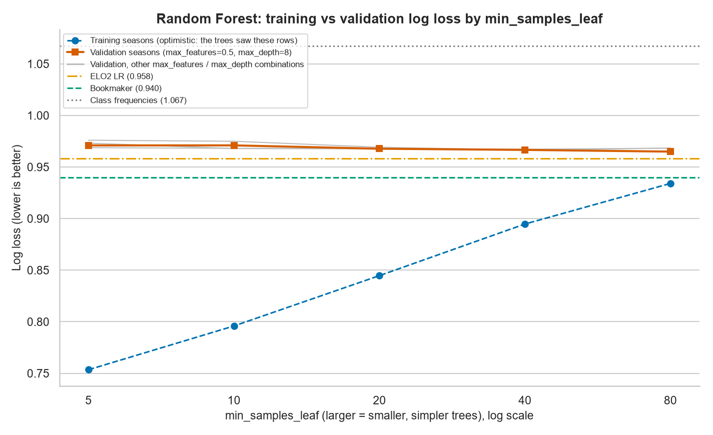
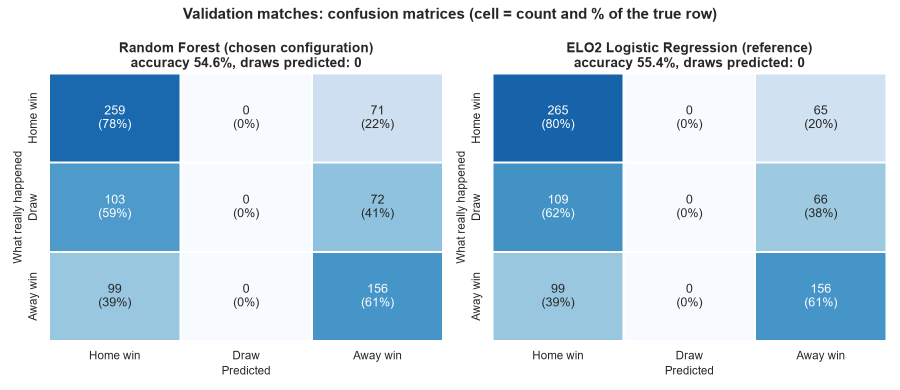
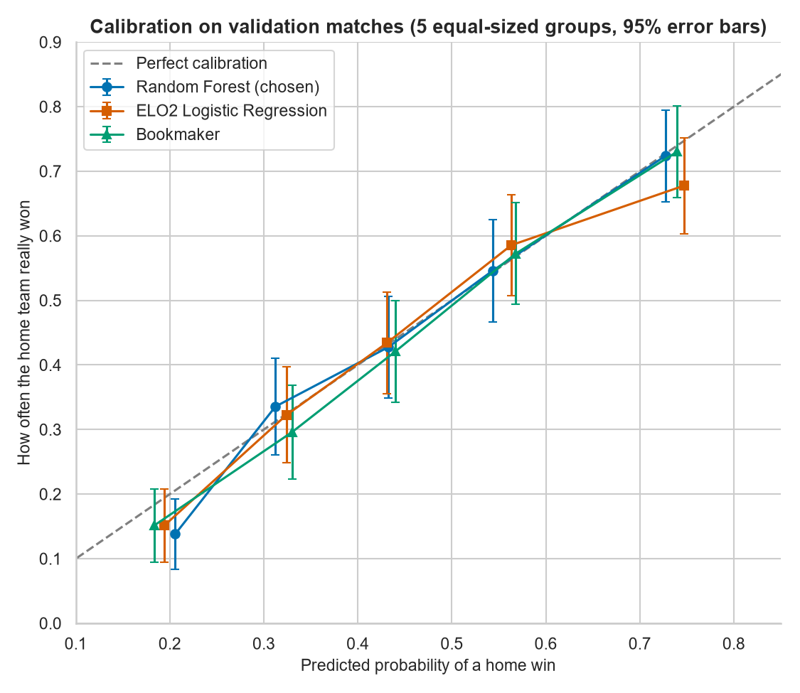
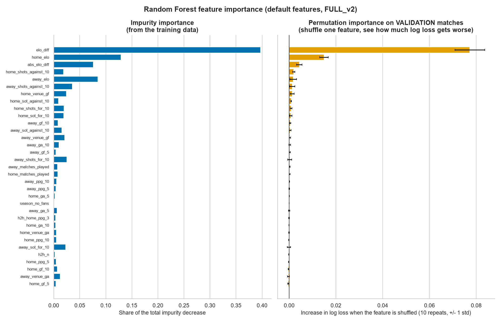
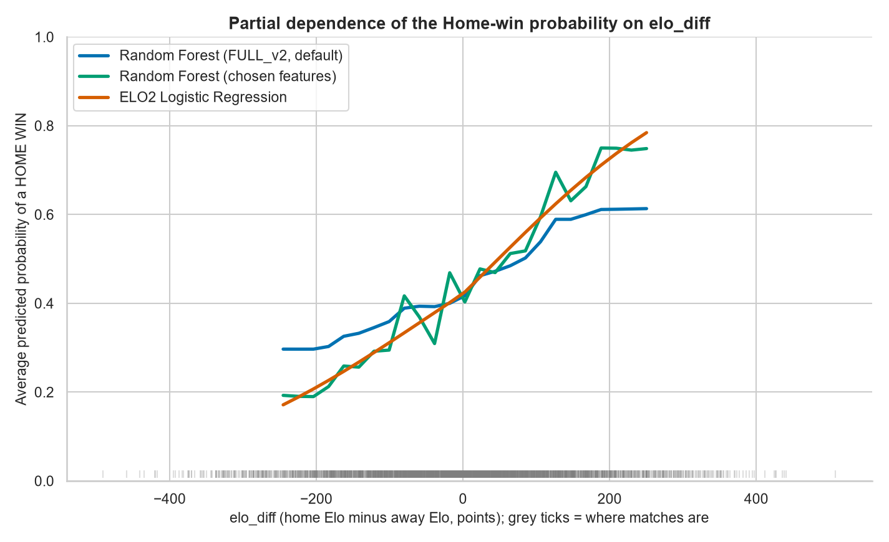
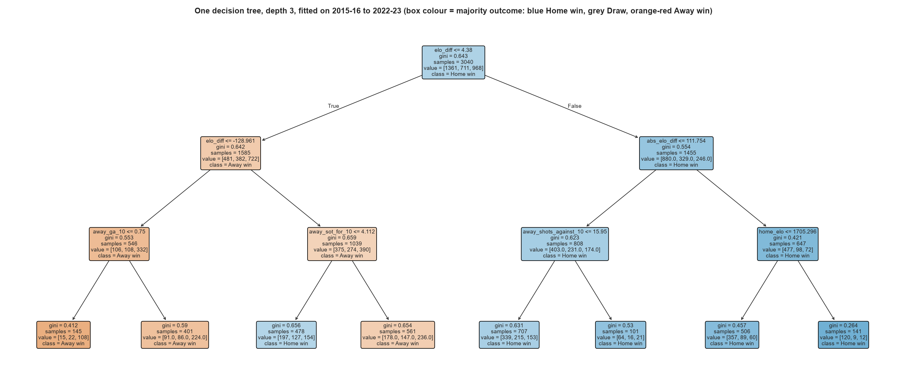

# Lesson 05b: Random Forest

**Stage goal in one sentence:** Train a Random Forest the same careful way as the Logistic Regression (validation seasons only, a noise rule for every decision), understand what it learned, and compare it honestly with the ELO2 Logistic Regression and the bookmaker.

**Files created or changed:**
- `src/modeling_utils.py` (extended): the level-neutral DIFF features, the v3 feature-set builder and a check that DIFF is same-row arithmetic
- `src/rf.py`: grid tuning, the five experiments, importance, partial dependence, tree plot, figures, final models
- `src/check_rf.py`: the checks for this stage (11 checks, including perturbation tests)
- `data/processed/feature_sets_v3.json` and `feature_sets_v3.sha256`: the frozen Random Forest feature sets and their recorded hash
- `reports/ablations_rf.csv`: every experiment with its numbers and decision
- `reports/val_predictions_5b.csv`: validation probabilities of the forests, both Logistic Regressions, class frequencies and the bookmaker
- `models/random_forest.joblib` (+ `random_forest_config.json`): the forest chosen by the noise rule; `models/random_forest_full_reference.joblib` (+ config): the default FULL_v2 forest, kept as a reference row for Stage 6
- `reports/figures/19_rf_validation_curve.png`, `20_rf_confusion_matrix.png`, `21_rf_calibration.png`, `22_rf_importance.png`, `23_rf_partial_dependence.png`, `24_rf_tree_depth3.png`
- `docs/decisions.md` (updated) and `docs/learning/05b_random_forest.md`: this lesson

---

## 1. The big picture
In 5a a very simple model (Logistic Regression on two Elo numbers) reached a validation log loss of 0.9582, while the bookmaker is at 0.9400. The obvious next question is: can a more flexible model squeeze out more? A Random Forest can find curves, thresholds and interactions that a straight-line model cannot. It has a long reputation for working well on tables of numbers, so it is a fair challenger. The honest answer from our data is in section 5, and it is not what you might hope: the forest does **not** beat the simple model. Learning *why* is the real value of this stage.

**The test-set rule is unchanged:** the 2025-26 season is not touched. Every choice uses the two validation seasons (2023-24 and 2024-25, 760 matches), with models trained on 2015-16 to 2022-23. The code guards from 5a still refuse to load test rows.

## 2. What we built
1. **Four frozen feature sets** (written to `feature_sets_v3.json` and its hash, SHA-256 `9ca21047...`, recorded *before* any forest result was seen; v1 and v2 are untouched):

   | Set | Features | What it is |
   |---|---|---|
   | FULL_v2 | 33 | everything except the league-average feature; keeps head-to-head; the default |
   | REDUCED | 24 | the v2 REDUCED set (redundant twins and head-to-head removed) |
   | ELO2 | 2 | `elo_diff`, `abs_elo_diff` |
   | DIFF | 16 | **level-neutral differences**: `diff_X` = home_X minus away_X for 12 statistics (points, goals for and against over 5 and 10 matches, shots and shots on target for and against, venue goals for and against), plus `elo_diff`, `abs_elo_diff`, `season_no_fans`, `home_matches_played` |

   *Why DIFF?* In 5a we saw that goal and shot averages ran about 0.3 standard deviations higher in the validation seasons (the 2023-24 scoring jump). A **difference** between the two teams cancels a shift that raises both teams' numbers. DIFF is computed in code from existing columns, with same-row arithmetic only (no other match is involved), so it cannot leak. `features.csv` was not changed.
2. **A Random Forest** (500 trees, fixed random seed) tuned on a grid of 20 combinations, scored by validation log loss.
3. **Five experiments**, one change at a time, judged by the same noise rule as 5a.
4. **Understanding tools:** two kinds of feature importance, a partial-dependence plot, and one readable depth-3 tree.
5. **Final models**, refit on all ten training seasons and saved (0.8 MB each, far below the 50 MB limit), not scored on the test season.

## 3. New concepts (explained simply)

### 3a. A single decision tree first
- **Decision tree:** a flowchart of yes/no questions about the features. Start at the top ("root"), answer a question such as "is `elo_diff` at most 4.38?", follow the arrow, answer the next question, and so on until you reach a box with no more questions (a **leaf**). The leaf predicts the share of home wins, draws and away wins among the training matches that ended up there. Figure 24 (below) is a real one.
- **How one split is chosen: Gini impurity.** "Impurity" measures how mixed a group is. **Gini impurity = 1 - (p_home² + p_draw² + p_away²)**, where p is the share of each outcome. A group that is all home wins has Gini 0 (pure); a group split evenly three ways has Gini 0.667 (very mixed). A good question splits a group into two groups that are *less mixed* than before.
- **Worked example with our real counts (fit seasons 2015-16 to 2022-23, 3,040 matches).**
  - All 3,040 matches: Home win 1,361, Draw 711, Away win 968. Shares: 0.448, 0.234, 0.318. Gini = 1 - (0.448² + 0.234² + 0.318²) = **0.6435**.
  - Question: "is `elo_diff` above 50?"
    - **No** (`elo_diff` at most 50): 2,001 matches (Home 678, Draw 499, Away 824). Gini = **0.6534**. This group is slightly *more* mixed than the start: the home team has no Elo edge.
    - **Yes** (above 50): 1,039 matches (Home 683, Draw 212, Away 144). Shares 0.657, 0.204, 0.139. Gini = **0.5070**. A purer group: the home team is clearly stronger and wins most of the time.
  - Impurity **after** the split = the weighted average = (2,001 x 0.6534 + 1,039 x 0.5070) / 3,040 = **0.6034**.
  - **Impurity decrease** = 0.6435 - 0.6034 = **0.0401**.
  - The tree does not use my guess of 50. It tries *every feature and every threshold* and takes the one with the biggest decrease. Its own best first question is "`elo_diff` at most 4.38?", with a decrease of **0.0432** (left group 1,585 matches, Gini 0.642; right group 1,455 matches, Gini 0.554). It then asks the same thing again inside each group.
- **A tree on its own overfits.** It can keep asking questions until each leaf holds a handful of matches, and it will happily memorise the noise. In football the result is mostly luck, so that is a real danger. `min_samples_leaf` (no leaf may hold fewer than this many matches) and `max_depth` (a limit on the number of questions in a row) hold it back. In Figure 24 no leaf has "Draw" as its biggest outcome, and even the leaf with the most draws has only 30% draws ([339, 215, 153] home/draw/away), which is why a tree will almost never *predict* a draw.

### 3b. Then the forest
- **Random Forest:** many trees (here 500) whose answers are averaged. Each tree is made different in two ways: (1) it is trained on a **bootstrap sample**: 3,040 matches drawn *with replacement* from the 3,040 (so some matches appear twice, about a third are left out); (2) at each question it may only look at a **random subset of the features** (`max_features`). The trees therefore make different mistakes.
- **Why averaging helps (analogy).** Ask one pundit for a prediction and you get their personal quirks. Ask 500 pundits who each studied slightly different matches and look at different statistics, and the quirks cancel while what they all agree on remains. Averaging many noisy-but-unbiased guesses gives a more stable guess.
- **Where the probabilities come from.** Each tree gives the class shares of its leaf; the forest averages them across trees. Example from our data (Man City v Liverpool, 25 Nov 2023, which ended 1-1, with the default forest trained on 2015-16 to 2022-23): three of the 500 trees said [Home 48%, Draw 28%, Away 24%], [65%, 16%, 19%] and [44%, 29%, 27%]. Their average is [52%, 24%, 23%]. All 500 trees together gave [Home 56.7%, Draw 24.5%, Away 18.8%]. The match was a draw, so its log loss was -ln(0.245) = 1.41.
- **Compared with KNN.** Both are "local" methods: they predict from similar past matches. KNN finds the K nearest matches by **distance** over all features, so features must be scaled (otherwise big numbers dominate) and irrelevant features hurt. A tree asks **one threshold question about one feature at a time** ("is it above 4.38?"). Multiplying a feature by 10 only moves the threshold from 4.38 to 43.8, and the split is the same, so **trees need no scaling**. Trees also pick the useful features themselves.
- **Hyperparameters** (settings we choose before training):
  - `n_estimators` = 500: the number of trees. More trees give a more stable average; they do not cause overfitting.
  - `min_samples_leaf`: larger means simpler, smoother trees (less overfitting, more underfitting). With 80 our trees end up with a median of about 99 matches per leaf.
  - `max_features`: how many features each question may look at ("sqrt" is 5 of the 33 features; 0.5 means half, 16). Fewer features makes the trees more different from each other.
  - `max_depth`: the maximum number of questions in a row (None = unlimited, or 8).

### 3c. Importance and understanding
- **Impurity importance:** how much total impurity decrease each feature produced across all the trees *while training*. It is biased toward features with many different values, such as shot averages: they offer many thresholds, so they get more chances to find a split that looks good by luck on the training data. Correlated "twin" features (`home_elo`, `away_elo`, `elo_diff`) split the credit between them.
- **Permutation importance:** take the *validation* matches, shuffle one feature's column (destroying its link to the result) and measure how much the log loss gets worse. If it barely changes, the model was not really using that feature. It uses data the forest did not train on, so it does not reward lucky splits. Twins can hide each other (when one is shuffled, the other still carries the information).
- **Partial dependence:** vary one feature over a range while keeping everything else as it is, and average the predictions. It shows the shape the model has learned for that one feature.
- **Calibration of forest probabilities:** averaging many trees pulls predictions toward the middle and away from 0 and 1, because the average of bounded leaf shares cannot be more extreme than the leaves, and a few trees that disagree soften it. Fully grown trees (tiny leaves) also give noisy leaf shares. On our validation seasons the forest's predictions are indeed less extreme than the Logistic Regression's: its highest predicted home-win probability is 0.83, against 0.93 for the Logistic Regression (and 0.88 for the bookmaker).

## 4. How the code works
- `modeling_utils.py`: `add_diff_features(table)` creates the `diff_X` columns on a **copy** (each value uses two columns of its own row and nothing else). `verify_diff_is_row_local` proves it: the same values after shuffling the rows and when computed one row at a time. `build_feature_sets_v3` writes the frozen sets.
- `rf.py`:
  - `make_rf(cfg)` builds a `RandomForestClassifier` (500 trees, fixed `random_state`). There is no scaler in the pipeline: trees do not need one.
  - `fit_rf` and `rf_proba` go through `make_xy`, the guarded function from 5a that refuses any table containing a test row.
  - `tune_grid` tries the 20 combinations of `min_samples_leaf` {5, 10, 20, 40, 80}, `max_features` {"sqrt", 0.5}, `max_depth` {None, 8}. `tune_leaf_only` re-tunes only `min_samples_leaf` for another feature set (experiment a).
  - `run_experiments` runs the one-change-at-a-time experiments and applies the same `decide` rule as 5a. `permutation_importance` (from scikit-learn) uses log loss as the score, 10 shuffles and a fixed seed.
  - `save_rf` refits on 2015-16 to 2024-25, saves compressed and checks the size.
- `check_rf.py`: 11 checks. The most important is the **perturbation test for the DIFF features**: change one match's score and shots, rebuild every feature from scratch, and confirm that the DIFF values of that match and of every earlier match are identical.

## 5. Results and how to read them

### The comparison (validation seasons, 760 matches)
| Predictor | Accuracy | Log loss | Macro-F1 | Brier | Draws predicted |
|---|---|---|---|---|---|
| Always Home win | 43.4% | not defined | 0.202 | 1.132 | 0 |
| Class frequencies | 43.4% | 1.0675 | 0.202 | 0.646 | 0 |
| Bookmaker | 56.8% | 0.9400 | 0.422 | 0.556 | 0 |
| ELO2 Logistic Regression | 55.4% | 0.9582 | 0.412 | 0.569 | 0 |
| FULL reference Logistic Regression | 55.5% | 0.9577 | 0.410 | 0.568 | 1 |
| **Random Forest, default (FULL_v2, min_samples_leaf 80, max_features 0.5, max_depth 8)** | 55.9% | 0.9649 | 0.417 | 0.572 | 0 |
| Random Forest, chosen by the rule (ELO2 features) | 54.6% | 0.9733 | 0.406 | 0.577 | 0 |

**Paired bootstrap (improvement in log loss; positive = the forest is better):**
- Default forest vs ELO2 Logistic Regression: **-0.0067 [-0.0135, +0.0006]**. The interval includes zero, so we cannot say it is worse, but it is certainly not better.
- Default forest vs FULL Logistic Regression: -0.0073 [-0.0177, +0.0030] (cannot tell).
- Default forest vs bookmaker: -0.0249 [-0.0359, -0.0131]: **the bookmaker is clearly better**.
- Forest chosen by the rule (2 features) vs ELO2 Logistic Regression: **-0.0151 [-0.0239, -0.0056]**: clearly worse on identical inputs.

**Draws:** the default forest predicted **0 draws** (draw precision, recall and F1 are all 0), exactly like the Logistic Regression and the bookmaker. As in EDA Figure 11 and Lesson 05a, a draw is almost never the single most likely outcome (the forest's highest draw probability on validation is 33.5%), so a model that predicts the most likely outcome never says "draw". Its draw *probabilities* are still useful; its draw *predictions* are not.

### Figure 19: the validation curve (overfitting)


*What am I looking at?* For the chosen `max_features` and `max_depth`, the forest's log loss against `min_samples_leaf`: on the training seasons (blue dashed) and on the validation seasons (orange). The faint grey lines are the other combinations. *What does it tell us?* With tiny leaves (5) the training loss is **0.75**, far better than the validation 0.97: the trees have memorised the training matches. Larger leaves bring the training loss up (0.93 at 80) while the validation loss slowly *improves* (0.9709 to 0.9649). That gap is **overfitting**. (The training loss is optimistic by design: each tree has seen most of those rows.) *Honest reading:* the validation line is nearly flat; the whole grid spans only 0.9649 to 0.9759. The best value, 80, is the **edge of our grid**, so a larger leaf size might be even better (we did not test it). A "bad" result would be a validation line that rises steeply as the leaves shrink.

### Figure 20: confusion matrices


Left: the forest chosen by the rule; right: the ELO2 Logistic Regression. Both are very similar: they find 78% to 80% of home wins and 61% of away wins, and neither ever predicts a draw (the draw column is empty).

### Figure 21: calibration


Matches are sorted by predicted home-win probability into five groups; each point shows the average prediction against how often the home team really won. The forest, the Logistic Regression and the bookmaker all sit close to the diagonal and within each other's error bars; the lowest group is over-optimistic for the forest (predicted 21%, actual 14%) and the Logistic Regression (19% vs 15%), which matches the 2024-25 season having few home wins (see below). We did not find the forest to be badly calibrated here, mainly because `min_samples_leaf` = 80 forces smooth leaf shares.

### The experiments (one change at a time; validation log loss; improvement = default minus alternative)
Default forest: FULL_v2, `min_samples_leaf` 80, all 8 fit seasons, warm-up rows included: log loss 0.9649, accuracy 55.9%.

| Experiment | Option | Log loss | Accuracy | Improvement [95% interval] | Verdict |
|---|---|---|---|---|---|
| a. Feature set (leaf size re-tuned) | REDUCED (24) | 0.9647 | 55.7% | +0.0002 [-0.0017, +0.0022] | cannot tell |
| | ELO2 (2) | 0.9733 | 54.6% | -0.0084 [-0.0169, +0.0005] | cannot tell (barely): the simplest set is kept by the rule |
| | DIFF (16) | 0.9586 | 56.3% | +0.0063 [-0.0006, +0.0134] | cannot tell |
| b. Head-to-head | without | 0.9654 | 56.1% | -0.0005 [-0.0018, +0.0009] | cannot tell |
| c. `season_no_fans` | exclude | 0.9649 | 55.7% | 0.0000 [-0.0012, +0.0013] | cannot tell |
| d. Training window | last 3 (extra row) | 0.9696 | 55.3% | -0.0047 [-0.0125, +0.0032] | cannot tell |
| | last 5 | 0.9661 | 55.0% | -0.0012 [-0.0058, +0.0034] | cannot tell |
| | all 8, recency weights | 0.9657 | 55.1% | -0.0008 [-0.0057, +0.0039] | cannot tell |
| e. Warm-up rows | exclude | 0.9649 | 56.1% | -0.0000 [-0.0018, +0.0018] | cannot tell |

**What this means.** *Not one* of the changes is clearly better or clearly worse than the default: the data cannot tell any of them apart. Under the noise rule, ties go to the simpler option, which gives: feature set ELO2 (a), without head-to-head (b), without `season_no_fans` (c; both moot once the set is ELO2), all 8 seasons with no weights (d) and warm-up rows kept (e). We added the "last 3 seasons" row because `CLAUDE.md` asks for the last 3, 5 and all seasons; it is not clearly different from the others.

**A problem with the rule, honestly.** "Keep the simpler option" picks ELO2 as the feature set, and a forest on two features is **clearly worse than the Logistic Regression on the same two features** (-0.0151 [-0.0239, -0.0056]). The ELO2 interval against the default only just includes zero (upper end +0.0005). So the rule gave a legal but unhelpful answer. DIFF has the lowest loss (0.9586) and the best score in *both* validation seasons, but not clearly better, and choosing it now would be a post-hoc choice. I flagged this for review, and after review the team **confirmed the rule's choice: the primary Random Forest is the ELO2 forest** (`docs/decisions.md`). To keep Stage 6 fair we saved both the rule's forest (ELO2) and the default FULL_v2 forest as a reference row, matching the Logistic Regression pair in 5a.

### Figure 22: feature importance


Both panels are for the default forest (33 features). *Left, impurity importance* (from training): `elo_diff` 0.40, `home_elo` 0.13, `away_elo` 0.085, `abs_elo_diff` 0.076, then shot features such as `away_shots_against_10` (0.036), `away_shots_for_10` (0.025) and `away_sot_for_10` (0.023). *Right, permutation importance on validation:* shuffling `elo_diff` makes the log loss worse by **0.077** (error bar +/-0.006); `home_elo` by 0.015; `abs_elo_diff` by 0.004; every other feature by 0.002 or less. For `away_shots_against_10` the impurity share was 0.036 but the permutation damage is only 0.0013; for `away_sot_for_10` it is -0.0001 (shuffling does nothing). **12 of the 33 features do not hurt at all when shuffled.** That is exactly the bias we described: impurity importance credits finely-valued, noisy shot features that the forest does not really need on unseen matches. Also note how the three Elo twins split the credit.

### Figure 23: partial dependence on `elo_diff`


The average predicted home-win probability as `elo_diff` goes from -245 to +250 (the 5th to 95th percentile). The **ELO2 Logistic Regression** (orange-red) is a smooth S-curve from 17% to 78%. The **forest on ELO2 features** (green) follows the same path (19% at -245, 41% at 0, 75% at +250) but wiggles: the zigzags (for example the dip near -40 and the bump near -80) are noise, not football. So **we found no convincing non-linear shape**: the relationship is basically smooth and increasing, which a Logistic Regression already captures. The **default forest** (blue) looks flatter (30% to 61%), but that is partly an artifact: the curve changes `elo_diff` while `home_elo` and `away_elo` keep their real values, and the forest also uses those twin features.

### Figure 24: one tree you can read


How to read it: start at the top box. Each box shows the question, the Gini impurity, the number of matches, the counts [home wins, draws, away wins] and the biggest outcome. Follow "True" (left) or "False" (right). The first question is `elo_diff` at most 4.38. Weaker home team (left): a further question at -128.96, then things like `away_ga_10` (goals conceded by the away team). Stronger home team (right): `abs_elo_diff` at most 111.75, then shots conceded and `home_elo`. The purest leaf (bottom right: 141 matches, [120, 9, 12]) says: the home team is much stronger and has high Elo: 85% home wins. No leaf has Draw as its biggest outcome.

### Why the forest does not beat a 2-feature Logistic Regression here (from our own numbers)
1. **The signal is one smooth relationship.** Elo difference carries almost everything (permutation importance 0.077 for `elo_diff` against at most 0.015 for any other feature), and its effect is smooth and increasing (Figure 23). A Logistic Regression describes that with about three numbers per outcome. A forest has to learn it as a set of steps from leaves holding about 99 noisy matches each, which gives a lumpy estimate.
2. **The outcome is mostly luck.** With 3,040 training matches and results this noisy, flexibility mostly fits noise (Figure 19).
3. **The other 31 features add little:** 12 of 33 do nothing when shuffled and none adds more than 0.015.
4. **Drift** (next paragraph).
A forest would win if there were strong interactions or threshold effects, or far more data. We found no sign of either.

### How the drift finding showed up
- In 5a we found that goal and shot rolling features run about 0.3 standard deviations higher in the validation seasons. A tree splits on thresholds learned in training, so a systematic upward shift moves matches into different leaves. The **level-neutral DIFF set** was the best set in *both* validation seasons (log loss 0.9227 and 0.9946, against 0.9308 and 0.9990 for FULL_v2, 0.9296 and 0.9998 for REDUCED, 0.9382 and 1.0084 for ELO2), which is consistent with the idea, but the difference against FULL_v2 is within noise ([-0.0006, +0.0134]), so it is only a hint.
- **2024-25 was a hard season for everyone.** The home team won only 40.8% of the time (EDA Figure 2; 46.1% in 2023-24). The ELO2 Logistic Regression scored 0.9852 in 2024-25, better than every forest (DIFF 0.9946, FULL_v2 0.9990, REDUCED 0.9998, ELO2 1.0084). Per-season log loss for each predictor:

  | Predictor | 2023-24 | 2024-25 | Change |
  |---|---|---|---|
  | Bookmaker | 0.9092 | 0.9708 | +0.062 |
  | ELO2 Logistic Regression | 0.9313 | 0.9852 | +0.054 |
  | FULL_v2 forest | 0.9308 | 0.9990 | +0.068 |
  | ELO2 forest | 0.9382 | 1.0084 | +0.070 |
  | Class frequencies | 1.0540 | 1.0809 | +0.027 |

  *Every* predictor got worse in 2024-25, and every one over-predicted home wins: the average predicted home-win probability was 44.6% (bookmaker), 45.2% (ELO2 Logistic Regression), 45.4% (FULL_v2 forest) and 44.8% (ELO2 forest), against 40.8% real. The forests lost more than the Logistic Regression, so the Logistic Regression's advantage is clear only in that season: ELO2 Logistic Regression vs ELO2 forest +0.0233 [+0.0102, +0.0362] in 2024-25 but +0.0070 [-0.0059, +0.0201] in 2023-24; vs the default forest +0.0139 [+0.0035, +0.0238] in 2024-25 and -0.0005 [-0.0101, +0.0096] in 2023-24. *Caution:* a low home-win season hurting all predictors, and the more variable forest probabilities most, is a plausible explanation but not a proven one, and splitting the validation set by season after seeing the results is a post-hoc look at 380 matches per season.
- The warm-up experiment showed no effect for the forest (-0.0000), unlike for the Logistic Regression in 5a. That is consistent with the Logistic Regression effect having been caused by `league_avg_goals_prev380`, which is not in any of these sets.

## 6. Common mistakes and gotchas
- **Reading impurity importance as truth.** It rewards noisy, finely-valued features and splits credit between twins. Use permutation importance on unseen data as the check.
- **Judging a forest by its training score.** Training log loss is optimistic (0.75 at tiny leaves). Only validation counts.
- **Assuming a more flexible model must win.** Here the simplest model is at least as good.
- **Scaling for trees.** Unnecessary: trees only compare a feature with a threshold.
- **Too many comparisons on 760 matches.** The grid, the five experiments and four feature sets are a lot of looks at one validation set; that is why we use the bootstrap rule, and why we only trust clear differences.
- **A rule can give an unhelpful answer.** The "simpler option" rule chose a two-feature forest that a two-feature Logistic Regression beats clearly. The rule is a safeguard, not an oracle.
- **Grid edge.** `min_samples_leaf` = 80 is the edge of the grid. After review the team decided **not** to extend it (the time is better spent on XGBoost), so we know a larger leaf size might do slightly better and accept that.
- **Test-set leakage.** None: the code guards, the frozen file hash, and the perturbation test for DIFF are all checked in `check_rf.py`.
- **Known pitfalls from `CLAUDE.md` addressed in this stage:** *Metrics* (log loss, macro-F1, per-class results and confusion matrix, not accuracy alone); *small sample noise* (a paired bootstrap on 760 matches and a stated accuracy noise of about 1.8 points, applied to the validation set); *bookmaker benchmark* (scored on validation, never a feature); *training window* (last 3, last 5, all 8 and recency weights, all compared on the validation seasons); *Elo warm-up and promoted teams* (warm-up rows were included, and the experiment checked excluding them); *level shifts / drift* (the DIFF set and the drift-based removal of the league average).
- **Decisions made after review** (recorded in `docs/decisions.md`): (1) the **primary Random Forest is the ELO2 forest**, as chosen by the noise rule; (2) the **FULL_v2 forest stays as the reference model** saved alongside it, like the Logistic Regression pair in 5a, and both are scored on the test set together in Stage 6; (3) the leaf-size grid is **not** extended. **DIFF is a diagnostic only:** it had the best validation score but within noise (+0.0063 [-0.0006, +0.0134]), so in Stage 6 it will be scored on the test set *as a diagnostic, labelled as such, and not treated as a competing primary model*. Its configuration is fixed in advance (DIFF set, 500 trees, `min_samples_leaf` 80, `max_features` 0.5, `max_depth` 8, all ten training seasons) so that it cannot become a tuning step.

## 7. Check yourself
1. Write the Gini impurity of a group with 50 home wins, 25 draws and 25 away wins. Is it purer or more mixed than a group with 90 home wins, 5 draws and 5 away wins?
2. How does a Random Forest make each tree different from the others, and why does averaging many different trees give a steadier prediction than one tree?
3. A match is sent through three trees and their leaves say [60%, 20%, 20%], [50%, 30%, 20%] and [40%, 30%, 30%] for home/draw/away. What probabilities does the forest give?
4. Why do trees not need scaling when KNN does?
5. Impurity importance ranks `away_shots_against_10` much higher than permutation importance does. Explain why.
6. In Figure 19 the training log loss falls from 0.93 to 0.75 as `min_samples_leaf` goes from 80 to 5, but the validation loss does not improve. What is happening?
7. Why did the forest not beat the ELO2 Logistic Regression, and what did the partial-dependence plot tell us?

## 8. Try it yourself
Save this as `try_leaf.py` in the project folder (not in `src/`) and run `python try_leaf.py` with the environment active:
```python
import sys
sys.path.insert(0, "src")                      # lets us import our own modules
from modeling_utils import load_features, add_diff_features, get_slice, load_feature_sets
from rf import score_rf, make_rf_config

rows = add_diff_features(load_features())      # training rows only: the test set cannot be loaded
fit, val = get_slice("fit", rows), get_slice("validation", rows)
features = load_feature_sets(version=3)["FULL_v2"]
for leaf in (2, 20, 200):
    result = score_rf(make_rf_config(features, leaf, 0.5, 8), fit, val)
    print(f"min_samples_leaf = {leaf:>3}: training log loss {result['train_loss']:.4f}, "
          f"validation log loss {result['metrics']['log_loss']:.4f}")
```
Before running it, predict: for `min_samples_leaf` = 2, will the training log loss be much lower or much higher than for 200? Will the validation log loss for 2 be better or worse than for 20? Which setting overfits and which underfits? Then run it and compare with your predictions, and with Figure 19.

## 9. How this connects to the report
This stage feeds the **Models** section (second model), the **Evaluation** section (why log loss, F1 and a confusion matrix; why draws are hard) and the **Comparison** section (a flexible model against a simple one and the bookmaker). It also shows that we understand the model, which the course requires.

*Draft paragraph:* "As a second model we trained a Random Forest of 500 decision trees. Each tree is trained on a bootstrap sample of the matches and may only look at a random subset of the features at each question; the forest averages the class shares of the trees' leaves to obtain probabilities for home win, draw and away win. Hyperparameters and feature sets were chosen on two validation seasons (2023-24 and 2024-25) with models trained on 2015-16 to 2022-23, and the 2025-26 test season was kept unseen. The best forest reached a validation log loss of 0.965 and 55.9% accuracy, which is not distinguishable from, and numerically behind, a Logistic Regression that uses only the Elo difference (0.958, 55.4%), and clearly behind the bookmaker (0.940, 56.8%). Permutation importance shows that almost all of the predictive information is in the Elo difference (shuffling it raises the log loss by 0.077; no other feature by more than 0.015), and the partial-dependence curve shows a smooth, increasing relationship that a Logistic Regression already captures. Like all our models, the forest almost never predicts a draw."

---

## Answers to "Check yourself"
1. Shares 0.50, 0.25, 0.25: Gini = 1 - (0.25 + 0.0625 + 0.0625) = 1 - 0.375 = **0.625**. For 90, 5, 5: Gini = 1 - (0.81 + 0.0025 + 0.0025) = **0.185**. The first group is much more mixed; the 90/5/5 group is purer.
2. Each tree gets a different bootstrap sample of the matches (drawn with replacement) and, at every question, a random subset of the features, so the trees make different mistakes. Averaging 500 such trees cancels their individual quirks and keeps what they agree on, so the prediction is steadier (less variance) than that of one tree.
3. The average of the three: home (60 + 50 + 40) / 3 = **50%**; draw (20 + 30 + 30) / 3 = **26.7%**; away (20 + 20 + 30) / 3 = **23.3%**.
4. A tree only asks whether one feature is above a threshold, so stretching or shrinking a feature just moves the threshold; the split is the same. KNN adds up differences across all features to get a distance, so a feature with large numbers would dominate unless the features are put on the same scale.
5. Impurity importance is computed from training data and rewards features with many possible thresholds (such as shot averages): they offer many chances to find a split that looks good by luck. Permutation importance uses unseen validation matches, so it shows the real contribution, which for that feature is tiny (0.0013 log loss).
6. Overfitting. Tiny leaves let the trees memorise the training matches (the training score looks excellent), but that memorised noise does not carry over to new matches, so the validation score does not improve.
7. Almost all the information is in one smooth, increasing relationship (the Elo difference), which a Logistic Regression describes with a few numbers while the forest has to estimate it as lumpy steps from noisy leaves; the other features add very little; and the partial-dependence plot showed no real non-linear shape (the zigzags are noise).
