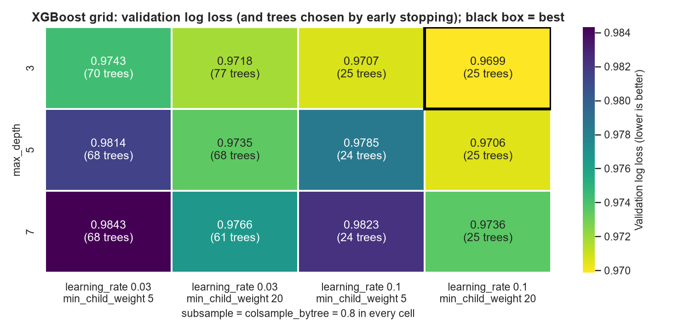
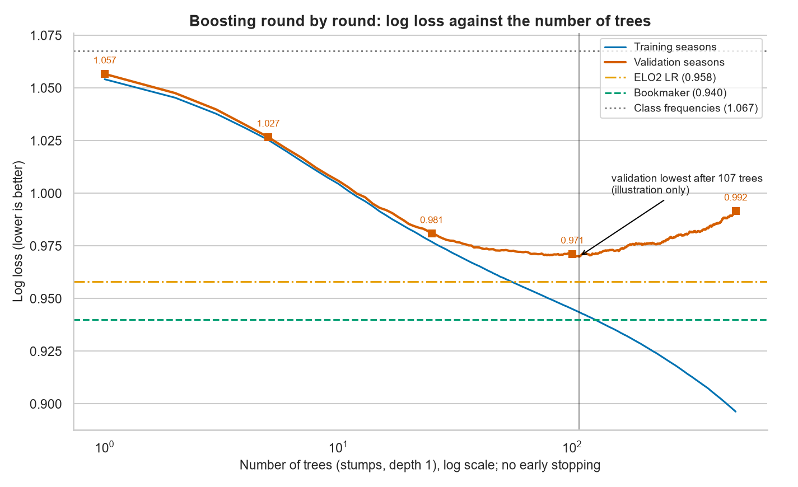
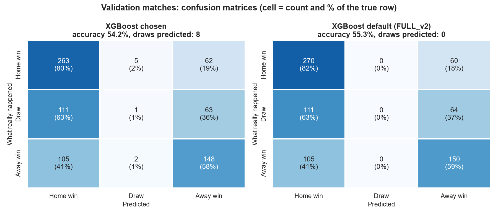
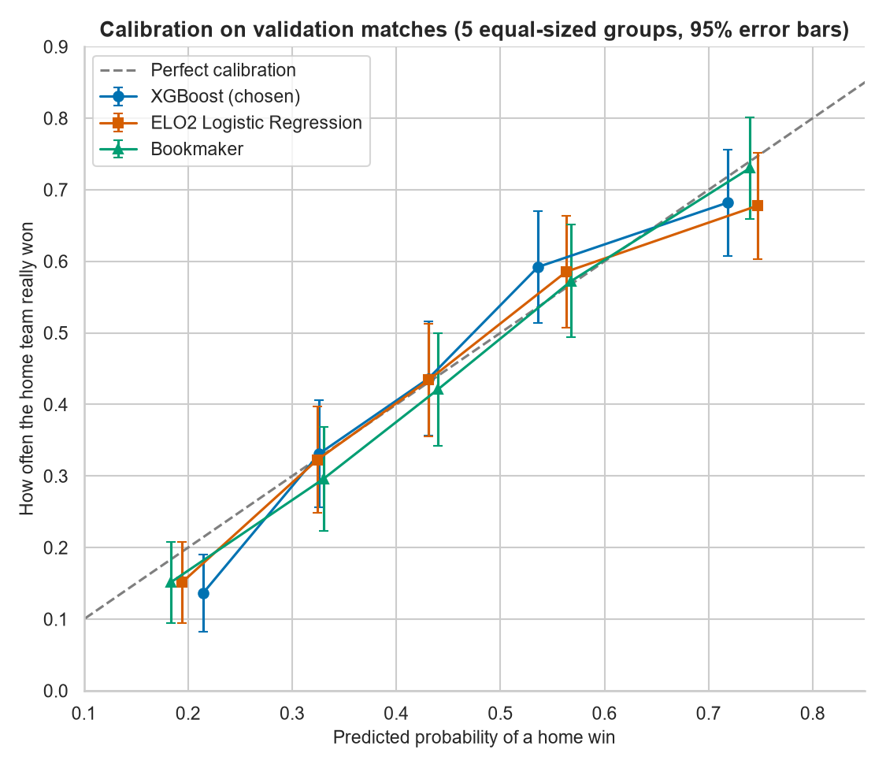
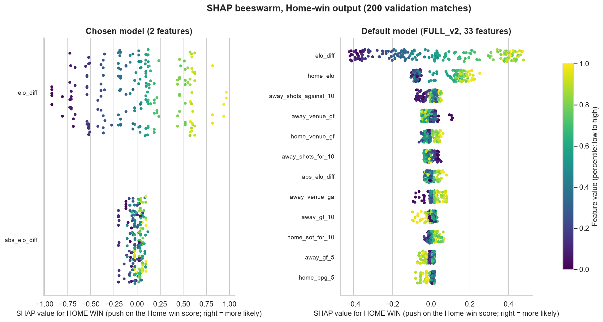
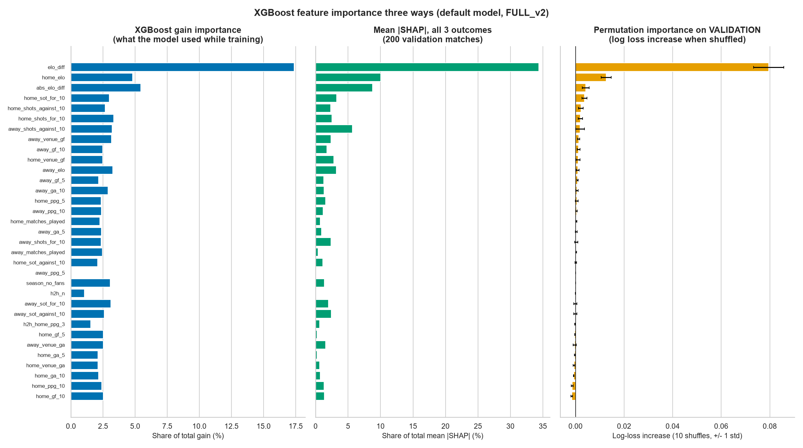
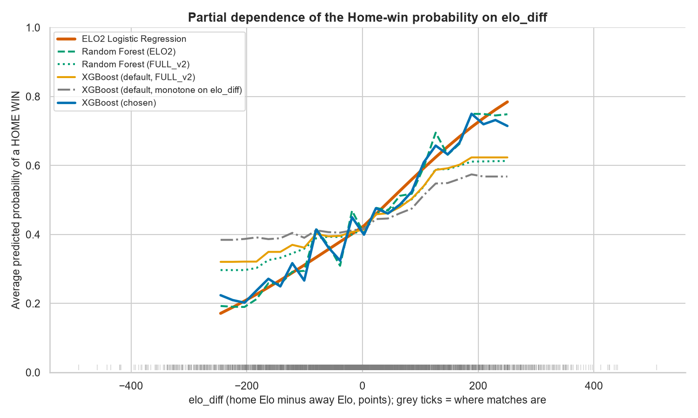

# Lesson 05c: XGBoost

**Stage goal in one sentence:** Train a gradient-boosted tree model (XGBoost) with the same careful protocol as before, understand how boosting works round by round, and compare it honestly with the ELO2 Logistic Regression, the Random Forests and the bookmaker.

**Files created or changed:**
- `src/xgb.py`: grid tuning, early stopping, the six experiments, boosting curve, SHAP, importance, partial dependence, figures, final models
- `src/check_xgb.py`: the checks for this stage (11 checks, including the early-stopping audit)
- `reports/ablations_xgb.csv`: every experiment with its numbers and decision (plus two diagnostics)
- `reports/val_predictions_5c.csv`: validation probabilities of XGBoost (default and chosen), both Logistic Regressions, both Random Forests, class frequencies and the bookmaker
- `reports/xgb_early_stopping_audit.json`: one entry per early-stopping run (which seasons were used to fit and to stop)
- `models/xgboost.joblib`, `models/xgboost.ubj`, `models/xgboost_config.json`: the model chosen by the noise rule; `models/xgboost_full_reference.*`: the default FULL_v2 model, a reference row for Stage 6 (same pattern as 5a and 5b)
- `reports/figures/25_xgb_tuning_heatmap.png` to `31_xgb_partial_dependence.png`
- `docs/decisions.md` (updated) and `docs/learning/05c_xgboost.md`: this lesson
- `requirements.txt` is unchanged (`xgboost` was already listed; we did not need the `shap` package, see section 3)

---

## 1. The big picture
Logistic Regression draws one smooth curve. A Random Forest averages hundreds of independent trees. **XGBoost** uses a third idea, **boosting**: build small trees one after another, each one trained to fix the mistakes that the trees so far still make. On many tables of numbers boosting is the strongest off-the-shelf method, so it deserves a fair trial. The honest result from our data is the same as for the forest: it does **not** beat the simple model that uses only the Elo difference, and it is clearly behind the bookmaker. We will see why.

**The test-set rule is unchanged:** the 2025-26 season is not touched. Every choice uses the two validation seasons (2023-24 and 2024-25, 760 matches), with models trained on 2015-16 to 2022-23. The guards from 5a still refuse to load test rows.

## 2. What we built
1. **The same four frozen feature sets** from Stage 5b (`feature_sets_v3.json`, no new version): FULL_v2 (33 features), REDUCED (24), ELO2 (2), DIFF (16 level-neutral differences).
2. **XGBoost** (`multi:softprob`, three probabilities per match, no scaling), tuned on a deliberately small grid of 12 combinations: `max_depth` {3, 5, 7}, `learning_rate` {0.03, 0.1}, `min_child_weight` {5, 20}, with `subsample` and `colsample_bytree` fixed at 0.8.
3. **Early stopping on data that is not the main validation set** (see section 3).
4. **Six experiments**, one change at a time: feature set, head-to-head, `season_no_fans`, training window, warm-up rows, and a monotone constraint.
5. **Tools to understand the model:** boosting round by round with stumps, three kinds of feature importance (gain, SHAP, permutation) and a partial-dependence plot.
6. **Final models**, refit on all ten training seasons (each well under 1 MB; limit 50 MB), not scored on the test season.

**The comparison (validation seasons, 760 matches):**

| Predictor | Accuracy | Log loss | Macro-F1 | Brier | Draws predicted |
|---|---|---|---|---|---|
| Always Home win | 43.4% | not defined | 0.202 | 1.132 | 0 |
| Class frequencies | 43.4% | 1.0675 | 0.202 | 0.646 | 0 |
| Bookmaker | 56.8% | 0.9400 | 0.422 | 0.556 | 0 |
| ELO2 Logistic Regression | 55.4% | 0.9582 | 0.412 | 0.569 | 0 |
| FULL reference Logistic Regression | 55.5% | 0.9577 | 0.410 | 0.568 | 1 |
| Random Forest ELO2 | 54.6% | 0.9733 | 0.406 | 0.577 | 0 |
| Random Forest FULL_v2 | 55.9% | 0.9649 | 0.417 | 0.572 | 0 |
| **XGBoost default (FULL_v2; max_depth 3, learning_rate 0.1, min_child_weight 20, 25 rounds)** | 55.3% | 0.9699 | 0.410 | 0.574 | 0 |
| XGBoost chosen by the noise rule (ELO2 features, 57 rounds) | 54.2% | 0.9714 | 0.407 | 0.576 | 8 |

**Paired bootstrap (improvement in log loss; positive = XGBoost is better):**

| XGBoost vs | default (FULL_v2) | chosen (ELO2) |
|---|---|---|
| ELO2 Logistic Regression | **-0.0117 [-0.0208, -0.0019]** (clearly worse) | **-0.0132 [-0.0224, -0.0038]** (clearly worse) |
| Bookmaker | **-0.0299 [-0.0420, -0.0169]** (bookmaker clearly better) | **-0.0315 [-0.0449, -0.0173]** (bookmaker clearly better) |
| Random Forest ELO2 | +0.0035 [-0.0070, +0.0134] (cannot tell) | +0.0019 [-0.0030, +0.0069] (cannot tell) |
| Random Forest FULL_v2 | -0.0050 [-0.0103, +0.0004] (cannot tell, leaning worse) | -0.0065 [-0.0161, +0.0025] (cannot tell) |

## 3. New concepts (explained simply)

### Boosting from scratch
- **The idea.** Start with a bad predictor and improve it in small steps. Each step adds one small tree that is trained *not* on the matches' results but on **what the current predictor still gets wrong**. Add the new tree's output, scaled down by a small number (the **learning rate**), to the current scores. Repeat. The final score is the sum of all the small trees' outputs, and **softmax** (from Lesson 05a) turns the three scores into probabilities.
- **Which "mistake" does a tree learn? The gradient.** For log loss and softmax there is a very simple answer. For each match and each outcome, the **gradient** is **p - y**: the predicted probability minus 1 if it happened (0 if not). It says "how much, and in which direction, should this outcome's score move". A match that ended in a draw has a negative gradient for the draw score (raise it) and positive gradients for the other two (lower them). The **hessian** p(1 - p) measures how sure the model already is; XGBoost uses both to decide the size of each leaf's step: **leaf value = -(sum of gradients) / (sum of hessians + lambda)** (lambda = 1 here keeps steps cautious).
- **A worked example with our real numbers (fit seasons 2015-16 to 2022-23, 3,040 matches).**
  - Start with a predictor that "knows nothing": the class shares, Home win 1,361 (44.77%), Draw 711 (23.39%), Away win 968 (31.84%), so probabilities [0.448, 0.234, 0.318].
  - Take the match Man City v Liverpool, 25 Nov 2023 (a validation match that ended 1-1, a draw). Its gradient at the start is p - y = [0.448, -0.766, 0.318]: the draw score should go up, the Home and Away scores down.
  - Now the first small tree for the **Home-win score**. To keep every number checkable we use the question from Figure 24, "is `elo_diff` at most 4.38?" (the real XGBoost searches for its own best question and builds one tree per outcome in each round). **Left group** (`elo_diff` at most 4.38): 1,585 matches, of which only 481 were home wins. We predicted 44.8% home wins for all of them, so we over-predicted: sum of gradients = 1,585 x 0.4477 - 481 = **+228.6**; sum of hessians = 1,585 x 0.4477 x 0.5523 = 391.9; leaf value = -228.6 / (391.9 + 1) = **-0.582**; times the learning rate 0.1 = **-0.058**. **Right group** (above 4.38): 1,455 matches, 880 home wins: sum of gradients **-228.6**, hessians 359.8, leaf value **+0.634**, times 0.1 = **+0.063**. So the first tree lowers the Home-win score by 0.058 for matches with a weak home team and raises it by 0.063 otherwise.
  - What our default model then does to that match: after 1 round the probabilities are [Home 0.460, Draw 0.235, Away 0.305]; after 5 rounds [0.502, 0.236, 0.262]; after 25 rounds (where early stopping ended) [0.607, 0.238, 0.155]. The Home-win chance went up because Man City were the stronger side, the Away chance down; the draw chance hardly moved: **the features contain nothing that predicts a draw**, so no tree raises it. The match's log loss ended at -ln(0.238) = 1.437 and its gradient is still [0.607, -0.762, 0.155]: a draw is a mistake the model cannot learn to fix.
  - **A "tree" in our numbers means a boosting round.** With three outcomes XGBoost builds one small tree per outcome in every round, so 25 rounds are 75 small trees.
- **Compared with the Random Forest (5b).** A forest builds its trees independently and averages them (this reduces random variation). Boosting builds trees one after another, each correcting the last (this reduces systematic error). A forest cannot overfit by adding trees; boosting can: after enough rounds it starts fitting noise (Figure 26).
- **Compared with KNN.** KNN stores all matches and averages the nearest ones; boosting learns a short, fixed list of small rules and discards the data. Like any tree method it needs no scaling: a question is "is this number above a threshold?".

### The hyperparameters (settings we choose before training)
- `max_depth`: how many questions in a row each small tree may ask (3 means at most 8 leaves). Deeper trees capture more interactions but also fit more noise.
- `learning_rate` (eta): how much of each tree's output is added. Small values (0.03) learn slowly and need more rounds; large values (0.3) learn fast and overshoot. In our data: learning rate 0.01 needs 243 rounds, 0.1 needs 25 and 0.5 needs only 4, with about the same training loss.
- `min_child_weight`: the least "evidence" (sum of hessians) a leaf must hold; larger means fewer tiny leaves, less overfitting.
- `subsample` (0.8): each tree is trained on a random 80% of the matches; `colsample_bytree` (0.8): each tree may only use a random 80% of the features. Both add randomness, like in a forest, and reduce overfitting. (With only 2 features, 80% means each tree sees just one of them.)
- `reg_lambda` (1.0) and `reg_alpha` (0): penalties on large leaf values.
- `n_estimators` (the number of rounds, capped at 2,000) and **early stopping** (stop when the validation score has not improved for 50 rounds): the number of rounds is the most important overfitting control.

### Early stopping on data that is NOT the main validation set
Early stopping needs a score to watch. If we watched the same validation seasons that we then use to report the model's score, we would have chosen the number of rounds *by looking at the answers*: the number is picked where the curve happens to be lowest, so the reported score is flattered. That is a **leakage mistake**, even though no test row is involved: the final score is no longer an honest estimate. (Figure 26 shows it: of 500 rounds, the lowest point of the validation curve is, by definition, the best-looking one.)

What we did instead, in two steps, always on a time-ordered split *inside* the data the model may use:
1. Fit on the earlier seasons of the window and watch the log loss on its **last two seasons**. For the default model: fit on 2015-16 to 2020-21, watch 2021-22 and 2022-23. The round where the watched loss stops improving is the number of rounds.
2. Refit on the **whole** window (all 8 fit seasons) with exactly that number of rounds, and score it on the validation seasons 2023-24 and 2024-25 for the first time.

The validation seasons are never used for stopping when a model is scored on them. (The two *final* models, refit on all ten seasons, choose their rounds by stopping on 2023-24 and 2024-25; they are not scored on those seasons again.) The check script verifies this for all 32 early-stopping runs behind scored models and at the level of individual matches. In the grid we also recorded the early-stopped model on its own: 0.9758 against 0.9699 for the refit.

### Monotone constraints
A **monotone constraint** tells the model "the output may only rise (or only fall) as this feature rises". For an Elo-driven problem it is natural: a bigger Elo edge should never make a home win *less* likely, so any wiggle in that direction (like the zigzags we saw in the forest's partial-dependence plot) is noise. We set +1 on `elo_diff` and 0 on every other feature. **What we found:** it made no difference to the validation score (-0.0004 [-0.0047, +0.0041]) and, in this multi-class setting, it does not do what we hoped. XGBoost applies the constraint to *every* outcome's score, and a probability depends on the three scores relative to each other, so the Home-win probability can still fall: even with `elo_diff` as the only Elo feature, 9 of the 24 steps of the Home-win curve still go down (11 without the constraint). In the 33-feature model the unconstrained `home_elo` and `away_elo` twins can bypass the constraint altogether. A truly monotone Home-win probability would need a different construction (for example a separate yes/no Home-win model with the constraint); we did not try it.

### Three importances, and SHAP in one paragraph
- **Gain** (XGBoost's own measure): how much each feature improved the training loss when the trees used it for splits. It answers "**what did the model use while training?**" and can credit features the model used on noise.
- **Permutation importance**, measured on the validation seasons: shuffle one feature's column and see how much the log loss gets worse. It answers "**does the model's prediction on new data depend on this feature?**" Twin features can hide each other.
- **SHAP values:** a way of splitting each single prediction into contributions from each feature, in a fair way (it comes from game theory: how to share a total among players). For one match, the contributions add up to the difference between this match's score and the average score. We compute them with XGBoost's own exact tree algorithm (the same one the `shap` package uses; we did not need to install that package). The mean absolute SHAP value over many matches (we used 200 validation matches) is a third importance, and the beeswarm plot shows direction as well.
- **Which to trust when:** gain tells you how the model was built (useful for debugging, but biased toward features with many split points); permutation and SHAP tell you what drives predictions on new data (SHAP for *how* and in which direction, permutation for *how much the score depends on it*). When they disagree, prefer permutation measured on unseen data for "is it worth keeping this feature?".

## 4. How the code works
- `xgb.py`:
  - `make_xgb(cfg, n_estimators)` builds an `XGBClassifier` (`multi:softprob`, `num_class` 3, `tree_method` "hist", one thread so every run is exactly reproducible). There is no scaler.
  - `find_n_trees` is step 1 of early stopping (fit on the earlier seasons of the window, stop on its last two) and records the seasons used in an audit list; `fit_xgb` is step 2 (refit on the whole window); `score_xgb` scores on the validation seasons.
  - `tune_grid` runs the 12 combinations; `tune_depth_only` is used in experiment a; `run_experiments` applies the same `decide` rule as 5a and 5b.
  - `boosting_curve` trains stumps (depth 1) for 500 rounds and scores after every round; `shap_values` calls XGBoost's `pred_contribs`; `save_xgb` saves `.joblib` (compressed) and `.ubj` (XGBoost's own format) and checks the file size.
- `check_xgb.py`: 11 checks. Most important: the early-stopping audit (every run behind a scored model fits and stops inside 2015-16 to 2022-23, and the matches used for stopping share no match_id with the validation matches), and that the `.ubj` and `.joblib` files give the same predictions.

## 5. Results and how to read them

### Figure 25: the tuning grid


Each cell is one combination: validation log loss and the number of rounds early stopping chose. Darker/purple is worse, yellow better. The best cell (black box) is `max_depth` 3, `learning_rate` 0.1, `min_child_weight` 20: **0.9699 with 25 rounds**. Moving down (deeper trees) or left (smaller `min_child_weight`) makes the validation score worse, while the training loss keeps falling (0.93 for the best cell, 0.735 for depth 7 with `min_child_weight` 5): deeper, less restrained trees only fit noise. The best cell sits at three edges of our grid (smallest depth, largest learning rate, largest `min_child_weight`), so even simpler or more cautious settings may be better; we did not test them. The whole grid spans only 0.9699 to 0.9843.

### Figure 26: boosting round by round


Stumps (trees with one question) trained for 500 rounds with *no* early stopping. After 1 round the validation log loss is 1.057 (almost the "knows nothing" level, 1.067); after 5 rounds 1.027; after 25 rounds 0.981; after 100 rounds 0.971; the lowest point is **0.9699 after about 107 rounds**; then it rises to 0.992 after 500 rounds while the training loss keeps falling (0.896). That is boosting reducing error step by step, and then **overfitting**. The curve never reaches the ELO2 Logistic Regression (0.958) or the bookmaker (0.940). (The lowest point is shown only as an illustration; it was not used to choose anything.)

### Figure 27: confusion matrices, and draws


Left: the model chosen by the rule; right: the default. Both find 80% to 82% of home wins and 58% to 59% of away wins. The default model predicts **0 draws** (draw precision, recall and F1 are all 0). The chosen model predicts **8 draws**, of which 1 is right (precision 0.125, recall 0.006, F1 0.011): not useful. Its highest draw probability is only 0.373. As before, a draw is almost never the single most likely outcome, so a model that predicts the most likely outcome hardly ever says "draw".

### Figure 28: calibration, and no over-sharpening


Matches are sorted by predicted home-win probability into five groups; each point is the average prediction against how often the home team really won. XGBoost (blue) follows the diagonal about as well as the Logistic Regression and the bookmaker, within the error bars. The lowest group is over-optimistic (predicted 22%, actual 14%; for the Logistic Regression 19% vs 15%), consistent with the low home-win season 2024-25. **Over-sharpening** (probabilities pushed too close to 0 or 1) is typical of boosting with very small `min_child_weight` and many rounds. We do not see it, because early stopping ended after only 25 rounds: the default model's largest Home-win probability is 0.81 (95th percentile 0.756), against 0.93 (0.792) for the Logistic Regression and 0.88 (0.785) for the bookmaker.

### Figure 29: SHAP beeswarm


How to read it: each row is a feature (biggest effect on top); each dot is one of the 200 validation matches; the horizontal position is the SHAP value for **Home win** (right = pushes toward a home win); the colour is the feature's value for that match (purple = low, yellow = high). *Right panel (default model, 33 features):* for `elo_diff` the dots go from purple on the left (a weak home team pushes down by up to about 0.42) to yellow on the right (a strong home team pushes up by up to about 0.48): the expected pattern. `home_elo`: high values push up (about +0.15). `away_gf_10` (goals scored by the away team): high values (yellow) push down. But look at `home_ppg_5`: high values push *down*, which makes no football sense: it is the "twin" effect: its information is already in `home_elo` and the model compensates. *Left panel (the chosen 2-feature model):* only `elo_diff` and `abs_elo_diff`; the same colour gradient for `elo_diff`.

### Figure 30: the three importances


All three panels are for the default model, sorted by permutation importance. `elo_diff` is first on all three: gain 17.4%, mean |SHAP| 34.4% of the total, and shuffling it makes the validation log loss worse by **0.0795**. The ranks then diverge. `home_elo` is 3rd by gain but 2nd by SHAP and permutation (+0.0126). `season_no_fans` has a gain of 3.0% (rank 9: the trees used it during training to isolate 2020-21) but permutation importance **0.0000** and SHAP rank 18: in every validation match it is 0, so shuffling it changes nothing. This is exactly the difference between "mattered to the model" and "mattered to predictions on new data". `away_ppg_5` is never used (gain 0); `h2h_n` has gain rank 32 of 33. **13 of the 33 features do not hurt at all when shuffled.** Gain spreads over almost all features (most have 2% to 3%) because trees with `colsample_bytree` 0.8 and noisy data split on everything; permutation concentrates on the Elo features.

### Figure 31: partial dependence on `elo_diff`


The average predicted home-win probability as `elo_diff` goes from -245 to +250. The ELO2 Logistic Regression (thick orange-red) is a smooth S-curve from 17% to 78%. The XGBoost model on the two Elo features (blue) and the forest on the same two features (green dashed) follow it with zigzags (11 of 24 steps go down for XGBoost): that is noise, not a shape. The default XGBoost (orange, 32% to 62%) and the forest on all 33 features (green dotted) are much flatter: the curve changes `elo_diff` while `home_elo` and `away_elo` keep their real values, and the models use those twins too. The monotone version (grey dash-dot) is flatter still (38% to 57%) and, as explained above, still not monotone (5 of 24 steps down). **No real non-linear shape was found.**

### The experiments (one change at a time from the default; validation log loss; improvement = default minus alternative)
Default: FULL_v2, `max_depth` 3, `learning_rate` 0.1, `min_child_weight` 20, all 8 fit seasons, warm-up rows included, 25 rounds: log loss 0.9699, accuracy 55.3%.

| Experiment | Option | Log loss | Accuracy | Improvement [95% interval] | Verdict |
|---|---|---|---|---|---|
| a. Feature set (`max_depth` re-tuned) | REDUCED (24) | 0.9716 | 55.7% | -0.0017 [-0.0064, +0.0028] | cannot tell |
| | ELO2 (2), 57 rounds | 0.9714 | 54.2% | -0.0016 [-0.0113, +0.0083] | cannot tell: simplest, chosen by the rule |
| | DIFF (16) | 0.9651 | 55.8% | +0.0048 [-0.0034, +0.0135] | cannot tell |
| b. Head-to-head | without | 0.9697 | 55.1% | +0.0001 [-0.0028, +0.0032] | cannot tell |
| c. `season_no_fans` | exclude | 0.9702 | 55.0% | -0.0003 [-0.0031, +0.0026] | cannot tell |
| d. Training window | last 3 (extra row) | 0.9818 | 55.5% | -0.0120 [-0.0231, -0.0008] | **clearly worse** |
| | last 5 | 0.9735 | 55.3% | -0.0037 [-0.0103, +0.0027] | cannot tell |
| | all 8, recency weights | 0.9771 | 56.1% | -0.0072 [-0.0144, 0.0000] | interval ends exactly at zero: not better, probably worse |
| e. Warm-up rows | exclude | 0.9684 | 55.4% | +0.0015 [-0.0038, +0.0067] | cannot tell |
| f. Monotone constraint | `elo_diff` increasing | 0.9703 | 55.8% | -0.0004 [-0.0047, +0.0041] | cannot tell |

**What this means.** Nothing is clearly *better* than the default. The only clear result is that using just the last 3 seasons is worse, so more history is better here (again). Ties go to the simpler option, which gives ELO2 for the feature set (and moot choices for b and c), all 8 seasons without weights, warm-up rows kept, and no monotone constraint. Two diagnostics (not used to choose): the monotone constraint on ELO2 (+0.0008 [-0.0046, +0.0059]) and on DIFF (+0.0007 [-0.0045, +0.0058]) also made no difference.

**The same problem with the rule as in 5b.** "Keep the simpler option" chose a boosted model on two Elo features that is **clearly worse than the Logistic Regression on the same two features** (-0.0132 [-0.0224, -0.0038]). The default 33-feature model is also clearly worse than it (-0.0117 [-0.0208, -0.0019]). I flagged this for your decision (`docs/decisions.md`): both models were saved, so Stage 6 can score the rule's choice and the default together, as in 5a and 5b.

### Why XGBoost did not beat the 2-feature Logistic Regression or the bookmaker (from our own numbers)
1. **The signal is one smooth relationship** (the Elo edge), and a Logistic Regression fits it with a few numbers. A tree model approximates a smooth line with steps, and with results this noisy those steps wobble (Figure 31).
2. **Only about 3,000 noisy training matches.** Boosting needs few rounds before it starts to fit noise: early stopping ended after 25 rounds, and the stump curve turns up after about 107 rounds. Deeper, more flexible trees were worse across the whole grid.
3. **The other 31 features add almost nothing:** 13 of 33 do nothing when shuffled, and the three Elo features account for 53% of the total mean |SHAP|. (SHAP shares: `elo_diff` 34.4%, `home_elo` 10.0%, `abs_elo_diff` 8.7%, then everything else under 6% each.)
4. **The bookmaker knows more** than our features: injuries, line-ups, news. It is clearly better than every model of ours (by about 0.018 to 0.033 log loss).
5. **Boosting vs the forest:** XGBoost's default is numerically slightly behind the FULL_v2 forest (-0.0050 [-0.0103, +0.0004]) and about equal to the ELO2 forest; the data cannot separate them. With data this small and noisy, neither tree method has an advantage.

### How the drift finding showed up (if at all)
- The level-neutral **DIFF** set was again the best set in **both** validation seasons (log loss 0.9313 and 0.9989, against 0.9384 and 1.0013 for FULL_v2, 0.9384 and 1.0048 for REDUCED, 0.9408 and 1.0021 for ELO2), but the difference against FULL_v2 is within noise (+0.0048 [-0.0034, +0.0135]), so it is a hint, not a result. (In 5b it was best in both seasons too.)
- **The monotone constraint, the "principled fix", did not help:** it gave no improvement on any feature set and did not make the Home-win curve monotone.
- **2024-25 again:** the ELO2 Logistic Regression scored 0.9852, better than XGBoost's 1.0013 (default) and 1.0021 (chosen) and the ELO2 forest's 1.0084; the bookmaker 0.9708. All models over-predicted home wins in that season (home teams won 40.8%): XGBoost default predicted 46.4% on average, chosen 44.8%, ELO2 Logistic Regression 45.2%, bookmaker 44.6%.

## 6. Common mistakes and gotchas
- **Early stopping on the validation set you report.** The leakage mistake described above; our audit and the check script verify that we did not do it.
- **Too many rounds.** Boosting overfits (Figure 26); the number of rounds must be chosen on unseen data.
- **Deeper is not better.** Every deeper setting in the grid was worse on validation, while the training loss fell.
- **Trusting one importance measure.** Gain, SHAP and permutation answer different questions (Figure 30).
- **Reading SHAP signs on correlated features.** `home_ppg_5` pushes the wrong way because its twin `home_elo` already carries the information.
- **Assuming a constraint does what its name says.** The monotone constraint did not make the Home-win probability monotone in multi-class mode. We checked.
- **A rule can give an unhelpful answer.** The "simpler option" rule chose a model that a simpler model beats clearly.
- **Grid edges.** `max_depth` 3, `learning_rate` 0.1 and `min_child_weight` 20 are all at the edge of the grid.
- **Many comparisons on 760 matches.** The grid, six experiments and four feature sets are many looks at one validation set; only clear differences count.
- **Known pitfalls from `CLAUDE.md` addressed in this stage:** *Metrics* (log loss, macro-F1, per-class results and confusion matrix, not accuracy alone); *small test-set noise* (paired bootstrap on 760 matches; accuracy noise about 1.8 points); *bookmaker benchmark* (scored on validation, never a feature); *training window* (last 3, last 5, all 8 and recency weights, all compared on the validation seasons, never on 2025-26); *Elo warm-up and promoted teams* (warm-up rows kept and tested); *level shifts / drift* (the DIFF set, the monotone-constraint experiment and the per-season checks).
- **Decisions to review** (in `docs/decisions.md`): which XGBoost goes to Stage 6 (the rule's ELO2 model or the default FULL_v2 model; both saved); whether DIFF should also be a test diagnostic for XGBoost, as it is for the forest; the grid edges; whether to try a two-model monotone construction.

## 7. Check yourself
1. A match ended in a draw. The current model gives [Home 0.50, Draw 0.20, Away 0.30]. What is the gradient (p - y) for each outcome, and what does it tell the next tree to do?
2. What is the difference between how a Random Forest and XGBoost use many trees?
3. With `learning_rate` 0.1 early stopping chose 25 rounds; with 0.01 it chose 243 and with 0.5 only 4. Why?
4. Why must the number of rounds not be chosen by watching the same validation seasons that we use to report the score? What did we do instead?
5. `season_no_fans` had a gain importance of 3.0% but a permutation importance of exactly 0. What does this tell you about the difference between the two?
6. What is a monotone constraint, and why did it not give us a monotone Home-win probability here?
7. Why did XGBoost not beat the ELO2 Logistic Regression, and which result in the figures supports your answer?

## 8. Try it yourself
Save this as `try_eta.py` in the project folder (not in `src/`) and run `python try_eta.py` with the environment active:
```python
import sys
sys.path.insert(0, "src")                      # lets us import our own modules
from modeling_utils import load_features, add_diff_features, get_slice, load_feature_sets
from xgb import score_xgb, make_xgb_config

rows = add_diff_features(load_features())      # training rows only: the test set cannot be loaded
fit, val = get_slice("fit", rows), get_slice("validation", rows)
features = load_feature_sets(version=3)["FULL_v2"]
for eta in (0.01, 0.1, 0.5):
    result = score_xgb(make_xgb_config(features, 3, eta, 20), fit, val)
    print(f"learning_rate = {eta:>4}: {result['n_trees']:>4} trees chosen by early stopping, "
          f"training log loss {result['train_loss']:.4f}, validation log loss {result['metrics']['log_loss']:.4f}")
```
Before running it, predict: will the smallest learning rate (0.01) need more or fewer rounds than 0.5, and roughly how many times more? Will the best validation log loss differ much between the three? Then run it, compare with your predictions, and explain what the product (learning rate x rounds) tells you.

## 9. How this connects to the report
This stage feeds the **Models** section (third model), the **Evaluation** section and the **Comparison** section: a boosted-tree model against a simple one, a forest and the bookmaker, with a clear account of overfitting control (early stopping) and explainability (SHAP, permutation importance).

*Draft paragraph:* "As a third model we trained XGBoost, a gradient-boosted tree model that adds small trees one at a time, each trained to correct the errors of the ensemble so far. The number of boosting rounds was chosen by early stopping on a time-ordered split inside the training seasons, so that the validation seasons (2023-24 and 2024-25) were never used for stopping. The best model reached a validation log loss of 0.970 and 55.3% accuracy, clearly behind a Logistic Regression that uses only the Elo difference (0.958, 55.4%) and clearly behind the bookmaker (0.940, 56.8%); it was indistinguishable from the Random Forest. Shuffling the Elo difference worsens the log loss by 0.080, whereas 13 of the 33 features have no measurable effect, and SHAP values confirm that the Elo difference dominates the predictions. A monotone constraint on the Elo difference did not change the result. Like all our models, XGBoost almost never predicts a draw."

---

## Answers to "Check yourself"
1. y = [0, 1, 0], so p - y = [0.50, -0.80, 0.30]. A negative gradient means "raise this outcome's score" and a positive one "lower it": the next tree is asked to raise the Draw score (by a lot) and lower Home win and Away win.
2. A Random Forest trains its trees independently (each on a random sample) and averages them, which reduces random variation. XGBoost trains its trees one after another, each one fitted to the mistakes (gradients) of the ensemble so far, which reduces systematic error; it can overfit if you add too many.
3. With a small learning rate each tree adds only a tiny correction, so many rounds are needed to reach the same fit; with a large one each round makes a big step, so a few rounds are enough (and may overshoot). The product learning rate x rounds stays roughly similar (0.01 x 243 = 2.4, 0.1 x 25 = 2.5, 0.5 x 4 = 2.0).
4. If the stopping point is picked where the validation curve is lowest, the reported score on those same seasons is flattered (we chose the number of rounds by looking at the answers). Instead we fitted on the earlier seasons of the window, stopped on its last two seasons (2021-22 and 2022-23 for the default), and then refit on the whole window with that number of rounds before scoring on 2023-24 and 2024-25.
5. Gain measures what the model used while training: the trees used `season_no_fans` to separate 2020-21. Permutation importance measures what the predictions on new data depend on: in all validation matches the feature is 0, so shuffling it changes nothing. A feature can matter to the model without mattering to new predictions.
6. A constraint that forces the output to rise (or fall) with a feature. In XGBoost's multi-class mode it is applied to each outcome's score, and the Home-win probability depends on all three scores relative to each other, so it can still fall (9 of 24 steps did, even with `elo_diff` as the only Elo input). Other unconstrained Elo features (`home_elo`, `away_elo`) can also bypass it.
7. Almost all the information is in one smooth, increasing relationship (the Elo difference), which a Logistic Regression fits with a few numbers, while the boosted trees approximate it with noisy steps and overfit quickly (Figure 26 turns upward after about 107 rounds; 13 of 33 features do nothing when shuffled). The paired bootstrap shows it directly: XGBoost is clearly worse than the ELO2 Logistic Regression (-0.0117 [-0.0208, -0.0019]).
