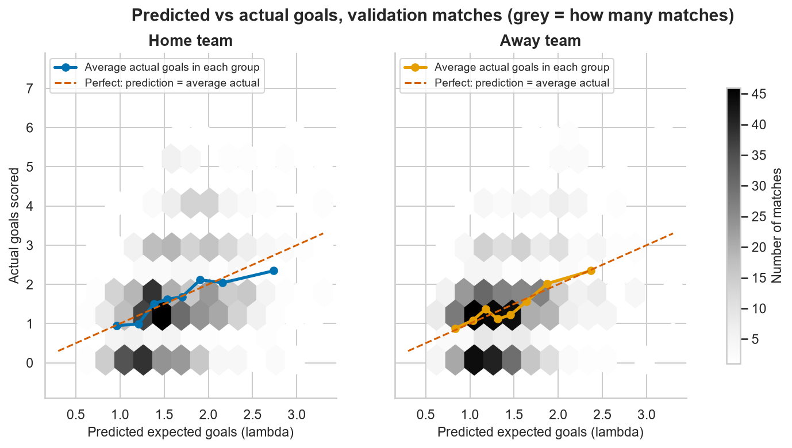
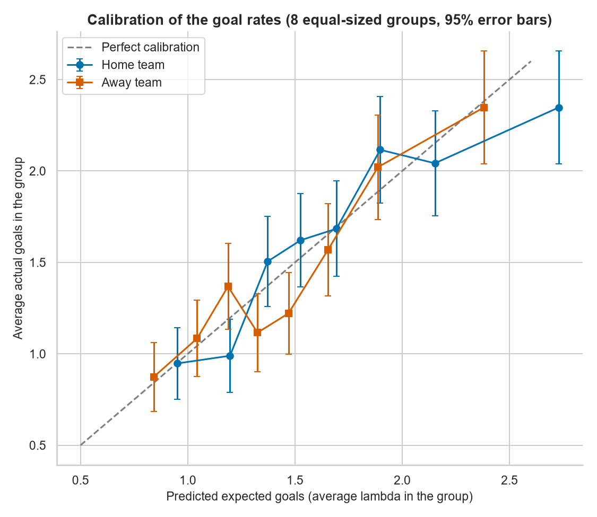
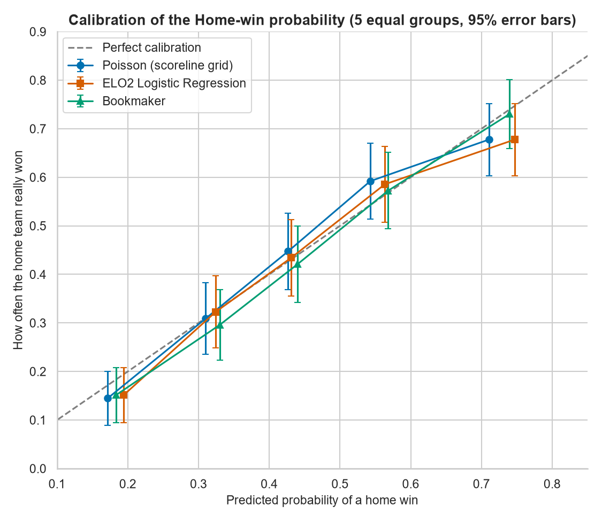
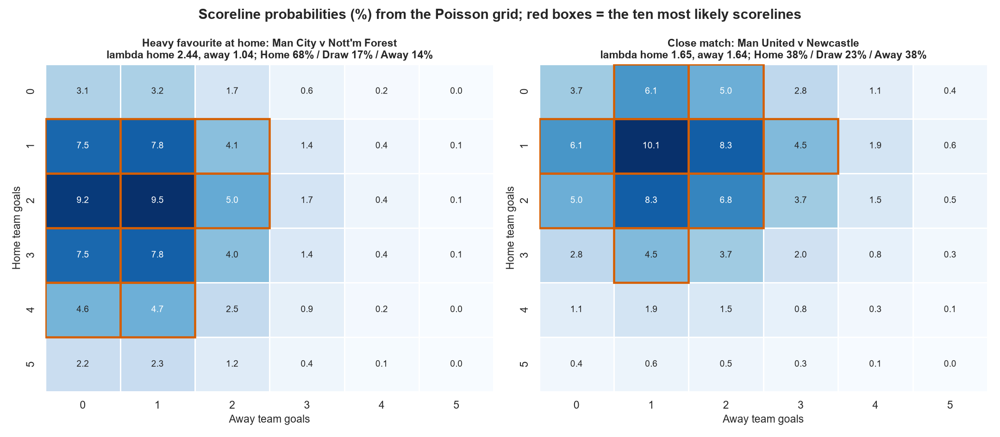
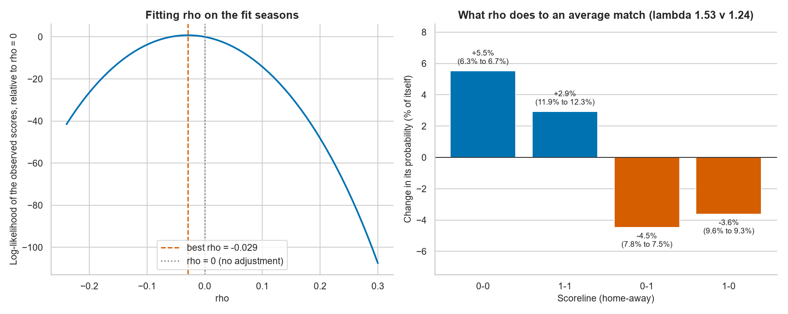

# Lesson 05d: Poisson regression for goals

**Stage goal in one sentence:** Build a model that predicts how many goals each team is expected to score (`lambda_home` and `lambda_away`), and use those two numbers to predict scores, to get Home/Draw/Away probabilities, and as the raw rates for the Stage 7 season simulation.

**Files created or changed:**
- `src/features_goals.py` and `data/processed/features_goals.csv`: level-neutral goal features (same 4,180 rows as `matches_clean.csv`; `features.csv` is unchanged), `data/processed/goal_feature_params.json`
- `src/poisson_model.py`: the Poisson model, the scoreline grid and the Dixon-Coles tools (also used by Stage 7)
- `src/poisson.py`: the three models, the experiments, the draw and score analysis, the figures, the final model and the Stage 7 handoff
- `src/check_poisson.py`: the checks for this stage (11 checks, including perturbation tests)
- `models/poisson_stacked.joblib` and `models/poisson_config.json`: the saved model (coefficients, scaler, rho, window)
- `data/processed/poisson_pre_season_2025-26.csv` (Elo `keep` 0.9) and `poisson_pre_season_2025-26_keep075.csv` (Elo `keep` 0.75): `lambda_home` and `lambda_away` for all 380 fixtures of 2025-26 (no results used)
- `reports/poisson_final_5d.csv`, `reports/val_lambdas_5d_final.csv`: validation scores and rates of the model that was finally deployed (see section 5b)
- `reports/ablations_poisson.csv`, `reports/val_lambdas_5d.csv`: experiment table; validation rates and probabilities
- `reports/figures/32_poisson_predicted_vs_actual_goals.png` to `36_poisson_dixon_coles_effect.png`
- `README.md` (new section: how Stage 7 should call the model), `docs/decisions.md` (updated) and `docs/learning/05d_poisson.md`: this lesson

---

## 1. The big picture
Until now every model answered one question: *who wins* (Home, Draw or Away). A football match really has a richer outcome: a score. If we can predict **how many goals each team is expected to score**, we get three things from one pair of numbers: a **score prediction**, the **Home/Draw/Away probabilities** (by adding up the probabilities of all scores that give a home win, a draw or an away win), and the **rates** for Stage 7 to roll dice with when it simulates a whole season. Goal counts have a classic shape, the **Poisson distribution**, and the model that predicts its one parameter from features is **Poisson regression**.

**The test-set rule is unchanged:** the 2025-26 season is not used for fitting or scoring; every choice uses the validation seasons (2023-24, 2024-25), with models fitted on 2015-16 to 2022-23. The one place the 2025-26 file is opened is to read the **fixture list** (dates and team names, never a score) for the Stage 7 handoff.

## 2. What we built
1. **Level-neutral goal features.** Each team's rolling goal average divided by the league average of the same quantity (1.0 = league average), so a season in which everybody scores more does not shift the inputs.
2. **Three Poisson models** (statsmodels `GLM`, Poisson family, log link): **A** independent (one model for home goals, one for away goals), **B** stacked (one model for both, with an `is_home` flag), **C** = B plus the Dixon-Coles low-score adjustment.
3. **Five experiments**, one change at a time (features, the league scoring level, the training window, the Dixon-Coles rho, team effects), judged by the same bootstrap noise rule.
4. **The draw problem and score predictions**, with two hand examples.
5. **The Stage 7 handoff:** the saved model, a table of pre-season rates for every 2025-26 fixture, and a README section saying exactly how to call the model.

**The three models on the validation seasons (760 matches).** MAE = average distance between expected and actual goals. Deviance = the Poisson analogue of log loss for the goal counts (lower is better). Outcome log loss = log loss of the Home/Draw/Away probabilities summed from the scoreline grid.

| Model | MAE home / away / total | Deviance | Outcome log loss | Accuracy | Draws predicted |
|---|---|---|---|---|---|
| A independent Poisson | 0.984 / 0.896 / 1.360 | 1.1132 | 0.9565 | 55.7% | 0 |
| B stacked Poisson | 0.982 / 0.897 / 1.356 | 1.1140 | 0.9566 | 55.4% | 0 |
| C stacked + Dixon-Coles (rho -0.0294) | same rates as B | 1.1140 | 0.9567 | 55.4% | 0 |
| ELO2 Logistic Regression (reference) | not available | not available | 0.9582 | 55.4% | 0 |
| Bookmaker (reference) | not available | not available | 0.9400 | 56.8% | 0 |

**Paired bootstrap** (outcome log loss, improvement of the first over the second): A vs B +0.0001 [-0.0033, +0.0038]; C vs B +0.0002 [-0.0010, +0.0012]; B vs ELO2 LR +0.0016 [-0.0032, +0.0068] (cannot tell); B vs bookmaker -0.0166 [-0.0270, -0.0055] (the bookmaker is clearly better). By Poisson deviance B is not clearly different from A (-0.0017 [-0.0114, +0.0075]). So **the three Poisson variants are indistinguishable from each other and from the ELO2 Logistic Regression as outcome predictors, and all are clearly behind the bookmaker.** The new thing a goals model gives is the scores and the rates.

## 3. New concepts (explained simply)

### The Poisson distribution
- **Poisson distribution:** the distribution of a *count* of events (goals, here) that happen at some average rate. It has a single number, **lambda** (the expected count). The chance of exactly k goals is **P(k) = e^(-lambda) x lambda^k / k!**.
- **Walk-through with lambda = 1.55** (the average home goals in our data): P(0) = e^(-1.55) = **0.212**. P(1) = 0.212 x 1.55 = **0.329**. P(2) = 0.329 x 1.55 / 2 = **0.255**. P(3 or more) = 1 - (0.212 + 0.329 + 0.255) = **0.204**. (Real home teams: 23.2% scored 0, 31.9% scored 1, 23.8% scored 2, 21.1% scored 3 or more: close, with a few more zeros, which is what EDA 03 found.)
- **Why goals look Poisson:** goals are fairly rare, they happen at a roughly steady rate, and the number in one match does not "use up" the chances for the next.

### Poisson regression: a log link
- We want lambda to depend on the match (a strong home team has a bigger lambda). But lambda must be **positive**, and a weighted sum of features can be negative. The fix is the **log link**: model **log(lambda) = intercept + weight1 x feature1 + weight2 x feature2 + ...** Then lambda = e^(that sum), always positive. This is a **generalised linear model (GLM)**.
- **Compare with Logistic Regression** (Lesson 05a): that models the *log odds* of an outcome; this models the *log of an expected count*. In both, the weights are found by maximising the likelihood, and in both a weight acts **multiplicatively** on the thing we predict: in the model the rule picked (last 3 seasons), **+100 Elo points of advantage multiplies a team's expected goals by 1.17**, and at equal strength the **home team's expected goals are 1.19 times the away team's** (the deployed all-seasons model, section 5b, gives 1.18 and 1.21) (that is the single home-advantage weight from `is_home`).
- **Compare with KNN:** KNN would predict goals by averaging the goals of the K most similar past matches; Poisson regression learns a short formula instead (here 8 weights). The inputs are standardised (mean 0, standard deviation 1), as in Stage 2, so that the weights are comparable.
- **A worked example with our real numbers** (Man City v Nott'm Forest, 4 Dec 2024, a validation match that ended 3-0; the model fitted on the fit seasons). For the **home row**: log(lambda) = intercept (-0.037) + the feature contributions (0.458, of which the Elo edge of +208 points, 1.41 standard deviations, contributes 0.321, the home-advantage flag 0.073 and the home team's own home scoring record 0.092) + the league level offset (log of 3.208 / 2 = 0.473) = **0.893**, so lambda_home = e^0.893 = **2.442**. For the **away row**: -0.037 + (-0.395) + 0.473 = **0.040**, so lambda_away = e^0.040 = **1.041**. (The away row uses the *negative* Elo edge, -208, because the model looks at each team from its own point of view.)

### Scoring the goal counts: deviance and MAE
- **MAE on goals:** the average absolute difference between the expected goals and the real goals. It is large (about 0.9 to 1.4) simply because the number of goals in a match is very random.
- **Poisson deviance:** for one count y and expected value mu, 2 x (y ln(y/mu) - (y - mu)) (just 2 x mu when y = 0). Tiny examples with mu = 1.55: if the team scored **2** the deviance is **0.120** (a good prediction); if it scored **0** the deviance is **3.100**. A model that gives a better expected value gets a lower average deviance. We use it to compare models that change the rates; the outcome log loss compares the Home/Draw/Away probabilities.

### Independent vs stacked
- **A (independent):** one model for home goals and one for away goals, each with its own weights. Easy to read.
- **B (stacked):** every match becomes **two rows**: one for the home team's goals, one for the away team's goals, with the features seen from that team's own point of view (own attack, the opponent's defence, own Elo edge) and an `is_home` flag (1 for the home row, 0 for the away row). The weights are **shared**, so there is one clean home-advantage weight and fewer parameters, and the model uses twice as many rows to learn each weight. Neither was clearly better, so by the "simpler option" rule we kept B.

### Level-neutral (_rel) features, and the league scoring level
- **The problem:** EDA 04 found that the scoring level moves from season to season (2.68 to 3.28 total goals per match). A raw average such as "this team scored 1.8 goals per game" means something different in a 2.7-goal league and in a 3.3-goal league.
- **The fix:** `home_gf_10_rel` = the team's last-10 goal average divided by the league average over the same stretch of matches. Example: 1.8 goals per game when the league average is 1.4 gives 1.29; the same 1.8 when the league average is 1.6 gives 1.125. In our data the average raw `home_gf_10` rises from 1.33 (2015-16) to 1.59 (2023-24), while the average `home_gf_10_rel` stays between 0.985 and 1.007 in every season.
- **No leakage:** each `_rel` feature uses the same prior matches as its parent feature, plus the league average over the matches played between the start of that window and the day before the match. The code recomputes all 8 parent features and asserts they equal the ones in `features.csv`, and a perturbation test (change a later match's score, rebuild everything, confirm earlier rows are identical) passes for the new features too.
- **Why the league level is still needed:** with every team measured against the league, nothing in the features says how many goals to expect *in total*. For a goals model the league scoring level is a real signal, not a liability. We tried three ways to give it to the model (experiment b): as a free feature (the default), left out, and as an **offset**, a term added to log(lambda) with its weight fixed at 1, so lambda = (league average goals per team) x e^(the rest). Result: **the free feature was the worst** (a deviance 0.032 worse than leaving it out, and 0.067 worse than the offset). Its fitted weight was slightly *negative*, and the validation seasons sit 4.5 to 6.7 training standard deviations away from the training mean, so the model extrapolated in the wrong direction: it predicted 2.66 total goals per match on validation when the real figure was 3.11. The offset has no weight to extrapolate, and the chosen model predicts 3.16. This is the same extrapolation trap as in Stage 5a, in a new place.

### The scoreline grid ("bivariate Poisson" in plain words)
- If the home team's goals follow Poisson(lambda_home) and the away team's goals follow Poisson(lambda_away), and we treat the two as independent, the chance of **any exact score is the product**: P(home scores i and away scores j) = P(i) x P(j). Our grid covers 0 to 10 goals for each team: an 11 x 11 table (the part beyond 10 goals is tiny; we divide by the grid total so it sums to exactly 1).
- **The little grid for our example match** (lambda_home 2.442, lambda_away 1.041; percentages; rows = home goals, columns = away goals; only the corner 0 to 5 is shown, the rest is under 0.1%):

| home \ away | 0 | 1 | 2 | 3 | 4 | 5 |
|---|---|---|---|---|---|---|
| 0 | 3.1 | 3.2 | 1.7 | 0.6 | 0.2 | 0.0 |
| 1 | 7.5 | 7.8 | 4.1 | 1.4 | 0.4 | 0.1 |
| 2 | 9.2 | **9.5** | 5.0 | 1.7 | 0.4 | 0.1 |
| 3 | 7.5 | 7.8 | 4.0 | 1.4 | 0.4 | 0.1 |
| 4 | 4.6 | 4.7 | 2.5 | 0.9 | 0.2 | 0.0 |
| 5 | 2.2 | 2.3 | 1.2 | 0.4 | 0.1 | 0.0 |

  By hand: P(2-1) = P(home scores 2) x P(away scores 1) = 0.2594 x 0.3676 = **0.0953** = 9.5%. The five most likely scorelines are 2-1 (9.5%), 2-0 (9.2%), 1-1 (7.8%), 3-1 (7.8%) and 1-0 (7.5%). **Home win** = the sum of all cells where the row number is bigger than the column number: **68.1%**; **draw** = the diagonal: **17.5%**; **away win** = the cells where the column number is bigger than the row number: **14.4%**. (The real score was 3-0.)
- **A note on the name.** This grid is a product of two independent Poissons (plus the small Dixon-Coles correction below). A "true" bivariate Poisson adds a shared component that links the two scores; we did not need it.

### Dixon-Coles: a small fix for low scores
- **What it does:** independent Poissons slightly mis-state the four lowest scorelines (0-0, 1-0, 0-1, 1-1). The Dixon-Coles adjustment multiplies those four cells by factors that depend on one number, **rho**: 0-0 by 1 - lambda_home x lambda_away x rho, 0-1 by 1 + lambda_home x rho, 1-0 by 1 + lambda_away x rho, 1-1 by 1 - rho. For a negative rho, 0-0 and 1-1 become a little more likely and 1-0 and 0-1 a little less. The changes cancel exactly, so **both marginal goal distributions, and therefore lambda_home and lambda_away, are unchanged**; only the way the two scores are linked changes. (We checked this numerically.)
- **Fitting rho honestly:** by maximum likelihood on the **fit seasons only** (never on validation). We got **rho = -0.0294**, a small number as expected. For an average match (lambda 1.53 v 1.24) it moves P(0-0) from 6.32% to 6.67% (+5.5% of itself), P(1-1) from 11.92% to 12.27%, P(0-1) from 7.81% to 7.46% and P(1-0) from 9.65% to 9.30% (Figure 36).
- **Was the premise true?** The idea behind Dixon-Coles is that independent Poissons get the low scorelines wrong. We checked: on the fit seasons the observed/expected counts were 1.056 (0-0), 1.024 (1-0), 0.876 (0-1) and 0.971 (1-1): close to 1. The gain in log-likelihood from rho = -0.029 is only 0.77, a likelihood-ratio statistic of 1.53 (you would need 3.84 for p = 0.05). On validation, adding the adjustment changed the outcome log loss by -0.0002 [-0.0012, +0.0010]. So **it does not help here, and the saved model uses rho = 0** (plain independent Poissons). Note that EDA 03 never measured 0-0 and 1-1 jointly: it showed an excess of zeros and over-dispersion for each team's goals separately.

### Why a goals model "predicts more draws" (and when it does not)
Honest answer, with our numbers. The Poisson model gives a draw probability to every match (average **21.2%**, real rate 23.0%, highest 26.5%), but **never as the top outcome**: it predicts **0 draws** by the rule "pick the outcome with the highest summed probability", exactly like the classifiers. Where it differs is the **most likely scoreline**: because 0-0 and 1-1 are such likely single cells, 1-1 is the single most likely score in **445 of 760 matches**. If you answer "what is the most likely score?" you say "1-1" (a draw) very often; the home win is spread over many scorelines (2-1, 2-0, 3-1, ...) and wins only when you add them up. Using the outcome of the most likely scoreline finds **106 of the 175 real draws** (recall 0.61, precision 0.24) but its accuracy falls to **41.4%**. So a goals model does not make draws *predictable*; it makes the **scoreline** rule produce draws, and the sensible output is still the probabilities.

## 4. How the code works
- `features_goals.py`: `build_goal_features` makes one chronological pass (same windows and the same promoted-team reset as Stage 4). Per team it keeps the dates, goals for and goals against of the last 10 matches (and of the last 10 home or away matches). League averages over a date range come from running totals, indexed only up to the day before the match. It reuses `features.build_features` for Elo and the parent features, and asserts the parents match.
- `poisson_model.py`: `design` builds the model matrices (each team from its own point of view; stacked or independent); `PoissonGoalModel` fits `statsmodels` GLMs with a `StandardScaler` fitted on the training rows only (a column that never changes in the window, such as `season_no_fans` in the last 3 seasons, gets weight 0); `score_grid` builds the 11 x 11 grid and applies Dixon-Coles; `outcome_probs` sums it; `fit_rho` maximises the likelihood.
- `poisson.py`: loads training rows only (the Stage 5 guards refuse test rows, and `fit_cfg` checks its input before filtering), fits and scores the models, runs the experiments, writes the figures and the handoff files. `load_fixtures_2025_26` reads only the fixture columns.
- `check_poisson.py`: 11 checks, including the perturbation test for the new features, the grid sums, "Dixon-Coles leaves the marginals unchanged" and "the saved model reproduces its rates after a fresh refit".

## 5. Results and how to read them

### The experiments (one change at a time; primary metric: validation deviance, except d: outcome log loss)
Default for the experiments: B, level-neutral features, league average as a free feature, all 8 fit seasons, rho = 0 (deviance 1.1140).

| Experiment | Option | Deviance | Improvement [95% interval] | Verdict |
|---|---|---|---|---|
| a. Features | raw goal averages | 1.1150 | -0.0020 [-0.0077, +0.0035] | cannot tell: the level drift alone does not hurt this model |
| b. League level | league average left out | 1.0978 | +0.0324 [+0.0227, +0.0430] | clearly better than the free feature |
| | **offset (weight fixed at 1)** | 1.0805 | **+0.0670 [+0.0280, +0.1097]** | **clearly best, chosen** |
| c. Training window | last 3 seasons | 1.0782 | +0.0717 [+0.0445, +0.1005] | clearly better, chosen by the rule (but see below) |
| | last 5 seasons | 1.0885 | +0.0510 [+0.0350, +0.0674] | clearly better |
| | all 8, recency weights | 1.0891 | +0.0499 [+0.0344, +0.0665] | clearly better |
| d. Dixon-Coles rho | fitted on the fit seasons | log loss 0.9567 | -0.0002 [-0.0012, +0.0010] | cannot tell: rho = 0 kept |
| e. Team effects (L2, alpha 1) | team attack and defence effects added | 1.1115 | +0.0051 [-0.0211, +0.0306] | cannot tell; outcome log loss worse (0.9725) |

- **a:** the level-neutral features were not needed to *avoid* a drift problem in this model; the real problem was the league-average feature (b).
- **d diagnostic (never used to choose):** rho fitted on fit **and** validation seasons would be -0.0313, almost the same, with the same log loss: validation would not have changed anything.
- **e:** with an L2 penalty the team effects added nothing (the same penalised model without team effects scores 1.1116, with them 1.1115): **Elo and the relative-goal features alone suffice.** (The penalty alpha = 1 was the largest in the grid and was chosen on validation: treat it as indicative.)
- **The combination** (offset + last 3 seasons, rho 0): deviance **1.0772** against 1.1140 (+0.0736 [+0.0303, +0.1190]); outcome log loss 0.9570 (the default 0.9566); average predicted total goals 3.163 against 3.107 real.

**A confound the rule could not see.** Experiments b and c fix the *same* problem: the default's rates are too low for the higher-scoring validation seasons, and using only recent seasons reduces the extrapolation. A diagnostic (not used for any decision) repeated the window comparison **with the offset in place**: all 8 seasons 1.0805; last 3 seasons +0.0067 [-0.0029, +0.0172]; last 5 +0.0059 [-0.0002, +0.0117]; recency +0.0037 [-0.0000, +0.0076]. **No window is clearly better once the level is handled.** So the clear win of "last 3 seasons" in experiment c is mostly the offset's work. The rule would pick the last 3 seasons; you decided in the review to use all seasons instead (see section 5b).

### 5b. After the review: the model that was actually deployed
The figures and hand examples above (figures 32 to 36) describe the **rule's pick**: last 3 seasons, fitted on 2015-16 to 2022-23, scored on validation. After you reviewed the stage, three things changed in the **deployed** model; the experiments and the choice of features did not.
1. **All training seasons instead of the last 3.** The confound above said no window was clearly better once the league level is an offset, so we took the simpler and larger one: the final model is fitted on all 10 training seasons (2015-16 to 2024-25, 3,800 matches, 7,600 stacked rows). It is still never scored on 2025-26.
2. **A cap on lambda at 3.5**, built into the model's `predict()`: `lambda = min(lambda, 3.5)`. Because the cap is inside the saved model, anything that calls `predict()` (Stage 7, the app) gets it automatically, and `predict_uncapped()` still gives the raw rates when we want to see what the cap did. The reason is the overshoot seen in figure 33: a log link makes rates grow exponentially with the Elo gap. A rate of 3.5 means "expect 3.5 goals" from one team in one match; the largest raw rate on validation was 4.34, and the top calibration group predicted 2.74 against 2.35 actual.
3. **Dixon-Coles dropped (rho = 0) and no team effects.** Our explanation for why Dixon-Coles did not help: Elo-based rates already describe low-score matches well, and our sample is small. (The premise test above is consistent with this; the "Elo already describes them" part is our explanation and we did not test it separately.)

**How many validation matches did the cap touch?** With the model fitted on 2015-16 to 2022-23 and scored on the validation seasons, **7 of 760 matches (0.9%)** had a rate above 3.5. All had an Elo gap of +343 or more (Arsenal v Luton, Liverpool v Sheffield United, Man City v Ipswich, Arsenal v Southampton, Man City v Southampton, Liverpool v Leicester, Liverpool v Southampton) and the favourite scored between 1 and 4 goals in them. The largest raw rate was 4.34. The cap changed no other prediction.

| Validation (760 matches) | Deviance | Outcome log loss | Accuracy | MAE total goals | Predicted total goals (real 3.107) |
|---|---|---|---|---|---|
| Rule's pick: last 3 seasons, uncapped | 1.0772 | 0.9570 | 55.7% | 1.3302 | 3.163 |
| All 8 seasons, uncapped | 1.0805 | 0.9581 | 55.4% | 1.3251 | 3.125 |
| **All 8 seasons, capped at 3.5 (deployed configuration)** | **1.0795** | **0.9583** | **55.4%** | **1.3231** | **3.122** |

*How to read it:* the three rows are close. Dropping from 3 seasons to all of them costs 0.0023 deviance (inside the noise), and the cap gains 0.0021 [+0.00003, +0.0061], a tiny gain at the edge of the noise rule. We did not adopt the cap because it scores better, but because a model that can say "4.3 goals" for one team is a risk for a simulation that runs 380,000 matches. The deployed model's weights are nearly the same as before: +100 Elo points now multiply expected goals by about 1.18 (the weight is 0.2490 per standard deviation, and the standard deviation of the Elo edge in the 10-season window is 149 points: e^(0.2490 x 100/149) = 1.18), the home team scores about 1.21 times as much at equal strength (the `is_home` flag has a standard deviation of 0.5, so e^(0.0971/0.5) = 1.21), and the other weights are small.

**Two pre-season tables, from two Elo snapshots.** Stage 7 needs every team's strength before the first match of 2025-26. Elo ratings are carried over from one season to the next, but pulled towards the average of 1500 by a fraction called `keep`: `new rating = 1500 + keep x (old rating - 1500)`. Stage 4 chose keep = 0.9 (most of last season's strength carries over), but the EDA suggested 0.75, and the two were tied within noise. So we save both:

| Pre-season table | lambda_home | lambda_away | Average total goals | Liverpool's Elo | Rates cut by the cap |
|---|---|---|---|---|---|
| `poisson_pre_season_2025-26.csv` (keep 0.9, default) | 0.94 to 2.41 | 0.78 to 1.98 | 2.879 | 1680 | 0 |
| `poisson_pre_season_2025-26_keep075.csv` (keep 0.75) | 1.03 to 2.23 | 0.85 to 1.84 | 2.865 | 1631 | 0 |

With keep 0.75 the strong teams are weaker and the weak teams stronger, so the rates are closer together (the home-rate range shrinks from 1.47 to 1.20). Both tables use only matches before 2025-26 (the 2025-26 rows are read without any score), and `features.csv` is untouched. **A subtlety:** the Poisson model learned its Elo weight on ratings built with keep 0.9. Feeding it keep 0.75 ratings is a change of input scale, not a retrained model, so the two tables are two legitimate inputs, not a fair race between two fitted models. Stage 7 picks.

### Figure 32: predicted vs actual goals


*What am I looking at?* Every validation match as a grey hexagon (darker = more matches): predicted lambda (x) against the goals actually scored (y), home team on the left and away team on the right. The coloured line is the average actual goals within each of 8 equal-sized groups of predicted lambda. *How to read it:* the real scores are whole numbers and very spread out (a team with lambda 1.5 scores anything from 0 to 5), which is why the MAE is large; what matters is whether the coloured line follows the red dashed diagonal "prediction = average actual". It does, with a flattening at the highest home predictions.

### Figure 33: calibration of the goal rates


Predicted mean goals (x) against the actual mean goals (y) for 8 groups of matches, for each side, with 95% error bars. Points on the diagonal = well calibrated. Most points sit within their error bars. **The weak spot is the top group on the home side: predicted 2.74 goals, actual 2.35.** The log link makes lambda grow exponentially with the Elo gap, so for extreme mismatches the model over-predicts. The largest validation rate was **4.30 goals** (Man City v Southampton, Elo gap +449, which ended 1-0). Stage 7 should be aware of this limit (`docs/decisions.md` asks whether to cap rates).

### Figure 34: Home-win probability from the grid


The Home-win probability obtained by summing the scoreline grid (blue), against the ELO2 Logistic Regression and the bookmaker, in 5 equal groups. Read it the same way as the calibration plot in Lesson 05a: points near the diagonal mean the predicted probability matches how often home wins really happened. Compare the three lines by eye and remember that with only 760 matches the error bars are wide, so small gaps between the lines mean nothing.

### Figure 35: scoreline probabilities for two matches


Each cell is the probability (%) of that exact score; the red boxes mark the ten most likely scores. *Left:* Man City v Nott'm Forest (lambda 2.44 v 1.04): the most likely scores are 2-1, 2-0, 1-1, 3-1 and 1-0, and the model says Home 68% / Draw 17% / Away 14%. *Right:* a close match, Man United v Newcastle (15 May 2024, lambda 1.65 v 1.64, which ended 3-2): the most likely score is **1-1 (10.1%)**, then 2-1 and 1-2 (8.3% each), 2-2 (6.8%) and 1-0 (6.1%); Home 38% / Draw 23% / Away 38%. This is the draw story in one picture: in a close match **the draw is not the most likely outcome (23%), but 1-1 is the most likely single score.**

### Figure 36: what Dixon-Coles does


*Left:* the log-likelihood of the observed fit-season scores for each value of rho, relative to rho = 0; the dashed line marks the best value (-0.029). The curve is almost flat near zero: the improvement at the top is only 0.77 log-likelihood units. *Right:* how that rho moves the four lowest scorelines of an average match (+5.5% for 0-0, +2.9% for 1-1, -4.5% for 0-1, -3.6% for 1-0, as a share of each probability).

### Score predictions on the validation seasons
- The **most likely scoreline is exactly right in 11.6%** of matches (88 of 760); the **rounded expected score** (round(lambda_home), round(lambda_away)) in **9.7%**.
- The **outcome (Home/Draw/Away) with the highest summed probability is right in 55.7%**; in 51.4% of all matches the outcome was right but the exact score was wrong. Scores are much harder to guess than results.
- The most common predicted scorelines are 1-1 (445 matches), 2-1 (92), 2-0 (82), 1-2 (52) and 0-2 (44).

### What the Stage 7 simulation will do with the rates
For each fixture, draw a home score from Poisson(lambda_home) and an away score from Poisson(lambda_away) (with rho = 0 this is exactly the model), award points, and repeat for all 380 fixtures to get one simulated season; repeat about 1,000 times to get the chance of the title, the top 4 and relegation. `data/processed/poisson_pre_season_2025-26.csv` already holds lambda_home (0.94 to 2.41) and lambda_away (0.78 to 1.98) for every fixture, computed from the start-of-2025-26 Elo snapshot (keep 0.9), neutral form features and the 2024-25 league scoring level (2.934 goals per match); it averages 2.88 goals per match. `poisson_pre_season_2025-26_keep075.csv` is the same with keep 0.75 (average 2.87). Stage 7 chooses between them. There are two ways to run Stage 7 (the README describes them): **frozen** rates for the whole season, or **updating** the features after every simulated matchweek. Which one is used is for you to decide in Stage 7.

## 6. Common mistakes and gotchas
- **Assuming a feature helps because it "should".** The league scoring level was supposed to help as a feature; as a free weight it made things worse. We tested it, and found the offset.
- **Experiments that fix the same problem.** Experiments b and c overlap; the diagnostic showed the window result was partly an artifact. When one-at-a-time experiments interact, repeat one of them under the new setting.
- **A log link extrapolates exponentially.** Extreme Elo gaps give extreme rates (up to 4.3 goals). Check the top calibration group. We now cap lambda at 3.5 inside `predict()`; it touched 7 of 760 validation matches.
- **Mixing up "most likely score" and "most likely outcome".** They give different answers (445 vs 0 draws).
- **Picking a penalty on the set you report.** The team-effect penalty alpha was chosen on validation (and is at the edge of its grid), so that experiment is indicative only.
- **Fitting rho on validation.** We fitted it on the fit seasons only (a validation-inclusive value is shown only as a diagnostic).
- **Treating fixtures as results.** For Stage 7 the model must never see 2025-26 scores; the loader reads only dates and team names, and the checks verify it.
- **Known pitfalls from `CLAUDE.md` addressed in this stage:** *Metrics* (outcome log loss, macro-F1, the confusion matrix, draws reported, plus goal MAE and deviance); *small sample noise* (paired bootstrap on 760 matches); *bookmaker benchmark* (scored on validation, never a feature); *training window* (last 3, last 5, all 8 and recency weights, plus the confound diagnostic); *level shifts / drift* (level-neutral features, the offset, and the finding that the league-average feature misbehaves); *newly promoted teams and cold start* (the pre-season rates use the Stage 4 start-of-season Elo, where promoted teams start at 1400, and neutral form features); *season simulation* (no real 2025-26 results are used, and the choice between the two modes is left to you).
- **Decisions settled in the review** (in `docs/decisions.md`): all seasons; lambda cap 3.5; Dixon-Coles and team effects not adopted; two Elo snapshots saved; Stage 8 player data from the vaastav FPL archive (with a team-name map and strictly earlier data only). **Still open:** the Stage 7 mode (frozen or matchweek-by-matchweek) and which Elo snapshot Stage 7 uses.

## 7. Check yourself
1. For lambda = 1.0, what are P(0), P(1) and P(2 or more) goals?
2. Why do we model log(lambda) and not lambda itself? What does a weight of 0.157 on a standardised feature do to the expected goals?
3. What is the difference between the independent model and the stacked model, and what is the advantage of the stacked one?
4. Why do we divide each team's goal average by the league average, and why did the league scoring level still have to come back into the model?
5. Why did the league average hurt as a free feature but help as an offset?
6. What does Dixon-Coles change in the scoreline grid and what does it leave unchanged? Why did we keep rho = 0?
7. Our model predicts 0 draws if we pick the highest-probability outcome, but "1-1" is the most likely score in 445 matches. How can both be true?
8. Why was the win of "last 3 seasons" in experiment c misleading?
9. Why is the cap on lambda inside the model's `predict()` and not applied by whoever calls it? How many validation matches did it change, and what do they have in common?
10. Why are the keep 0.9 and keep 0.75 tables not a fair race between two fitted models?

## 8. Try it yourself
Take the example match from this lesson (Man City v Nott'm Forest, lambda_home = 2.442, lambda_away = 1.041). First work out P(2-1), P(2-0) and P(1-1) by hand with a calculator, using P(k) = e^(-lambda) x lambda^k / k! for each team and multiplying. Then save this as `try_scorelines.py` in the project folder and run `python try_scorelines.py`:
```python
import sys
sys.path.insert(0, "src")                      # lets us import our own modules
from math import exp, factorial
from poisson_model import score_grid, top_scorelines, outcome_probs

lambda_home, lambda_away = 2.442, 1.041

def pmf(k, lam):
    return exp(-lam) * lam ** k / factorial(k)

for home, away in [(2, 1), (2, 0), (1, 1), (3, 1), (1, 0)]:
    print(f"{home}-{away}: by hand {pmf(home, lambda_home) * pmf(away, lambda_away) * 100:.1f}%")
grid, _ = score_grid([lambda_home], [lambda_away], 0.0)
print("model top 5:", [(h, a, round(p * 100, 1)) for h, a, p in top_scorelines(grid[0], 5)])
print("Home / Draw / Away:", outcome_probs(grid).round(3))
```
Before running it, predict: will the five scorelines you picked also be the model's five most likely? Which of the three outcomes will be the largest, and roughly how large is the draw? Then run it and compare with your hand calculation. As an extension, change lambda_away to 1.6 (a stronger opponent) and see how the draw probability and the top scorelines change.

## 9. How this connects to the report
This stage feeds the **Models** section (a fourth model, a goals model), the **Evaluation** section (MAE, deviance, log loss, scoreline accuracy) and the **Season simulation** section (the Poisson rates behind the Monte Carlo simulation). It also supports the claim that football goals are well described by a Poisson distribution.

*Draft paragraph:* "To model goals we used Poisson regression: the number of goals each team scores is assumed to follow a Poisson distribution whose mean lambda depends on the match through log(lambda) = a weighted sum of features. The features are the Elo difference and each team's recent scoring and conceding rates relative to the league average, and the league scoring level enters as a fixed offset. A stacked model with a single home-advantage weight (a home team scores about 21% more goals than an away team of equal strength; 100 Elo points multiply a team's expected goals by about 1.18) performed as well as separate home and away models. Summing a grid of scoreline probabilities gives Home/Draw/Away probabilities, with a validation log loss of 0.957 (accuracy 55.7%), indistinguishable from the Logistic Regression on the Elo difference (0.958) and clearly behind the bookmaker (0.940). The Dixon-Coles correction for low scores (rho = -0.03) did not improve the fit. The most likely scoreline was exactly right in 11.6% of validation matches. The model is the source of the expected-goals rates used in the season simulation."

---

## Answers to "Check yourself"
1. P(0) = e^(-1) = 0.368; P(1) = 0.368 x 1 = 0.368; P(2 or more) = 1 - 0.368 - 0.368 = 0.264.
2. lambda must be positive, and a weighted sum can be negative; exponentiating a weighted sum always gives a positive number, and effects become multiplicative. A weight of 0.157 per standard deviation multiplies the expected goals by e^0.157 = 1.17 for every extra standard deviation of that feature.
3. The independent model fits one model for home goals and one for away goals with separate weights. The stacked model fits one model on a table with two rows per match (home team's goals and away team's goals) and an `is_home` flag, so the weights are shared: fewer parameters, twice the rows to learn each weight, and a single clean home-advantage weight.
4. Dividing by the league average removes the scoring level of the moment (for example the 2023-24 jump), so a team's relative strength means the same in every season. But then nothing tells the model how many goals to expect in total, and that depends on the league level, so it has to come back in (as an offset).
5. As a free feature it needs a weight learned from only eight season levels; the weight came out slightly negative, and validation lies 4.5 to 6.7 standard deviations outside the training range, so the model extrapolated in the wrong direction (2.66 predicted goals per match against 3.11 real). As an offset the weight is fixed at 1, so there is nothing to extrapolate.
6. It multiplies the four cells 0-0, 0-1, 1-0 and 1-1 by small factors, so 0-0 and 1-1 become slightly more likely and 1-0 and 0-1 slightly less (for a negative rho). The two marginal goal distributions, and so lambda_home and lambda_away, stay exactly the same. We kept rho = 0 because the fitted rho (-0.029) is tiny, improves the log-likelihood by only 0.77, and did not improve the validation log loss.
7. The draw probability (about 21% to 26%) is spread over several scores (0-0, 1-1, 2-2, ...), while the home win is spread over many different scores (1-0, 2-1, 2-0, ...). Adding up, the home win beats the draw almost every time, so by the "highest outcome probability" rule the draw is never chosen. But a single cell such as 1-1 can be larger than any single home-win cell, so by the "most likely scoreline" rule a draw is chosen very often.
8. Experiments b and c fix the same problem (the rates are too low for the higher-scoring validation seasons): using only recent seasons made the league-average feature extrapolate less. When the league level is handled by the offset, no window is clearly better, so the apparent benefit of "last 3 seasons" was mostly the offset's work.
9. If every caller had to remember to cap the rates, one forgotten call (in Stage 7, or the app) would silently use a rate like 4.3. Putting it in `predict()` makes it automatic and saves it in the config. It changed 7 of 760 validation matches (0.9%): all had an Elo gap of +343 or more, a very strong favourite at home against a promoted or weak side.
10. The model learned its Elo weight on ratings built with keep 0.9. keep 0.75 produces ratings on a slightly different scale (closer to 1500), so the same weight is applied to a differently scaled input. It is a valid input, but not a model that was fitted for it.
